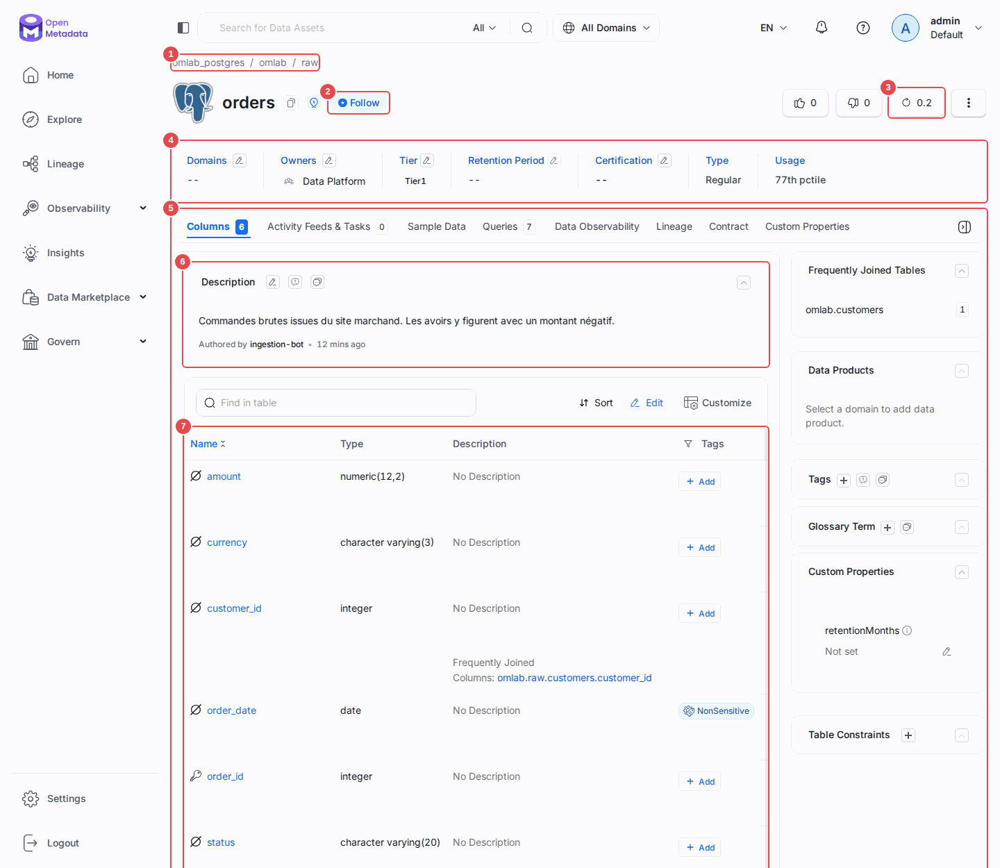
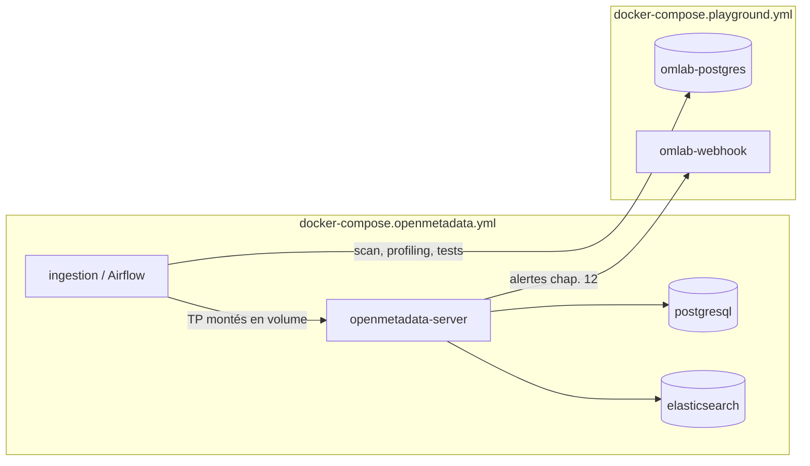

# OpenMetadata — tutoriel complet et exécutable

**Un cours en 17 chapitres pour apprendre tout ce que propose OpenMetadata, avec un laboratoire Docker complet pour tout essayer immédiatement.**


Une instance OpenMetadata 2.0.7, un entrepôt Postgres « terrain de jeu » peuplé
de données réalistes — **défauts compris** —, et un TP exécutable par chapitre.
Chaque commande de ce dépôt a été exécutée pour de vrai : les sorties reproduites
dans les chapitres sont celles que vous obtiendrez.

Chaque chapitre pratique contient aussi un **mode d'emploi illustré** : de vraies
captures de l'interface, avec des repères numérotés que le texte explique.



## Sommaire

- [Architecture](#architecture)
- [Démarrage](#démarrage)
- [Configuration](#configuration)
- [API / Endpoints](#api--endpoints)
- [Tests](#tests)
- [Structure du projet](#structure-du-projet)
- [Licences & composants](#licences--composants)
- [Le parcours](#le-parcours)
- [Commandes utiles](#commandes-utiles)
- [Données du terrain de jeu](#données-du-terrain-de-jeu)
- [Les pièges que ce tutoriel documente](#les-pièges-que-ce-tutoriel-documente)
- [Versions](#versions)
- [Ressources](#ressources)

## Architecture

Le laboratoire empile deux fichiers compose Docker sur le même réseau `app_net`.

| Service | Image | Rôle |
|---|---|---|
| `openmetadata-server` | `docker.getcollate.io/openmetadata/server:2.0.7` | Catalogue, UI, API REST |
| `postgresql` | `docker.getcollate.io/openmetadata/postgresql:2.0.7` | Base interne d'OpenMetadata |
| `elasticsearch` | `docker.elastic.co/elasticsearch/elasticsearch:9.3.0` | Index de recherche du catalogue |
| `ingestion` (Airflow) | fourni par OpenMetadata, ce dépôt monté en volume | Exécute les workflows d'ingestion, de profiling, de tests |
| `omlab-postgres` | `postgres:16-alpine` | Terrain de jeu à cataloguer — l'entrepôt retail avec ses défauts |
| `omlab-webhook` | `python:3.12-alpine` | Récepteur de webhooks du chapitre 12 |



Les deux composes partagent le réseau `app_net` : c'est ce qui permet au conteneur
d'ingestion de joindre `omlab-postgres` par son nom d'hôte plutôt que par une IP.

## Démarrage

**Prérequis :** Docker ≥ 20.10 avec 6 Gio de RAM et 4 vCPU alloués, environ
15 Go de disque.

> **Sous Windows :** travaillez depuis un terminal **WSL**, avec le dépôt dans
> le système de fichiers Linux (`~/Projets/...`). Voir le [chapitre 02](cours/02-installation-architecture.md).

```bash
cp .env.example .env
./omlab up          # ~5 Go d'images au premier lancement
./omlab token
```

| Service | URL | Note |
|---|---|---|
| UI OpenMetadata | http://localhost:8585 | `admin@open-metadata.org` / `admin` |
| Airflow | http://localhost:8080 | `admin` / `admin` |
| Playground Postgres | localhost:5433 | `omlab` / `omlab_pwd`, base `omlab` |
| Webhook de test | http://localhost:8010/ | reçoit les alertes du chapitre 12 |

Puis remplissez le catalogue :

```bash
./omlab ingest tp/04-ingestion/metadata.yaml
```

Et commencez par le [chapitre 01](cours/01-panorama.md). Pour voir directement le
catalogue de fin de parcours, `./omlab demo` rejoue tous les TP en cinq minutes environ.

## Configuration

Variables définies dans [.env.example](.env.example) :

| Variable | Défaut | Effet |
|---|---|---|
| `OM_HOST` | `http://localhost:8585` | URL d'OpenMetadata vue depuis l'hôte |
| `OM_HOST_INTERNAL` | `http://openmetadata-server:8585` | URL vue depuis les conteneurs |
| `OM_ADMIN_USER` / `OM_ADMIN_PASSWORD` | `admin@open-metadata.org` / `admin` | Identifiants admin par défaut |
| `OM_BOT_NAME` | `ingestion-bot` | Bot dont `./omlab token` récupère le jeton |
| `OM_TOKEN` | *(vide)* | Rempli par `./omlab token`, jamais committé |
| `OMLAB_WEBHOOK_PORT` | `8010` | Port hôte du récepteur de webhooks (chapitre 12) |
| `OMLAB_PG_HOST` / `OMLAB_PG_PORT` | `localhost` / `5433` | Accès au terrain de jeu depuis l'hôte |
| `OMLAB_PG_HOST_INTERNAL` / `OMLAB_PG_PORT_INTERNAL` | `omlab-postgres` / `5432` | Accès depuis les conteneurs (vu par l'ingestion) |
| `OMLAB_PG_DB` / `OMLAB_PG_USER` / `OMLAB_PG_PASSWORD` | `omlab` / `om_reader` / `om_reader_pwd` | Connexion utilisée par les workflows d'ingestion |
| `OMLAB_SERVICE_NAME` | `omlab_postgres` | Nom du service tel qu'il apparaît dans OpenMetadata — recopié en dur dans les YAML de `tp/` |

Le fichier `.env` (jeton, mots de passe) n'est **pas versionné**. Les YAML de
TP ne contiennent que des `${PLACEHOLDERS}` : `./omlab ingest` produit la
version remplie dans `tmp/`, également ignoré par git.

## API / Endpoints

Le récepteur de webhooks du chapitre 12 ([scripts/webhook_server.py](scripts/webhook_server.py)),
sans dépendance, exposé sur `omlab-webhook` :

| Méthode | Route | Rôle |
|---|---|---|
| `POST` | `/hook` | Reçoit un événement d'alerte OpenMetadata et le journalise |
| `GET` | `/events` | Liste les événements reçus (JSON) |
| `GET` | `/` | Page de lecture humaine des événements reçus |

## Tests

```bash
./omlab check              # toutes les vérifications de chapitre
./omlab check 04           # seulement le chapitre 04
```

```
Chapitre 04 — Ingestion des métadonnées : 3/3 — tout est bon
Chapitre 05 — Profiling : 2/2 — tout est bon
Chapitre 06 — Usage et lineage automatique : 3/3 — tout est bon
Chapitre 07 — Glossaire : 3/3 — tout est bon
Chapitre 08 — Classification et PII : 2/2 — tout est bon
Chapitre 09 — Équipes, rôles, politiques : 5/5 — tout est bon
Chapitre 10 — Qualité de données : 6/6 — tout est bon
Chapitre 11 — Lineage manuel : 1/1 — tout est bon
Chapitre 12 — Alertes : 1/1 — tout est bon
Chapitre 14 — SDK Python : 3/3 — tout est bon
Chapitre 15 — Connecteur maison : 2/2 — tout est bon
Chapitre 16 — Contrat de données : 1/1 — tout est bon
Chapitre 17 — Le tour complet de la 2.x : 8/8 — tout est bon
```

Un chapitre non encore fait apparaît en échec : c'est votre liste de courses.

La documentation a son propre contrôle, qui ne demande pas le laboratoire mais
[uv](https://docs.astral.sh/uv/) et un accès réseau :

```bash
./omlab check-docs
```

Il refuse les schémas en dessin ASCII, les liens morts et les captures orphelines, et
passe chaque bloc Mermaid dans l'analyseur officiel.

## Structure du projet

| Chemin | Contenu |
|---|---|
| [`omlab`](omlab) | CLI bash : point d'entrée de toutes les commandes |
| [`.env.example`](.env.example) | modèle de configuration locale |
| [`cours/`](cours/) | les 17 chapitres |
| [`cours/img/`](cours/img/) | les captures d'écran du mode d'emploi, générées par `./omlab captures` |
| [`tp/`](tp/) | un dossier par chapitre : YAML d'ingestion, scripts Python |
| [`lib/`](lib/) | `om.py` (client partagé), `csv_connector.py` (chapitre 15) |
| [`scripts/`](scripts/) | `get_token.py`, `check.py`, `webhook_server.py`, `render_yaml.py`, `captures.py`, `check_docs.py` |
| [`docker/`](docker/) | les deux fichiers compose et le seed SQL du playground |

## Licences & composants

| Composant | Rôle | Licence |
|---|---|---|
| OpenMetadata | Catalogue, UI, API, connecteurs d'ingestion | Apache License 2.0 |
| Elasticsearch | Index de recherche du catalogue | Elastic License v2 (SSPL ou AGPLv3 au choix côté code source) |
| PostgreSQL | Base interne d'OpenMetadata + terrain de jeu | PostgreSQL License |
| Apache Airflow | Orchestrateur des workflows d'ingestion | Apache License 2.0 |
| Python | Scripts des TP et récepteur de webhooks | PSF License |
| Docker Compose | Orchestration des conteneurs | Apache License 2.0 |
| **Ce projet** | Cours, TP, laboratoire, scripts | MIT — Copyright (c) 2026 floSa |

## Le parcours

### Module 0 — Fondations

| | Chapitre | Ce que vous saurez faire |
|---|---|---|
| 01 | [Panorama et modèle de données](cours/01-panorama.md) | situer le produit, lire un FQN |
| 02 | [Installer et comprendre la stack](cours/02-installation-architecture.md) | démarrer, diagnostiquer, repartir de zéro |

### Module 1 — Le catalogue

| | Chapitre | Ce que vous saurez faire |
|---|---|---|
| 03 | [Le catalogue au quotidien](cours/03-catalogue-decouverte.md) | chercher, lire une fiche, documenter |
| 04 | [L'ingestion de métadonnées](cours/04-ingestion-metadonnees.md) | écrire et déboguer un workflow, filtrer |
| 05 | [Le profiler](cours/05-profiler.md) | mesurer les données sans ruiner l'entrepôt |
| 06 | [Usage et lineage automatique](cours/06-usage-lineage-auto.md) | obtenir le graphe de dépendances tout seul |

### Module 2 — Gouvernance

| | Chapitre | Ce que vous saurez faire |
|---|---|---|
| 07 | [Le glossaire métier](cours/07-glossaire.md) | construire un vocabulaire et le relier aux données |
| 08 | [Classification et données personnelles](cours/08-classification-pii.md) | détecter les PII — et mesurer ce que ça rate |
| 09 | [Équipes, rôles et politiques](cours/09-teams-roles-policies.md) | écrire une politique d'accès conditionnelle |

### Module 3 — Qualité et observabilité

| | Chapitre | Ce que vous saurez faire |
|---|---|---|
| 10 | [Qualité de données](cours/10-data-quality.md) | écrire des tests qui ne mentent pas |
| 11 | [Lineage manuel et impact](cours/11-lineage-manuel-colonne.md) | compléter le graphe, analyser un impact |
| 12 | [Alertes et webhooks](cours/12-alertes-webhooks.md) | être prévenu au lieu de découvrir |

### Module 4 — Automatisation et extension

| | Chapitre | Ce que vous saurez faire |
|---|---|---|
| 13 | [L'API REST](cours/13-api-rest.md) | tout faire sans SDK ni UI |
| 14 | [Le SDK Python](cours/14-sdk-python.md) | documenter et enrichir en masse |
| 15 | [Écrire son propre connecteur](cours/15-connecteur-custom.md) | cataloguer un système non supporté |
| 16 | [Contrats, exploitation, projet final](cours/16-contracts-ops-projet-final.md) | industrialiser, puis pratiquer seul |

### Module 5 — La vue d'ensemble

| | Chapitre | Ce que vous saurez faire |
|---|---|---|
| 17 | [Le tour complet de la 2.x](cours/17-tour-complet-2x.md) | situer chaque fonction, publier un produit de données, interroger le serveur MCP |

**Parcours conseillés**

- *Découverte rapide* (2 h) : 01 → 02 → 03 → 04 → 06
- *Data engineer* (une journée) : tout sauf 09, en insistant sur 13, 14, 15
- *Gouvernance / data steward* : 01 → 03 → 07 → 08 → 09 → 10 → 16
- *Complet* : dans l'ordre, environ 12 heures avec les exercices

## Commandes utiles

```
Cycle de vie
  ./omlab up                 démarre la stack et attend qu'elle réponde
  ./omlab status             état des conteneurs
  ./omlab logs [service]     suit les logs (défaut : openmetadata-server)
  ./omlab down               arrête (les données restent)
  ./omlab nuke               supprime tout, volumes compris

Terrain de jeu
  ./omlab psql               ouvre un psql sur la base omlab
  ./omlab psql "SELECT 1"    exécute une requête
  ./omlab traffic            rejoue du trafic SQL (avant usage/lineage)

OpenMetadata
  ./omlab token              récupère le JWT de l'ingestion-bot dans .env
  ./omlab ingest   <f.yaml>  workflow de métadonnées / lineage
  ./omlab profile  <f.yaml>  workflow de profiling
  ./omlab test     <f.yaml>  workflow de qualité de données
  ./omlab usage    <f.yaml>  workflow d'usage
  ./omlab classify <f.yaml>  échantillonnage + détection de PII
  ./omlab py       <f.py>    exécute un script du SDK
  ./omlab demo               rejoue tous les TP, du chapitre 04 au 17

Vérifications
  ./omlab check              toutes les vérifications de chapitre
  ./omlab check 04           seulement le chapitre 04
  ./omlab check-docs         contrôle la doc : schémas, liens, Mermaid (hôte, uv)

Mode d'emploi
  ./omlab captures           refait les captures de cours/img (hôte, uv)
  ./omlab captures 07 10     seulement ces chapitres
```

## Données du terrain de jeu

Un mini-entrepôt retail dans `omlab-postgres`, conçu pour que chaque chapitre
ait de quoi mordre :

| Table | Lignes | Particularités |
|---|---|---|
| `raw.customers` | 500 | 39 pays NULL, 12 e-mails en doublon, PII |
| `raw.orders` | 3 000 | 88 montants négatifs (des avoirs mal modélisés) |
| `raw.order_items` | 7 200 | 135 quantités à zéro |
| `raw.products` | 80 | 5 produits partagent le même SKU |
| `raw.employees` | 60 | e-mails, téléphones, numéros de sécurité sociale |
| `analytics.dim_customer`, `analytics.fct_orders` | — | alimentées par SQL → lineage |
| `analytics.v_revenue_monthly`, `analytics.v_customer_360` | — | vues → lineage garanti |

**Ces défauts sont volontaires.** Ils font échouer les tests du chapitre 10
pour de vraies raisons — un catalogue tout au vert sur des données réelles
n'apprend rien.

## Les pièges que ce tutoriel documente

Ils ont tous été rencontrés en construisant ce dépôt. Aucun n'est dans la
documentation officielle sous cette forme, et chacun coûte au minimum une
demi-heure quand on le découvre seul.

| # | Piège | Chapitre |
|---|---|---|
| 1 | `hostPort: localhost` dans un YAML exécuté en conteneur | 04 |
| 2 | Le `/api` manquant à la fin de `workflowConfig.hostPort` | 04 |
| 3 | Filtres sans ancrage : `raw` attrape aussi `raw_archive` | 04 |
| 4 | `Success 100 %` avec `Filtered: 12000` — le workflow a réussi à ne rien faire | 04 |
| 5 | `profileSampleConfig` a changé de structure : deux niveaux depuis la 1.13, et `DYNAMIC` par défaut depuis la 2.0 | 05 |
| 6 | Le profiler ignore les vues par défaut, contrairement au workflow de métadonnées | 05 |
| 7 | `pg_stat_statements` n'est pas un journal : vide au démarrage, sans horodatage | 06 |
| 8 | Le workflow d'usage ne met pas à jour l'index : la recherche affiche `0th pctile` jusqu'à la réindexation | 06 |
| 9 | `generateSampleData` a déménagé dans un workflow `AutoClassification` | 08 |
| 10 | La détection de PII rate un numéro de sécurité sociale, classe un téléphone comme non sensible et étiquette une date de commande ou un nom de produit | 08 |
| 11 | Un nom d'opération de politique erroné donne « Invalid request format » | 09 |
| 12 | `columnValuesToBeBetween` ne supporte pas le type `NUMERIC` | 10 |
| 13 | `strategy: COUNT` avec un `SELECT id` renvoie l'id, pas un compte — silencieusement | 10 |
| 14 | Les tests s'exécutent sur un échantillon **dynamique** par défaut | 10 |
| 15 | Un test retiré du YAML continue de tourner : le YAML ne supprime jamais | 10 |
| 16 | `filteringRules` est calculé : en écriture, c'est `input` | 12 |
| 17 | `?fields=columns` renvoie les colonnes **sans** leurs étiquettes | 13 |
| 18 | Un connecteur maison doit créer son service lui-même, sinon 100 % de succès et zéro écriture | 15 |
| 19 | Le champ `assets` d'un produit de données est ignoré sans erreur : il faut passer par `/assets/add` | 17 |
| 20 | `ingestion-bot` n'a pas le droit `CreateTask` : `POST /tasks` répond 403 | 17 |

## Versions

| Composant | Version |
|---|---|
| OpenMetadata | 2.0.7 (publiée le 27 octobre 2026) |
| `openmetadata-ingestion` | 2.0.7.2 (dans l'image d'ingestion) |
| Airflow | 3.3.2 (dans l'image d'ingestion) |
| Elasticsearch | 9.3.0 |
| Postgres (playground) | 16-alpine |

**Changer de version :** modifiez le tag dans
[docker/docker-compose.openmetadata.yml](docker/docker-compose.openmetadata.yml), ou remplacez le fichier par l'asset
de la version voulue :

```bash
curl -sL -o docker/docker-compose.openmetadata.yml \
  https://github.com/open-metadata/OpenMetadata/releases/download/<version>-release/docker-compose-postgres.yml
```

Attendez-vous à des ajustements : plusieurs pièges listés ci-dessus viennent
précisément de changements de schéma entre versions mineures. Ce dépôt ne met pas à
jour une instance existante : la 2.0 n'a pas de retour arrière automatique, voyez le
[chapitre 16](cours/16-contracts-ops-projet-final.md).

Après un changement de version, rejouez les TP et lancez `./omlab check`, puis
`./omlab captures` pour remettre le mode d'emploi à jour. Les libellés cités dans les
chapitres viennent de l'interface 2.0.7, où ils sont en anglais.

## Ressources

- [Documentation officielle 2.0.x](https://docs.open-metadata.org/v2.0.x)
- Swagger de votre instance : http://localhost:8585/docs
- [Dépôt GitHub](https://github.com/open-metadata/OpenMetadata)
- [Slack de la communauté](https://slack.open-metadata.org/)
