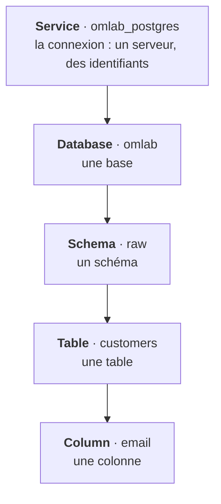
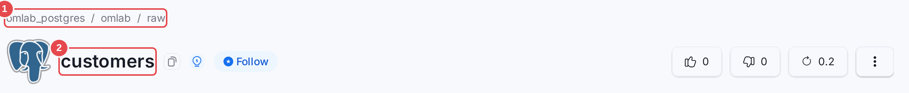

# Chapitre 01 — Panorama et modèle de données

> **Objectifs** — Savoir dire à quoi sert OpenMetadata et à quoi il ne sert pas ;
> comprendre le modèle d'entités et la notion de FQN, qui reviendront dans les
> seize chapitres suivants.
> **Durée** — 25 minutes, sans machine.

---

## 1. Le problème avant l'outil

Dans une organisation qui a plus de trois tables, quatre questions reviennent
sans arrêt, et aucune n'a de réponse fiable :

1. **Où sont les données dont j'ai besoin ?** Personne ne connaît les 4 000
   tables. La connaissance vit dans la tête de deux personnes.
2. **Est-ce que je peux leur faire confiance ?** Cette table est-elle à jour ?
   Est-elle testée ? Qui l'a produite ?
3. **Qu'est-ce que je casse si je modifie ça ?** Une colonne renommée, et trois
   tableaux de bord tombent — on l'apprend le lendemain, par un utilisateur.
4. **Qui est responsable ?** La table est là, elle est fausse, et personne ne
   se sent concerné.

Un catalogue de données est l'outil qui rend ces quatre questions répondables.
Ce n'est **pas** un entrepôt : il ne stocke pas vos données. Il stocke ce qu'on
sait *à propos* de vos données — et c'est déjà énorme.

## 2. Ce qu'OpenMetadata met dans la boîte

Là où beaucoup d'outils s'arrêtent au catalogue, OpenMetadata regroupe six
métiers dans un seul produit :

| Brique | Ce qu'elle apporte | Chapitres |
|---|---|---|
| **Découverte** | recherche, fiches d'assets, propriétaires, popularité | 03, 06 |
| **Ingestion** | ~100 connecteurs, workflows planifiés | 04, 05, 15 |
| **Gouvernance** | glossaire, classifications, PII, domaines, rôles | 07, 08, 09 |
| **Qualité** | tests, incidents, contrats de données | 10, 16 |
| **Observabilité** | lineage, alertes, analyse d'impact | 06, 11, 12 |
| **Collaboration et IA** | annonces, tâches, Context Center, serveur MCP | 17 |

Le point d'intérêt du produit n'est pas chaque brique prise isolément — il
existe de meilleurs outils spécialisés pour chacune. C'est leur **assemblage** :
un test qui échoue crée un incident, qui déclenche une alerte, qui remonte
au propriétaire de la table, qui voit du même écran quels tableaux de bord
en aval sont concernés.

### Ce qu'il ne fait pas

Soyons clairs, cela évitera des déceptions :

- il **n'exécute pas** vos transformations (ce n'est ni dbt ni Airflow — il
  s'y connecte) ;
- il **ne stocke pas** vos données (sauf de petits échantillons, cf. chapitre 08) ;
- il **n'impose rien** : c'est un miroir. Un catalogue mal alimenté reflète
  fidèlement une organisation qui ne documente pas.

### Collate, la version commerciale

OpenMetadata est sous licence Apache 2.0. La société Collate en vend une
version hébergée avec des fonctions supplémentaires. Attention en lisant la
documentation en ligne : certaines pages décrivent des fonctions Collate.
Tout ce qui est présenté dans ce tutoriel tourne sur la version libre — c'est
vérifié, chaque TP est exécuté. Le [chapitre 17](17-tour-complet-2x.md) dresse la
liste complète des fonctions, avec ce qui revient à Collate.

## 3. Le modèle d'entités

Tout, dans OpenMetadata, est une **entité**. Une entité a un identifiant, un
nom, une version, un historique, des propriétaires, des étiquettes, et une
place dans une hiérarchie.

Pour les bases de données, la hiérarchie est celle-ci :

Il en existe une par famille de systèmes, toujours bâtie sur le même principe :

| Famille | Hiérarchie |
|---|---|
| Base de données | Service → Database → Schema → **Table** → Column |
| Tableaux de bord | Service → **Dashboard** → Chart |
| Pipelines | Service → **Pipeline** → Task |
| Messagerie | Service → **Topic** |
| Stockage objet | Service → **Container** |
| ML | Service → **MlModel** |
| API | Service → API Collection → **API Endpoint** |
| Recherche | Service → **Search Index** |

À côté de cet arbre vivent des entités **transverses**, qui se rattachent à
n'importe quoi : glossaire et termes, classifications et étiquettes, équipes,
utilisateurs, rôles, politiques, domaines, produits de données, tests, contrats.

## 4. Le FQN : la clé de tout

Le **nom pleinement qualifié** (*fully qualified name*) est le chemin complet
d'une entité dans sa hiérarchie, séparé par des points :

`omlab_postgres.omlab.raw.customers.email` se lit ainsi :

| `omlab_postgres` | `omlab` | `raw` | `customers` | `email` |
|---|---|---|---|---|
| service | base | schéma | table | colonne |

L'interface affiche ce chemin en haut de chaque fiche : le fil d'Ariane **(1)** donne le service, la base et le schéma, le titre **(2)** donne le nom de l'entité.

Vous allez le taper des centaines de fois : dans les fichiers YAML, dans les
appels d'API, dans les scripts. Trois choses à savoir dès maintenant.

**Le FQN commence par le nom que VOUS avez choisi.** `omlab_postgres` n'est
pas imposé par Postgres : c'est le `serviceName` du fichier d'ingestion. Le
changer plus tard invalide tous vos scripts. Choisissez-le une fois, bien.

**Un nom contenant un point est mis entre guillemets.** Une table nommée
`ventes.2024` donne `service.base.schema."ventes.2024"`. C'est rare, mais
quand ça arrive, on cherche longtemps.

**Chaque entité a AUSSI un UUID.** Le FQN sert à la lecture et aux humains ;
l'UUID sert aux écritures (l'API en a besoin pour les PATCH). Une entité
renommée garde son UUID et change de FQN — c'est ce qui permet de ne pas
perdre son historique.

## 5. Un tour de vocabulaire

Quatre mots qui se ressemblent et qu'il vaut mieux ne pas confondre :

| Mot | Ce que c'est | Exemple |
|---|---|---|
| **Tag** (étiquette) | une valeur d'une classification, à visée technique ou réglementaire | `PII.Sensitive` |
| **Terme de glossaire** | une définition métier, avec des synonymes et un responsable | `Commerce.ChiffreAffaires` |
| **Tier** | le niveau de criticité, de Tier1 (vital) à Tier5 | `Tier.Tier1` |
| **Domaine** | le périmètre organisationnel propriétaire | `Ventes` |

La confusion classique est entre étiquette et terme de glossaire. Règle
simple : une **étiquette** décrit *ce que la donnée est* du point de vue du
système (personnelle, confidentielle, dépréciée). Un **terme** décrit *ce que
la donnée signifie* du point de vue du métier. `PII.Sensitive` est une
étiquette ; « chiffre d'affaires » est un terme.

## 6. Comment les métadonnées arrivent

Trois chemins, qu'il faut savoir distinguer parce qu'ils n'ont ni le même coût
ni la même fiabilité :

1. **L'ingestion automatique** — un workflow interroge le catalogue système de
   votre base et en déduit tables, colonnes, types, commentaires. Fiable,
   répétable, à planifier. C'est 80 % du contenu du catalogue.
2. **L'enrichissement humain** — descriptions, propriétaires, termes, criticité.
   C'est là qu'est toute la valeur ajoutée, et c'est ce qui coûte cher.
3. **L'inférence** — profiling, détection de PII, lineage déduit du SQL.
   Puissant, mais *approximatif* : le chapitre 08 vous montrera un détecteur
   de données personnelles qui rate un numéro de sécurité sociale et range
   une date de commande parmi les données personnelles. À vérifier, toujours.

---

## À retenir

- OpenMetadata catalogue des métadonnées, pas des données.
- Tout est une entité ; les entités s'organisent en hiérarchies de type
  Service → … → Asset.
- Le **FQN** est le chemin complet d'une entité. Il commence par un nom de
  service que vous choisissez, et vous ne pourrez plus en changer facilement.
- Étiquette ≠ terme de glossaire : la première dit *ce que c'est*, le second
  dit *ce que ça veut dire*.

## Pour aller plus loin

- [Modèle d'entités](https://docs.open-metadata.org/v2.0.x/main-concepts/metadata-standard/schemas)
- [Liste des connecteurs](https://docs.open-metadata.org/v2.0.x/connectors)

---

**Chapitre suivant :** [02 — Installer et comprendre la stack](02-installation-architecture.md)
