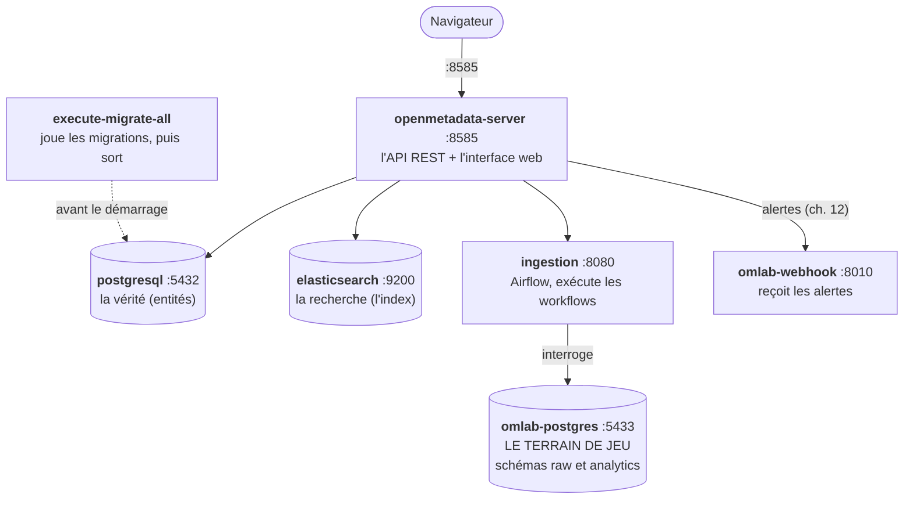

# Chapitre 02 — Installer et comprendre la stack

> **Objectifs** — Démarrer l'environnement complet, savoir ce que fait chaque
> conteneur, et savoir où regarder quand ça ne marche pas.
> **Durée** — 30 minutes, dont 10 de téléchargement au premier lancement.

---

## 1. Ce qu'on démarre

`./omlab up` lance sept conteneurs. Ce n'est pas une usine à gaz : chacun a
un rôle précis, et les connaître fait gagner un temps considérable au moment
du premier problème.



### Les deux Postgres, et pourquoi on s'y perd

C'est la confusion numéro un du tutoriel, alors autant la lever tout de suite :

| | `openmetadata_postgresql` | `omlab_postgres` |
|---|---|---|
| Rôle | base **interne** d'OpenMetadata | base **à cataloguer** |
| Contient | les entités, les tests, l'historique | des clients, des commandes |
| Port hôte | 5432 | **5433** |
| Nom réseau | `postgresql` | `omlab-postgres` |
| On y touche | jamais | tout le temps |

Le second n'existe que dans ce tutoriel : dans la vraie vie, c'est votre
entrepôt.

### Postgres et Elasticsearch : deux sources, deux rôles

OpenMetadata écrit **deux fois** chaque entité : dans Postgres, qui fait foi,
et dans Elasticsearch, qui sert la recherche. Conséquence pratique que vous
rencontrerez : une entité créée par l'API apparaît immédiatement par son FQN,
mais peut mettre un instant à sortir dans la barre de recherche. Ce n'est pas
un bug, c'est de l'indexation asynchrone. Si les deux divergent durablement,
on réindexe (chapitre 16).

## 2. Prérequis

| | Minimum | Ce qu'on a vérifié ici |
|---|---|---|
| Docker | 20.10+ | 29.6.2 |
| Docker Compose | v2.1.1+ | v5.3.1 |
| RAM allouée à Docker | 6 Gio | 32 Gio |
| vCPU | 4 | 16 |
| Disque | ~15 Go | — |

**Sous Windows :** travaillez depuis un terminal **WSL**, avec le dépôt dans le
système de fichiers Linux (`~/Projets/...`), pas dans `/mnt/c` ni via
`\\wsl.localhost`. Les conteneurs montent des dossiers de ce dépôt ; depuis un
chemin Windows, les montages échouent ou deviennent extrêmement lents. Vérifiez
aussi que l'intégration WSL est active dans Docker Desktop
(*Settings → Resources → WSL Integration*).

## 3. Démarrage

```bash
cp .env.example .env
./omlab up
```

Au premier lancement, comptez environ **5 Go d'images** à télécharger. Le
script attend ensuite que le serveur réponde, et affiche les accès :

```
OpenMetadata répond : {"version":"1.13.3","revision":"255f669...","timestamp":...}

  UI OpenMetadata : http://localhost:8585          (admin@open-metadata.org / admin)
  Airflow         : http://localhost:8080          (admin / admin)
  Playground PG   : localhost:5433                 (omlab / omlab_pwd, base omlab)
  Webhook de test : http://localhost:8010/
```

Puis récupérez le jeton dont tous les TP ont besoin :

```bash
./omlab token
```

### Les deux jetons, et pourquoi ça compte

`./omlab token` va chercher le jeton de l'**`ingestion-bot`**, pas celui de
l'administrateur. La différence est de taille :

- le jeton de session d'un humain expire au bout d'une heure ;
- le jeton d'un bot vit sept jours par défaut, et se renouvelle sans mot de passe.

Un script d'automatisation utilise toujours un bot. Un jeton humain dans une
tâche planifiée, c'est une panne à retardement.

> **Sécurité** — Le fichier `.env` contient ce jeton et n'est pas versionné
> (`.gitignore`). Les YAML de TP, eux, ne contiennent que des `${PLACEHOLDERS}` :
> `./omlab ingest` produit la version remplie dans `tmp/`, elle aussi ignorée
> par git. C'est le minimum syndical pour un dépôt qu'on partage.

## 4. Vérifier que tout va bien

```bash
./omlab status                     # les 6 conteneurs, leur état de santé
./omlab psql "SELECT count(*) FROM raw.orders"   # 3000
curl -s localhost:8585/api/v1/system/version
```

Sur la page d'accueil d'OpenMetadata, vous devez voir un catalogue vide :
c'est normal, aucune ingestion n'a encore tourné. C'est l'objet du chapitre 04.

## 5. Quand ça ne marche pas

| Symptôme | Cause la plus fréquente | Que faire |
|---|---|---|
| `port is already allocated` | 8585, 8080, 5433 ou 8010 déjà pris | changez `OMLAB_WEBHOOK_PORT` dans `.env`, ou libérez le port |
| Le serveur ne répond jamais | Elasticsearch a été tué faute de RAM | `./omlab logs elasticsearch` ; augmentez la mémoire Docker |
| `Le démon Docker ne répond pas` | Docker Desktop éteint, ou intégration WSL désactivée | démarrez Docker Desktop, activez l'intégration |
| Ingestion : `Connection refused` | vous avez écrit `localhost` dans un YAML | depuis un conteneur, c'est `omlab-postgres` et `openmetadata-server` |
| 401 sur l'API | jeton expiré ou absent | `./omlab token` |

Les logs, dans l'ordre où on les consulte :

```bash
./omlab logs openmetadata-server    # 90 % des problèmes sont ici
./omlab logs ingestion              # workflows et Airflow
./omlab logs elasticsearch          # si le serveur ne démarre pas
./omlab logs omlab-webhook          # chapitre 12
```

## 6. Repartir de zéro

```bash
./omlab down     # arrête, garde les données
./omlab nuke     # supprime tout, volumes compris — demande confirmation
```

`nuke` est utile plus souvent qu'on ne croit dans un contexte d'apprentissage :
on casse quelque chose, on repart propre en trois minutes. Le seed du
playground est rejoué automatiquement à la recréation du volume.

---

## TP guidé

1. `cp .env.example .env && ./omlab up`
2. `./omlab token`
3. `./omlab status` — les six conteneurs doivent être `running`, dont quatre
   `healthy`.
4. Ouvrez http://localhost:8585 et connectez-vous.
5. Ouvrez http://localhost:8080 (Airflow) : la liste des DAG est vide, c'est
   normal — les workflows déployés depuis l'UI y apparaîtront.
6. `./omlab psql` puis `\dt raw.*` pour voir les tables du terrain de jeu.

**Vérifier :**

```bash
./omlab status
./omlab psql "SELECT count(*) AS clients FROM raw.customers"   # 500
```

## Exercices

1. Arrêtez Elasticsearch (`docker stop openmetadata_elasticsearch`) et essayez
   une recherche dans l'UI. Que se passe-t-il ? Et la navigation par FQN ?
   Redémarrez-le ensuite.
2. Dans `docker/docker-compose.playground.yml`, trouvez pourquoi le playground
   écoute sur 5433 et non 5432.
3. Regardez `docker/docker-compose.openmetadata.yml` : combien de variables
   d'environnement le serveur accepte-t-il ? Cherchez `AUTHENTICATION_PROVIDER`
   et devinez ce qu'il faudrait changer pour brancher un SSO.

## Pièges & FAQ

**« Faut-il installer `openmetadata-ingestion` sur ma machine ? »**
Non, et c'est délibéré. Le conteneur `ingestion` embarque déjà le paquet et
ses cent connecteurs. `./omlab ingest` et `./omlab py` exécutent tout dedans,
avec le dépôt monté sur `/omlab`. Vous évitez ainsi le casse-tête de
dépendances qu'est l'installation locale de tous les pilotes de bases.

**« Pourquoi mon YAML parle-t-il de `openmetadata-server` et pas de `localhost` ? »**
Parce qu'il est exécuté *dans* le conteneur d'ingestion. Pour lui, `localhost`
est lui-même. C'est l'erreur la plus fréquente des débutants sur ce produit.

## Pour aller plus loin

- [Déploiement Docker](https://docs.open-metadata.org/v1.13.x/quick-start/local-docker-deployment)
- [Déploiement Kubernetes](https://docs.open-metadata.org/v1.13.x/deployment/kubernetes)

---

**Chapitre précédent :** [01 — Panorama](01-panorama.md) ·
**Suivant :** [03 — Le catalogue au quotidien](03-catalogue-decouverte.md)
