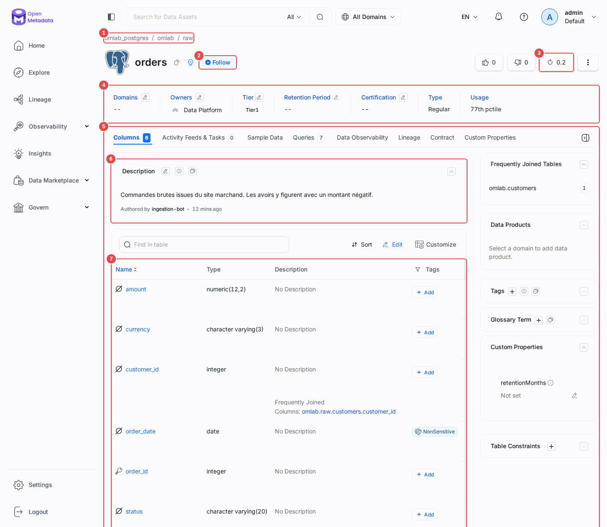
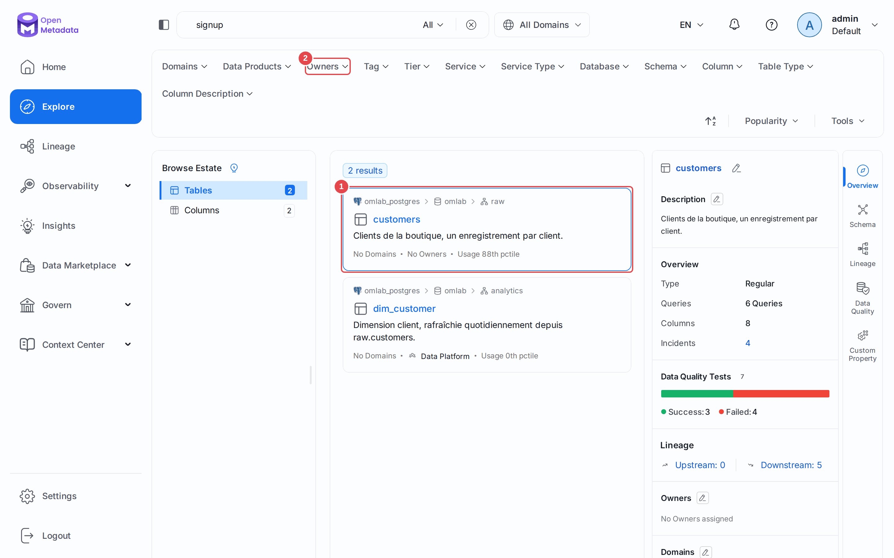
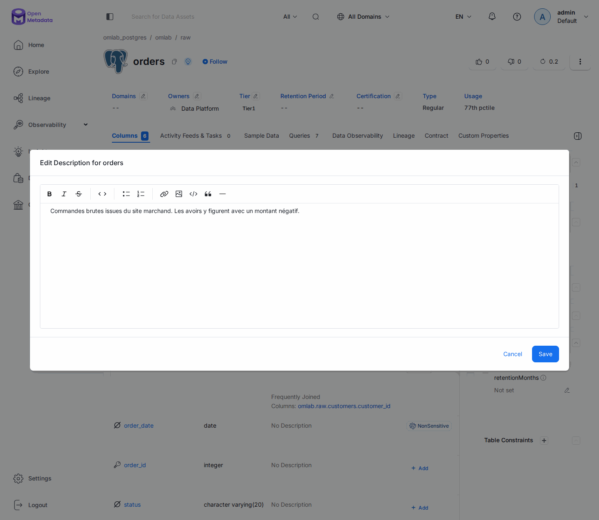
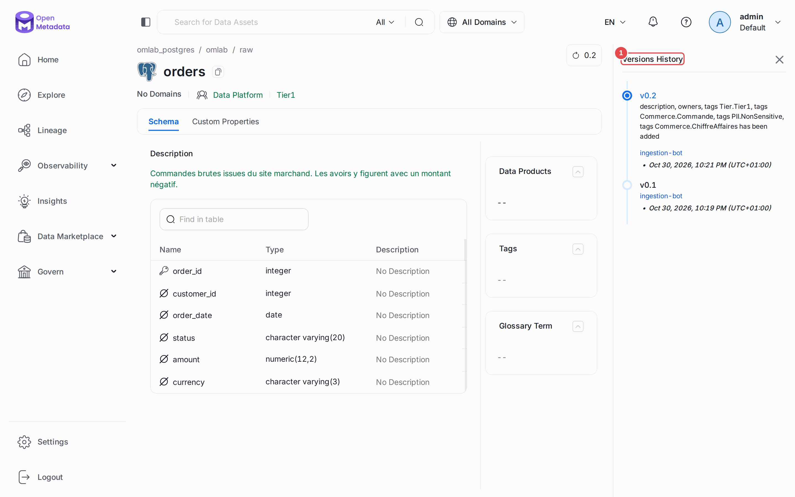

# Chapitre 03 — Le catalogue au quotidien

> **Objectifs** — Remplir le catalogue en une commande, puis apprendre à s'en
> servir comme le fera 90 % de vos utilisateurs : chercher, lire une fiche,
> documenter, suivre les changements.
> **Durée** — 45 minutes, dont beaucoup de navigation dans l'UI.

---

## 1. D'abord remplir, on expliquera après

Un catalogue vide n'apprend rien. On lance donc l'ingestion tout de suite ;
le fichier qui la décrit sera décortiqué ligne par ligne au chapitre 04.

```bash
./omlab ingest tp/04-ingestion/metadata.yaml
```

Une quinzaine de secondes plus tard :

```
Workflow Postgres Summary:
Processed records: 13
Filtered: 2
Errors: 0
Workflow Success %: 100.0
```

Treize entités : une base, deux schémas, sept tables, deux vues, plus le
service. Deux « filtrées » : les schémas `public` et `information_schema`,
que notre configuration exclut.

Rechargez http://localhost:8585 : le catalogue est peuplé.

## 2. Anatomie d'une fiche

Ouvrez `omlab_postgres.omlab.raw.customers`. La fiche est dense, mais chaque
zone répond à une des quatre questions du chapitre 01.

| Zone | Question à laquelle elle répond |
|---|---|
| Description, propriétaire, criticité | *Puis-je faire confiance ? Qui appelle-t-on ?* |
| Onglet **Columns** | *Que contient cette table ?* |
| Onglet **Lineage** | *Qu'est-ce que je casse si je la modifie ?* |
| Onglet **Data Observability** | *Est-elle testée ? Est-elle saine ?* |
| Onglet **Queries** | *Comment les autres s'en servent-ils ?* |
| Onglet **Activity Feeds & Tasks** | *Que s'est-il passé récemment dessus ?* |
| Bouton de version, en haut à droite | *Qui a changé quoi, quand ?* |

Voici la même fiche une fois le cours terminé, avec ses repères :



| Repère | Zone | Rôle |
|---|---|---|
| **1** | Fil d'Ariane | le chemin de la table : service, base, schéma |
| **2** | **Follow** | s'abonner aux changements (section 5) |
| **3** | Numéro de version | ouvre l'historique (section 4) |
| **4** | Bandeau de métadonnées | domaine, propriétaire, criticité, rétention |
| **5** | Onglets | les vues détaillées listées ci-dessus |
| **6** | **Description** | le crayon ouvre l'éditeur |
| **7** | Tableau des colonnes | type, description et étiquettes de chaque colonne |

Pour l'instant, l'essentiel est vide. C'est exactement le point : un catalogue
fraîchement ingéré est un squelette. Les descriptions de `raw.customers` et
`raw.employees` viennent des `COMMENT ON` posés dans la base — le connecteur
les récupère. Les autres tables n'en ont pas : c'est vous qui allez les écrire.

## 3. Chercher

La barre de recherche interroge Elasticsearch, pas la base. Elle cherche dans
les noms, les descriptions, les noms de colonnes, les termes de glossaire et
les étiquettes.

Essayez, dans l'ordre :

| Recherche | Ce qu'elle démontre |
|---|---|
| `customers` | la recherche par nom, évidente |
| `signup` | on trouve une table par le nom d'une de ses **colonnes** |
| `commande` | rien de pertinent pour l'instant : le catalogue est en anglais et sans glossaire. Refaites cette recherche après le chapitre 07, elle changera de visage |

Les filtres du bandeau supérieur (propriétaire **(2)**, étiquette, criticité,
service, base, schéma…) se combinent avec la recherche, et l'arbre de gauche
restreint le type d'asset. Le résultat sélectionné **(1)** s'ouvre en aperçu à
droite : pas besoin de quitter la liste pour jauger une table.



Le filtrage se combine donc avec le texte libre. Le motif à retenir : **on cherche en texte
libre, on affine par facettes**.

### La syntaxe avancée

Le champ de recherche accepte la syntaxe Lucene :

```
country                       le mot, n'importe où
columns.name:email            uniquement dans les noms de colonnes
tableType:View                uniquement les vues
NOT service.name:omlab_fichiers    exclusion
```

## 4. Documenter — le vrai travail

C'est là que se joue la valeur du catalogue, et c'est le seul chapitre où on
vous demande de taper du texte à la main. Prenez-le au sérieux : c'est ce que
feront vos utilisateurs.

Sur `raw.orders` (qui n'a aucune description) :

1. Cliquez sur le crayon de la zone **Description**, et écrivez une description
   honnête dans l'éditeur, puis validez par **Save**. Une bonne description dit
   ce que la table contient **et ce qui surprend** :

   > Commandes passées sur le site. Une ligne par commande.
   > Attention : les avoirs sont enregistrés comme des commandes à montant
   > négatif — filtrez `amount >= 0` pour un chiffre d'affaires brut.

   

2. Descendez dans l'onglet **Columns** et documentez `status` : la liste des
   valeurs possibles est exactement ce qu'un utilisateur cherche.

3. Remontez et cliquez sur le numéro de version, en haut à droite : votre
   modification a créé une version de plus. Le panneau **Versions History (1)**
   liste chaque changement et son auteur. OpenMetadata versionne **tout**, et le
   diff apparaît en couleur dans la fiche.

   

### Trois habitudes qui font la différence

- **Écrivez ce qui surprend.** « Table des clients » n'apprend rien. « Les
  clients supprimés sont conservés avec `is_active = false` » sauve une heure
  à quelqu'un.
- **Répondez « qui appelle-t-on ? »** avant de peaufiner la prose. Une table
  sans propriétaire est une table orpheline (chapitres 09 et 14).
- **Documentez au bon niveau.** Une explication qui vaut pour dix tables va
  sur le schéma, pas répétée dix fois.

## 5. Suivre : abonnement et fil d'activité

Le bouton **Follow** d'une entité vous abonne à ses changements ; ils
apparaissent alors dans votre fil d'activité personnel. Sur une table dont
vous dépendez, c'est le mécanisme le plus simple pour ne pas découvrir un
changement de schéma par une erreur en production.

L'onglet **Activity Feeds & Tasks** permet aussi d'ouvrir une **conversation** sur une
entité, et de mentionner quelqu'un avec `@`. La discussion reste attachée à
la table — au lieu de se perdre dans une messagerie où personne ne la
retrouvera dans six mois.

---

## TP guidé

1. Lancez l'ingestion : `./omlab ingest tp/04-ingestion/metadata.yaml`
2. Dans l'UI, trouvez la table qui contient une colonne `national_id`.
   *(Indice : cherchez `national_id`.)*
3. Documentez `raw.orders` et `raw.orders.status`.
4. Documentez `raw.products.sku` en signalant que le SKU n'est **pas** unique.
5. Suivez (**Follow**) `analytics.v_revenue_monthly`.
6. Cliquez sur le numéro de version de `raw.orders` et lisez le diff.

**Vérifier :**

```bash
./omlab check 04
```

```
Chapitre 04 — Ingestion des métadonnées
  OK   les 9 tables du playground sont cataloguées (9 trouvées)
  OK   les 2 vues sont reconnues comme des vues (2)
  OK   raw.orders a bien 6 colonnes
```

## Exercices

1. Combien de tables du catalogue n'ont **aucune** description ? Trouvez-les
   avec les filtres de l'UI, puis avec l'API :
   `curl -H "Authorization: Bearer $OM_TOKEN" 'localhost:8585/api/v1/tables?limit=50' | jq '.data[] | select(.description == null) | .name'`
2. Utilisez le filtre par **type d'asset** pour n'afficher que les vues.
3. Ouvrez `analytics.v_revenue_monthly`. La fiche indique le type `View` mais
   ne montre pas la requête qui la définit : lisez-la en base avec
   `./omlab psql "SELECT pg_get_viewdef('analytics.v_revenue_monthly')"`. Le
   lineage du chapitre 06 en déduit d'où vient chaque colonne.
4. Créez une conversation sur `raw.products` pour signaler le problème de SKU.

## Pièges & FAQ

**« J'ai documenté une table, et l'ingestion suivante a tout écrasé ! »**
Elle ne devrait pas : le connecteur ne remplace une description existante que
si la base source en fournit une. En revanche, si vous écrivez une description
côté catalogue **et** un `COMMENT ON` côté base, c'est la base qui gagne à
chaque ingestion. Choisissez un seul endroit de vérité.

**« Ma nouvelle table n'apparaît pas dans la recherche. »**
Deux causes possibles : l'ingestion ne l'a pas vue (vérifiez vos filtres,
chapitre 04), ou l'indexation Elasticsearch a du retard. Testez l'accès direct
par FQN : si la fiche s'ouvre mais que la recherche l'ignore, c'est l'index —
réindexez (chapitre 16).

**« Description ou terme de glossaire ? »**
La description est propre à *cette* table. Le terme de glossaire est une
définition partagée, réutilisable sur vingt colonnes. Si vous vous surprenez
à copier-coller la même phrase, c'est qu'il vous faut un terme (chapitre 07).

## Pour aller plus loin

- [Recherche et découverte](https://docs.open-metadata.org/v1.13.x/how-to-guides/data-discovery)
- [Fils d'activité et conversations](https://docs.open-metadata.org/v1.13.x/how-to-guides/data-collaboration)

---

**Précédent :** [02 — Installation](02-installation-architecture.md) ·
**Suivant :** [04 — Ingestion des métadonnées](04-ingestion-metadonnees.md)
