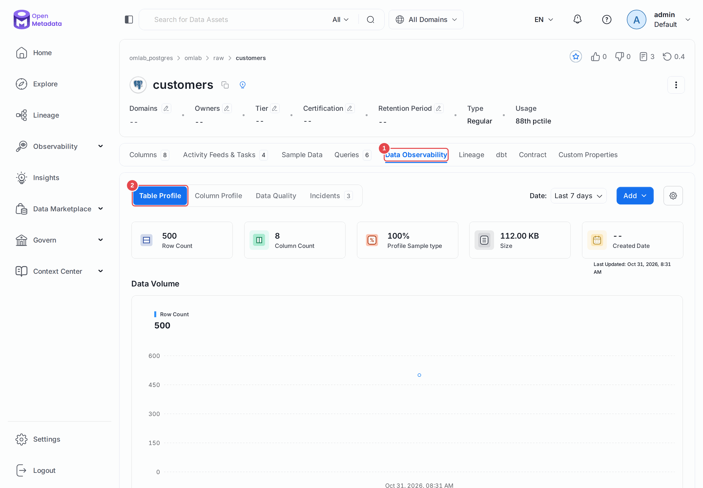
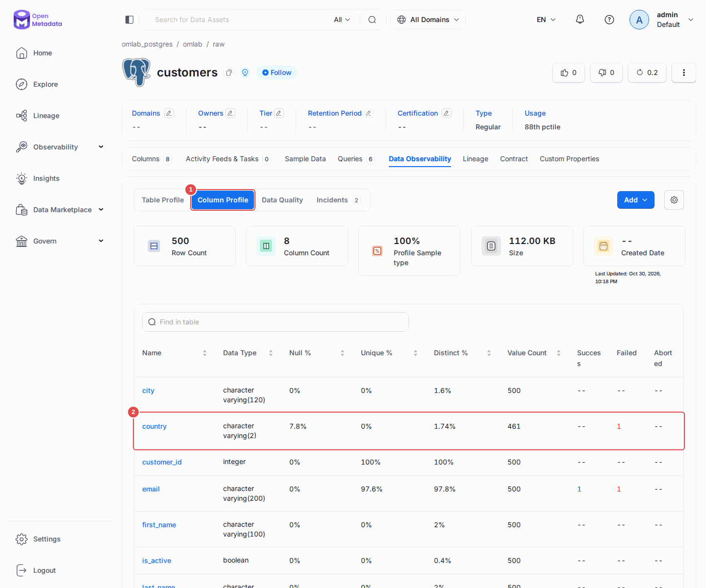
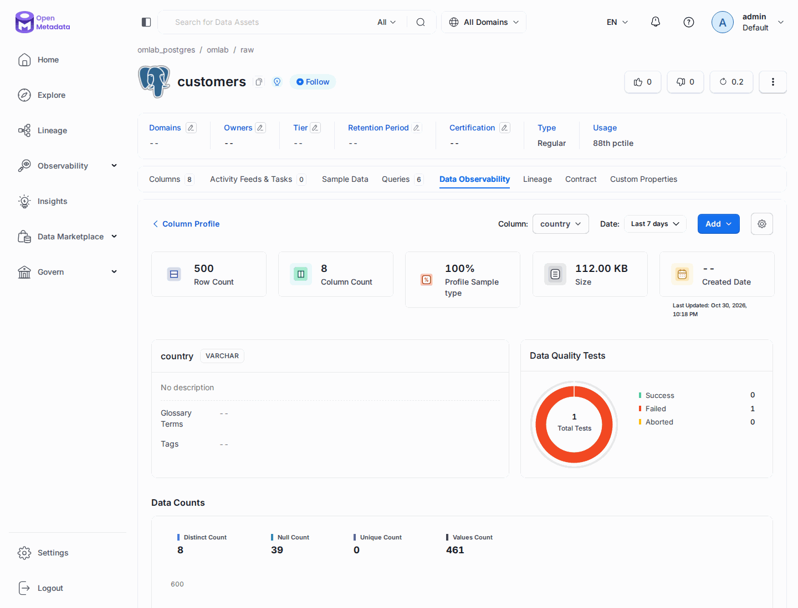

# Chapitre 05 — Le profiler

> **Objectifs** — Mesurer la forme réelle des données, comprendre pourquoi ce
> workflow coûte cher, et savoir le régler pour qu'il reste supportable.
> **Durée** — 35 minutes.

---

## 1. La différence qui change tout

| | Ingestion de métadonnées (ch. 04) | Profiler (ce chapitre) |
|---|---|---|
| Ce qu'elle lit | le **catalogue système** | les **données elles-mêmes** |
| SQL exécuté | `SELECT ... FROM information_schema` | `SELECT count(*), min(x), ... FROM votre_table` |
| Durée sur 9 tables | quelques secondes | moins d'une minute |
| Coût sur un entrepôt facturé | négligeable | **réel, et parfois salé** |
| Fréquence raisonnable | quotidienne | hebdomadaire, ou par échantillon |

Le chapitre 04 vous dit qu'il existe une colonne `country` de type `varchar(2)`.
Le profiler vous dit que **8 % de ses valeurs sont nulles** et qu'elle ne prend
que 8 valeurs distinctes. La première information vient gratuitement ; la
seconde se paie en temps de calcul.

## 2. Ce qu'il mesure

**Au niveau de la table :** nombre de lignes, nombre de colonnes, taille.

**Au niveau de chaque colonne :** valeurs nulles (compte et proportion),
valeurs distinctes et uniques, min / max / moyenne / écart-type, médiane et
quartiles pour les colonnes numériques.

Ces chiffres ont deux usages. Le premier est immédiat : comprendre une table
sans écrire une requête. Le second est plus subtil et bien plus utile — ils
alimentent les **tests de qualité** du chapitre 10 et permettent de détecter
une dérive (« le taux de nulls est passé de 2 % à 40 % cette nuit »).

## 3. Le fichier

[`tp/05-profiler/profiler.yaml`](../tp/05-profiler/profiler.yaml). Deux
différences avec le chapitre 04 : `type: Profiler`, un bloc `processor` de
type `orm-profiler`, et surtout une sous-commande différente :

```bash
./omlab profile tp/05-profiler/profiler.yaml     # et non `ingest`
```

### L'échantillonnage, et son piège de version

```yaml
profileSampleConfig:
  sampleConfigType: STATIC
  config:
    profileSample: 100
    profileSampleType: PERCENTAGE
```

Cette structure à deux niveaux est récente. Les tutoriels antérieurs à la
version 1.6 écrivent `profileSample: 100` **à plat**, sous `sourceConfig.config` ;
ceux de la 1.12 le mettent directement sous `profileSampleConfig`. Les deux
échouent encore en 2.0 avec un message qui ne dit pas ce qu'il faut faire :

```
Error loading profiler configuration: ...
	 - Extra parameter in ('profileSampleConfig', 'profileSample')
```

Deux modes existent :

- **`STATIC`** — vous imposez la fraction. C'est ce qu'on veut pour un contrôle
  de conformité : on ne veut pas rater le défaut qui touche 0,5 % des lignes.
- **`DYNAMIC`** — OpenMetadata choisit selon la taille de la table. Confortable
  pour de l'exploration sur du très gros volume, dangereux si vous croyez
  regarder toutes les lignes.

**La 2.0 a changé le défaut** : sans configuration, le profiler est en `DYNAMIC`, et
il ne calcule plus la distribution de cardinalité. Une configuration existante est
conservée ; c'est pourquoi notre fichier écrit `STATIC` noir sur blanc.

`profileSampleType` vaut `PERCENTAGE` (une fraction) ou `ROWS` (un nombre fixe
de lignes). Sur une table de 4 milliards de lignes, `ROWS: 100000` donne un
temps d'exécution prévisible, ce que le pourcentage ne garantit pas.

### Les autres leviers de coût

```yaml
computeTableMetrics: true     # peu cher
computeColumnMetrics: true    # LE poste de dépense
useStatistics: false          # true = lire les stats du SGBD, pas les données
includeViews: true            # attention : false par défaut ici !
threadCount: 5
timeoutSeconds: 43200
```

Deux remarques.

**`includeViews` vaut `false` par défaut dans le profiler**, alors qu'il vaut
`true` dans le workflow de métadonnées. Incohérence qui surprend : si vos vues
n'ont pas de statistiques, c'est probablement ça.

**`useStatistics: true`** demande au SGBD ses propres statistiques au lieu de
recalculer. C'est spectaculairement plus rapide et gratuit — mais les stats du
moteur sont approximatives et parfois périmées. Excellent pour un premier
balayage d'un entrepôt entier, inutilisable pour un test de conformité.

### Exclure des tables du profiling

```yaml
tableFilterPattern:
  excludes:
    - "^employees$"
```

Notre fichier exclut la table RH. Ce n'est pas une coquetterie : profiler une
table de salaires, c'est en stocker le minimum, le maximum et la moyenne dans
le catalogue, visibles par tous ceux qui ont accès à la fiche.

## 4. Exécuter et lire

```bash
./omlab profile tp/05-profiler/profiler.yaml
```

```
Workflow OpenMetadata Service Summary:
Processed records: 8
Filtered: 1              ← raw.employees, exclue volontairement
Workflow Profiler Summary:
Processed records: 166   ← 166 métriques calculées
Workflow finished in time: 49s 431ms
```

Dans l'UI, ouvrez `raw.customers`, onglet **Data Observability**. Vous
lisez maintenant, pour `country` : `Null Count` à 39 sur 500 lignes, soit 7,8 %,
et `Distinct Count` à 8. Le mode d'emploi ci-dessous montre où.

Trente-neuf pays manquants — exactement ce que le jeu de données contient. On
peut le vérifier des deux côtés :

```bash
./omlab psql "SELECT count(*) FROM raw.customers WHERE country IS NULL"   # 39
./omlab check 05
```

## 5. Le profiler dans le temps

Chaque exécution est **horodatée et conservée**. L'UI trace des courbes : c'est
là qu'apparaissent les dérives lentes qu'aucun test ponctuel ne détecte — le
taux de nulls qui grimpe de 2 % par mois, le nombre de lignes qui stagne alors
qu'il devrait croître.

C'est aussi ce qui rend possibles les tests « à assertion dynamique » du
chapitre 10, qui comparent la valeur du jour à l'historique plutôt qu'à un
seuil écrit en dur.

## Mode d'emploi : lire un profil

**La vue d'ensemble.** Sur la fiche de `raw.customers`, ouvrez l'onglet
**Data Observability (1)**. La sous-vue **Table Profile (2)** donne le nombre de
lignes et de colonnes, la taille, le taux d'échantillonnage, puis les courbes dans
le temps de la section 5.



**Colonne par colonne.** La sous-vue **Column Profile (1)** liste toutes les colonnes
avec leurs taux. La ligne `country` **(2)** montre tout de suite ses 7,8 % de nulls.



**Le détail d'une colonne.** Cliquez sur le nom `country` : les compteurs et leurs
courbes s'affichent, avec le test de qualité qui surveille cette colonne. On y
retrouve les 39 nulls et les 8 valeurs distinctes.



---

## TP guidé

1. `./omlab profile tp/05-profiler/profiler.yaml`
2. Ouvrez `raw.customers` dans l'UI, onglet **Data Observability**, sous-vue
   **Column Profile**. Repérez `country` et son taux de nulls.
3. Vérifiez en base : `./omlab psql "SELECT count(*) FROM raw.customers WHERE country IS NULL"`
4. Cherchez `raw.employees` dans l'UI : aucune donnée de profiling. Comprenez
   pourquoi en relisant `tableFilterPattern`.
5. Interrogez le profil par l'API :
   ```bash
   curl -s -H "Authorization: Bearer $OM_TOKEN" \
     "localhost:8585/api/v1/tables/omlab_postgres.omlab.raw.customers.country/columnProfile?startTs=0&endTs=99999999999999" | jq
   ```

**Vérifier :**

```bash
./omlab check 05
```

```
Chapitre 05 — Profiling
  OK   un profil existe pour raw.customers.country
  OK   le profiler compte 39 pays manquants (trouvé 39.0)
```

## Exercices

1. Retirez `^employees$` des exclusions, relancez, et regardez ce qui
   apparaît sur la colonne `salary`. Puis remettez l'exclusion et réfléchissez
   à ce que vous venez de publier.
2. Passez `profileSample` à `10` et relancez. Le `nullCount` de `country`
   change-t-il ? De combien ? Que conclure sur l'usage d'un échantillon pour
   un contrôle de conformité ?
3. Passez `useStatistics: true` et comparez la durée d'exécution.
4. Relancez trois fois le profiler et regardez la courbe temporelle dans l'UI.

## Pièges & FAQ

**« Le profiler tourne des heures. »**
Trois leviers, dans cet ordre : filtrez les tables inutiles, baissez
`profileSample`, passez `computeColumnMetrics` à `false` sur les tables très
larges. Un `threadCount` plus élevé aide, mais charge votre entrepôt d'autant.

**« Puis-je profiler sans droit de lecture sur les données ? »**
Non. Le profiler exécute de vrais `SELECT`. Si votre politique interdit la
lecture d'une table, elle interdit son profiling — et c'est cohérent.

**« Et l'échantillon de lignes visible dans l'UI ? »**
Il ne vient pas du profiler. Depuis la 1.6, il est produit par le workflow
d'auto-classification — c'est le chapitre 08.

## Pour aller plus loin

- [Workflow de profiling](https://docs.open-metadata.org/v2.0.x/how-to-guides/data-quality-observability/profiler)

---

**Précédent :** [04 — Ingestion](04-ingestion-metadonnees.md) ·
**Suivant :** [06 — Usage et lineage automatique](06-usage-lineage-auto.md)
