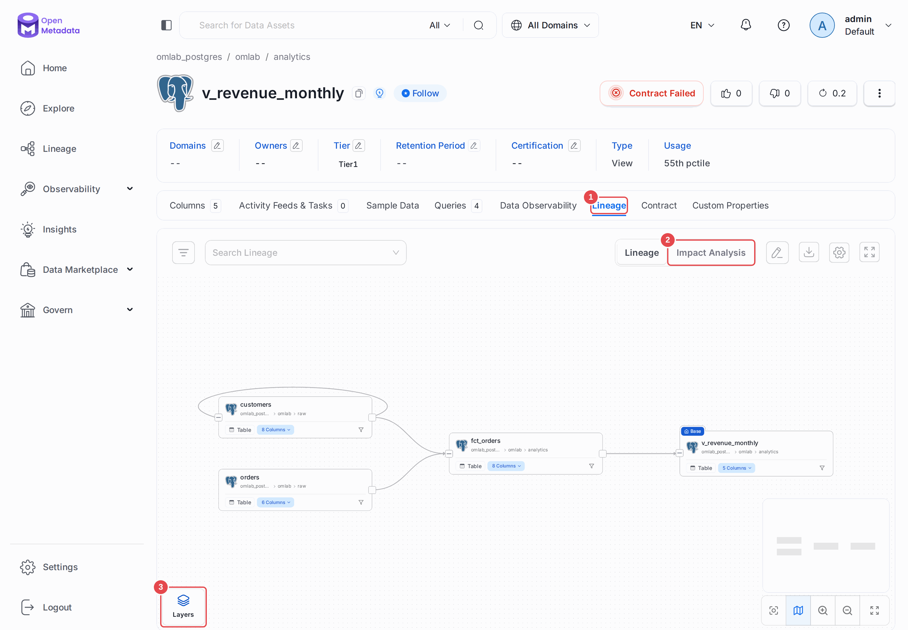
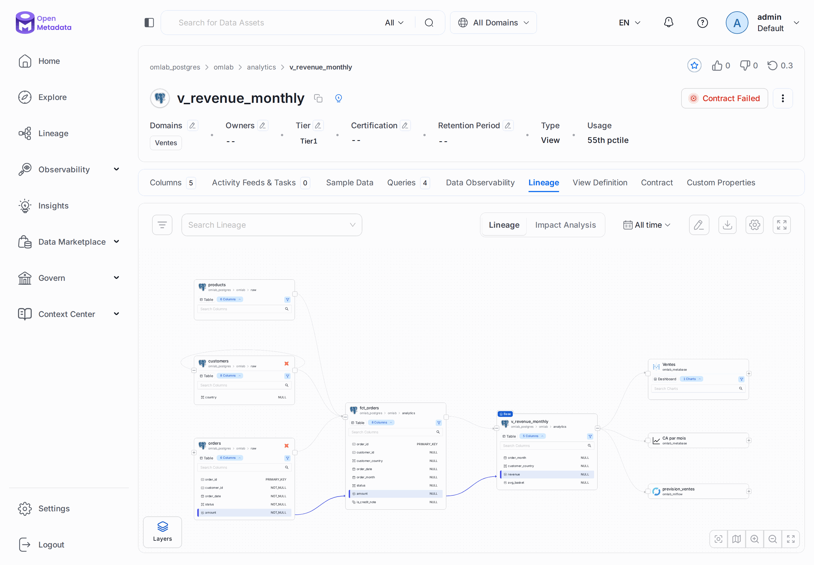
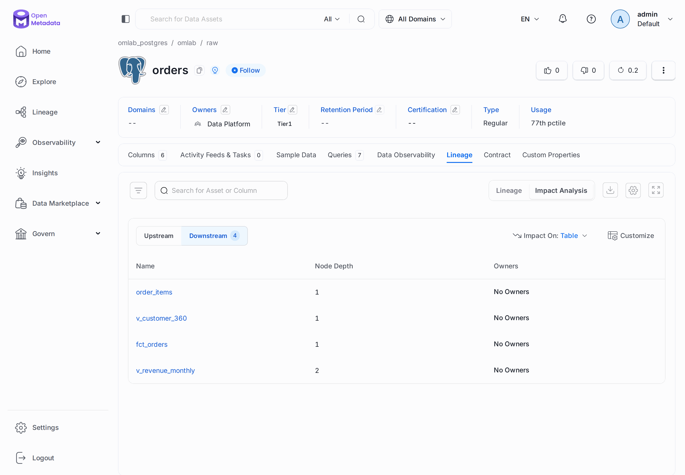
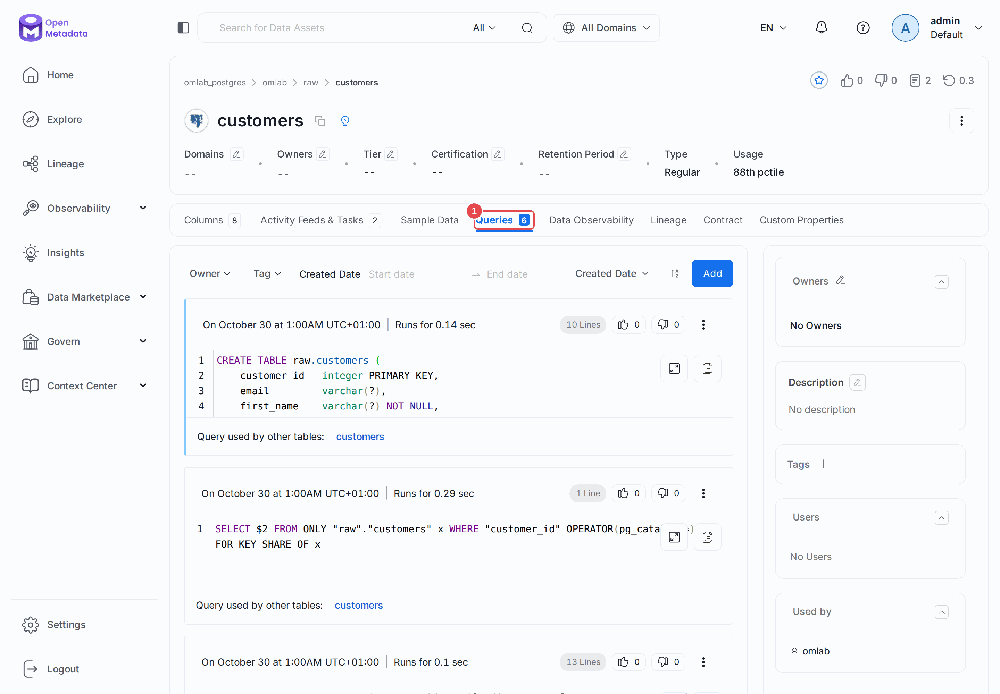
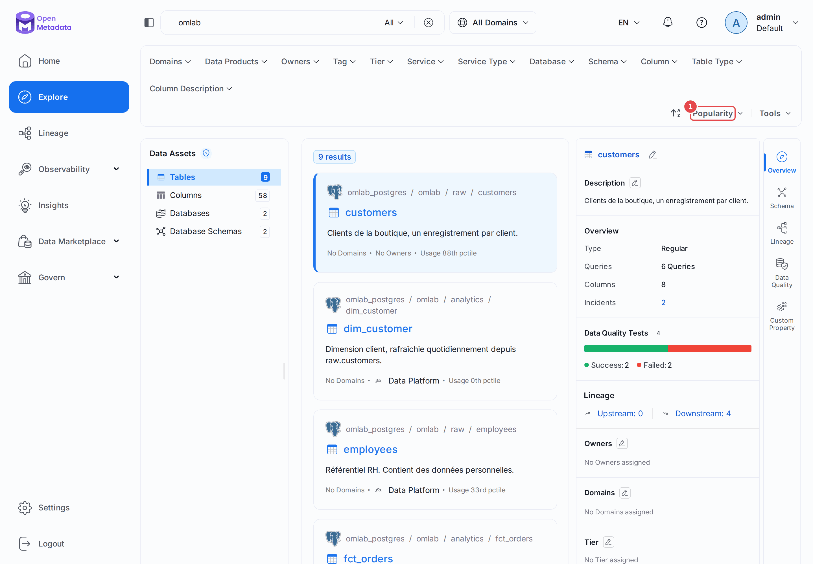

# Chapitre 06 — Usage et lineage automatique

> **Objectifs** — Faire apparaître le graphe de dépendances tout seul, à partir
> des requêtes réellement exécutées ; comprendre d'où viennent ces requêtes et
> ce que ce mécanisme ne peut pas voir.
> **Durée** — 45 minutes.

---

## 1. Deux questions, une même source

- **Usage** : quelles tables sont réellement lues, et par qui ? (La table que
  personne n'interroge depuis six mois est peut-être à supprimer.)
- **Lineage** : quelle table alimente quelle autre ? (La question qu'on se pose
  cinq minutes avant de renommer une colonne.)

Les deux se déduisent de la même matière première : **les requêtes SQL qui ont
tourné sur la base**.

## 2. D'où viennent les requêtes

Trois sources, par ordre de fiabilité décroissante :

**1. La définition des vues.** Le connecteur lit le SQL d'une vue et en déduit
ses dépendances. Fiable, gratuit, sans configuration.

**2. Les requêtes observées.** Sur Postgres, OpenMetadata lit la vue
`pg_stat_statements`. C'est puissant, mais il faut savoir ce qu'on lit :

> `pg_stat_statements` **n'est pas un journal de requêtes**. C'est un
> compteur en mémoire, de taille fixe (5 000 entrées par défaut), qui
> normalise les requêtes par forme et **ne conserve aucun horodatage par
> exécution**. Quand il est plein, les requêtes les moins fréquentes sont
> silencieusement évincées.

Conséquences très concrètes : sur une base fraîchement démarrée, il est vide,
donc aucun lineage ; un `pg_stat_statements_reset()` efface tout ; et
`queryLogDuration: 30` ne filtre pas vraiment sur 30 jours, faute d'horodatage.

Notre playground est configuré pour limiter la casse
([`docker-compose.playground.yml`](../docker/docker-compose.playground.yml)) :

```yaml
command:
  - postgres
  - -c
  - shared_preload_libraries=pg_stat_statements
  - -c
  - pg_stat_statements.max=10000
  - -c
  - pg_stat_statements.track=all
```

**3. Un fichier de journal.** Si vous disposez d'un vrai journal de requêtes
(export Snowflake, log applicatif), le workflow `query-log-usage` le lit
directement. Le CSV attend les colonnes `query_text` (obligatoire),
`user_name`, `start_time`, `end_time`, `aborted`, `database_name`,
`schema_name`. C'est la voie à privilégier quand elle est disponible : elle a
les horodatages que `pg_stat_statements` n'a pas.

## 3. Générer du trafic

Sans requêtes, rien à analyser. Le projet fournit
[`docker/traffic.sql`](../docker/traffic.sql), qui rejoue un trafic réaliste :
les `INSERT ... SELECT` qui alimentent `analytics` (matière à lineage), et des
lectures répétées sur certaines tables (matière à usage).

```bash
./omlab traffic
```

```
pg_stat_statements contient maintenant 263 requêtes distinctes.
```

Ce nombre dépend de ce qui a déjà tourné sur la base : ne vous attendez pas au
même. Ce qui compte, c'est qu'il ne soit pas nul.

> **À faire avant chaque exécution des deux workflows de ce chapitre.** C'est
> l'artefact du laboratoire : en production, votre entrepôt génère ce trafic
> tout seul.

## 4. Le lineage

[`tp/06-usage-lineage/lineage.yaml`](../tp/06-usage-lineage/lineage.yaml).
Le connecteur s'appelle `postgres-lineage`, et il se lance avec `ingest` :

```bash
./omlab ingest tp/06-usage-lineage/lineage.yaml
```

```
Processing Query Lineage
Processed 9 query log entries for lineage
Workflow Success %: 100.0
```

Le résultat, vu par l'API :

```
### analytics.v_revenue_monthly
    analytics.fct_orders -> analytics.v_revenue_monthly   (4 correspondances de colonnes)
    raw.customers        -> analytics.fct_orders          (1)
    raw.orders           -> analytics.fct_orders          (7)
### analytics.v_customer_360
    raw.customers -> analytics.v_customer_360   (3)
    raw.orders    -> analytics.v_customer_360   (3)
```

Deux choses méritent qu'on s'y arrête.

**Le lineage descend au niveau de la colonne.** OpenMetadata n'a pas seulement
compris que `fct_orders` vient de `orders` : il sait que `fct_orders.is_credit_note`
est dérivée de `orders.amount`. C'est ce qui permet de répondre à « si je change
le type de `amount`, qu'est-ce qui casse exactement ? ».

**Il a compris des transformations, pas seulement des copies.**
`date_trunc('month', order_date)` a bien été rattaché à `order_date`.

Dans l'UI : ouvrez `analytics.v_revenue_monthly`, onglet **Lineage**. La sous-vue
**Impact Analysis** remonte tous les descendants — c'est ce qu'on regarde avant
une migration.

## 5. L'usage

[`tp/06-usage-lineage/usage.yaml`](../tp/06-usage-lineage/usage.yaml). Ce
workflow a une structure **à six blocs**, unique dans le produit :

```yaml
source:      postgres-usage      # lit les requêtes
processor:   query-parser        # en extrait les tables lues
stage:       table-usage         # accumule dans un fichier temporaire
bulkSink:    metadata-usage      # envoie le tout en une fois
```

Pourquoi `stage` + `bulkSink` ? Parce qu'on agrège des milliers de requêtes
avant d'écrire. Un appel API par requête mettrait le serveur à genoux.

```bash
./omlab usage tp/06-usage-lineage/usage.yaml
```

```
Workflow Table Usage Summary:
Processed records: 62
Workflow Success %: 100.0
```

Le classement obtenu :

```
    10  p88.0   raw.customers
     8  p77.0   raw.orders
     6  p66.0   raw.products
     5  p55.0   analytics.v_revenue_monthly
     ...
     3  p0.0    analytics.v_customer_360
```

Le `p` est un **rang en percentile** : `p88` signifie que cette table est plus
consultée que 88 % des autres. C'est ce chiffre qui alimente le tri « les plus
populaires » de la recherche — et qui donne un argument objectif quand
quelqu'un veut supprimer une table.

L'onglet **Queries** d'une table liste les requêtes qui l'ont touchée. Pour
comprendre comment une table est *vraiment* utilisée, c'est plus instructif
que n'importe quelle documentation.

## Mode d'emploi : lire le graphe

**Le graphe.** Ouvrez `analytics.v_revenue_monthly`, onglet **Lineage (1)**. Le flux
se lit de gauche à droite : les sources `raw.customers` et `raw.orders`, puis
`fct_orders`, puis la vue. L'arc au-dessus de `customers` est une arête de la table
vers elle-même : le trafic du labo contient un `UPDATE raw.customers` qui lit
`raw.customers`, et le parseur l'interprète ainsi.



**Colonne à colonne.** Cliquez sur **Layers (3)**, puis **Column**. Chaque table se
déplie, et un clic sur une colonne surligne son chemin : ici, `revenue` remonte
à `fct_orders.amount`, puis à `orders.amount`.



**L'impact.** La sous-vue **Impact Analysis (2)** répond à la question en liste plutôt
qu'en graphe. Sur `raw.orders`, le sens **Downstream** montre quatre descendants, avec
leur profondeur et leur propriétaire.



**Les requêtes.** L'onglet **Queries (1)** de `raw.customers` liste le SQL observé,
avec sa durée.



**La popularité.** Dans **Explore**, le tri **Popularity (1)** classe les assets, et
chaque résultat affiche son percentile d'usage. Ces chiffres viennent de l'index de
recherche : voyez le piège ci-dessous si tout reste à `0th pctile`.



---

## TP guidé

```bash
./omlab traffic
./omlab ingest tp/06-usage-lineage/lineage.yaml
./omlab usage  tp/06-usage-lineage/usage.yaml
```

1. Dans l'UI, ouvrez `analytics.v_revenue_monthly`, onglet **Lineage**.
   Remontez jusqu'à `raw.orders`.
2. Cliquez sur **Layers → Column** et suivez le chemin de `amount`.
3. Ouvrez `raw.customers`, onglet **Queries**.
4. Réindexez (voir *Pièges & FAQ*), triez la recherche par popularité et
   retrouvez les percentiles ci-dessus.

**Vérifier :**

```bash
./omlab check 06
```

```
Chapitre 06 — Usage et lineage automatique
  OK   au moins 5 tables ont des statistiques d'usage (9)
  OK   fct_orders a au moins 2 sources en amont (3)
  OK   le lineage descend au niveau des colonnes
```

## Exercices

1. Créez une nouvelle table dérivée, faites-la découvrir :
   ```bash
   ./omlab psql "CREATE TABLE analytics.fct_produits AS SELECT p.product_id, p.category, sum(i.quantity) AS qte FROM raw.order_items i JOIN raw.products p USING (product_id) GROUP BY 1,2"
   ./omlab ingest tp/04-ingestion/metadata.yaml
   ./omlab ingest tp/06-usage-lineage/lineage.yaml
   ```
   Le lineage apparaît-il ? Depuis quelles tables ?
2. Exécutez `./omlab psql "SELECT pg_stat_statements_reset()"`, relancez le
   workflow de lineage sans rejouer `traffic`. Que reste-t-il ? Quelle leçon
   pour la planification de ce workflow en production ?
3. Interrogez 20 fois `raw.employees`, relancez l'usage, et regardez sa
   remontée dans le classement.
4. Écrivez un CSV de journal de requêtes et faites-le ingérer par un workflow
   `query-log-usage`.

## Pièges & FAQ

**« Le lineage est vide. »**
Dans l'ordre : avez-vous lancé `./omlab traffic` ? Le compte a-t-il
`pg_read_all_stats` (sinon il ne voit que ses propres requêtes) ? L'extension
`pg_stat_statements` est-elle chargée (`SELECT count(*) FROM pg_stat_statements`) ?

**« Le lineage est incomplet. »**
Le parseur SQL renonce plutôt que d'inventer : requêtes trop dynamiques, SQL
généré, procédures stockées. C'est un choix sain — un faux lineage est pire
que pas de lineage. Le complément se fait à la main : chapitre 11.

**« La recherche affiche `0th pctile` partout, alors que la fiche dit `88th`. »**
Le workflow d'usage met à jour la base, pas l'index Elasticsearch. Tant qu'on n'a pas
réindexé, la recherche voit des percentiles à zéro, sans le moindre message d'erreur.
Lancez *Settings → Applications → Search Indexing → Run Now*, ou par l'API :

```bash
curl -X POST -H "Authorization: Bearer $OM_TOKEN" -H "Content-Type: application/json" \
  -d '{}' localhost:8585/api/v1/apps/trigger/SearchIndexingApplication
```

En production, planifiez cette application après le workflow d'usage.

**« Faut-il lancer les deux workflows ? »**
Ils sont indépendants. Le lineage répond à « qu'est-ce qui casse ? », l'usage
à « qui s'en sert ? ». Beaucoup d'équipes commencent par le lineage seul.

**« Et sur Snowflake / BigQuery ? »**
Bien mieux : ces moteurs conservent un vrai historique de requêtes horodaté
(`SNOWFLAKE.ACCOUNT_USAGE.QUERY_HISTORY`, `INFORMATION_SCHEMA.JOBS`). Les
limites décrites ici sont propres à Postgres.

## Pour aller plus loin

- [Workflow de lineage](https://docs.open-metadata.org/v1.13.x/connectors/ingestion/lineage)
- [Usage depuis un journal de requêtes](https://docs.open-metadata.org/v1.13.x/connectors/ingestion/workflows/usage/usage-workflow-query-logs)

---

**Précédent :** [05 — Profiling](05-profiler.md) ·
**Suivant :** [07 — Glossaire](07-glossaire.md)
