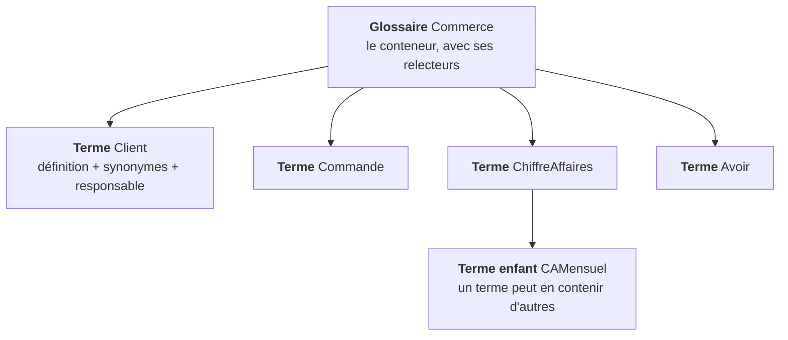
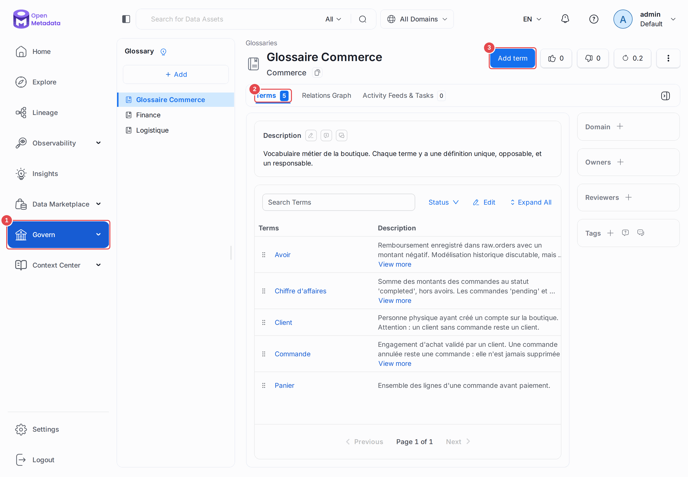
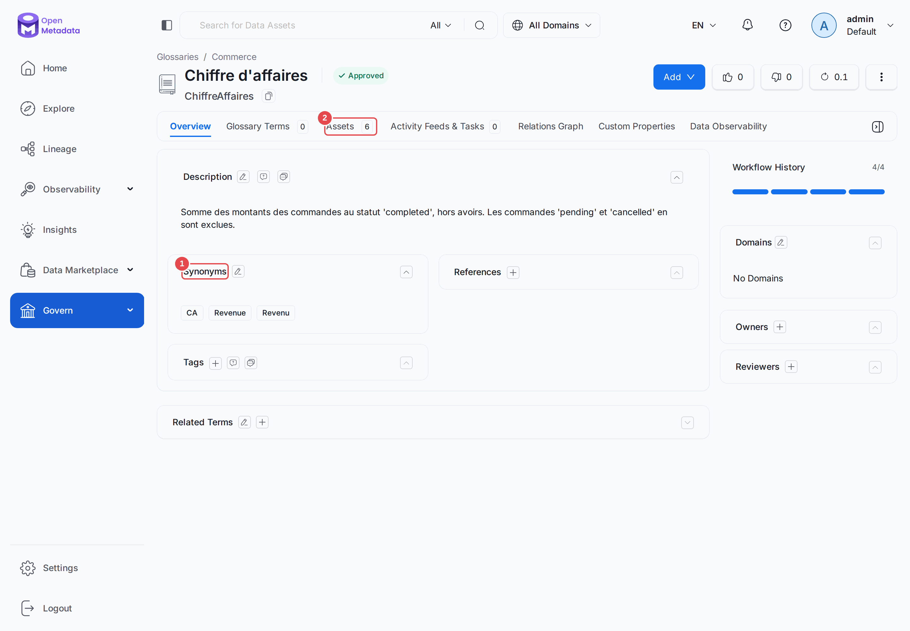
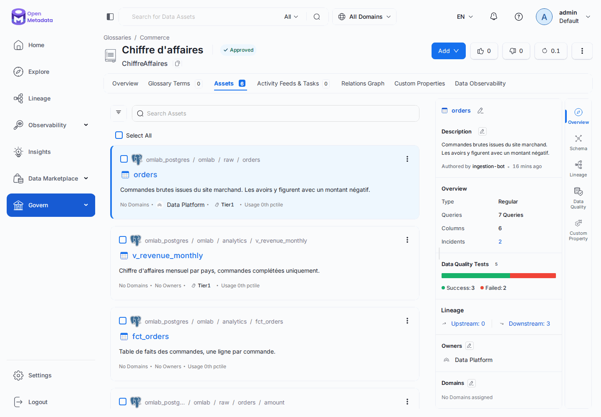
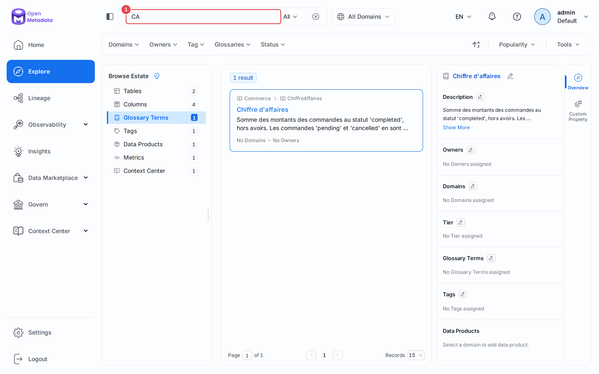
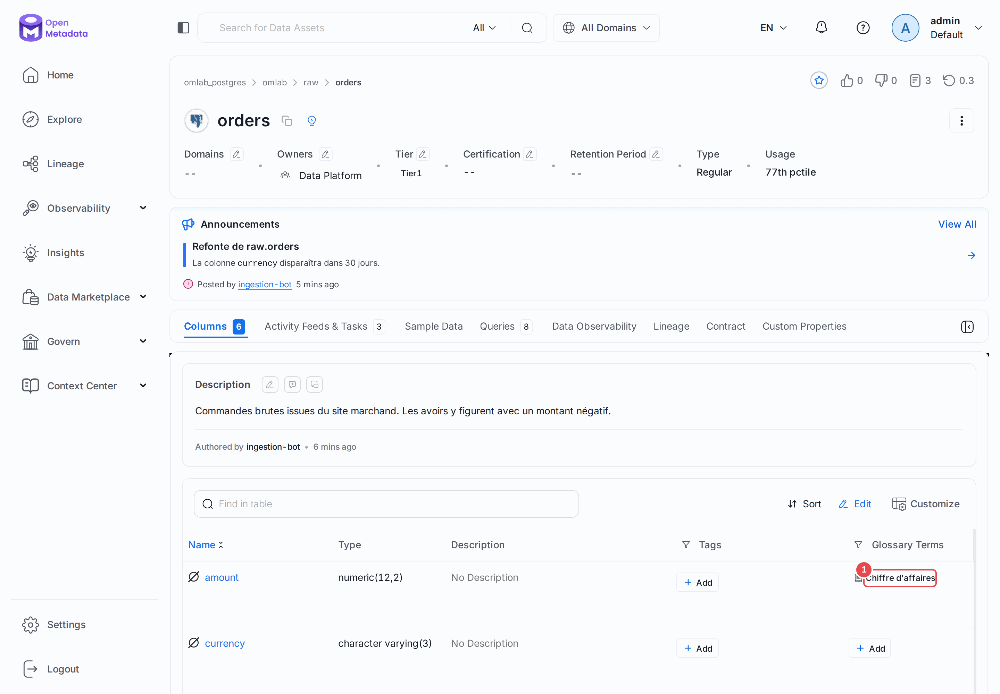

# Chapitre 07 — Le glossaire métier

> **Objectifs** — Construire un vocabulaire partagé, le relier aux données, et
> comprendre pourquoi c'est le chantier de gouvernance qui échoue le plus souvent.
> **Durée** — 40 minutes.

---

## 1. Le problème que ça résout

Demandez à trois personnes de votre organisation ce qu'est le « chiffre
d'affaires ». Vous aurez trois définitions : avec ou sans TVA, avec ou sans les
commandes annulées, à la date de commande ou à la date de facturation. Chacune
est défendable ; le problème est qu'elles coexistent sans que personne ne le
sache, et que deux tableaux de bord affichent deux nombres différents.

Le glossaire est l'endroit où l'on tranche. Une définition, un responsable,
une date. Ensuite, on l'accroche aux colonnes concernées — et la définition
suit la donnée partout où elle va.

## 2. La structure



Quatre notions à distinguer :

| Notion | Rôle | Exemple |
|---|---|---|
| **Description** | la définition qui fait foi | « Somme des commandes au statut completed » |
| **Synonymes** | les autres façons de le dire — ils alimentent la recherche | `CA`, `Revenue`, `Revenu` |
| **Termes liés** | des renvois entre termes, sans hiérarchie | `ChiffreAffaires` ↔ `Avoir` |
| **Termes enfants** | une hiérarchie, qui se lit dans le FQN | `Commerce.ChiffreAffaires.CAMensuel` |

Les **synonymes** sont sous-estimés. Un utilisateur qui tape « CA » dans la
barre de recherche ne connaît pas votre nomenclature ; c'est le synonyme qui
fait le pont entre son vocabulaire et le vôtre.

## 3. Créer le glossaire par le code

On pourrait tout faire à la souris. On ne le fera pas, pour une raison simple :
un glossaire est un **référentiel**. Il se relit en revue, se versionne, se
rejoue à l'identique sur la préproduction. Le clic est parfait pour explorer,
mauvais pour tenir un référentiel dans la durée.

```bash
./omlab py tp/07-glossaire/creer_glossaire.py
```

```
Glossaire : Commerce
  terme : Commerce.Client
  terme : Commerce.Commande
  terme : Commerce.ChiffreAffaires
  terme : Commerce.Avoir

Glossaire relu : Glossaire Commerce (version 0.1)
  Commerce.Client            synonymes=['Customer', 'Acheteur']
  Commerce.Commande          synonymes=['Order']
  Commerce.ChiffreAffaires   synonymes=['CA', 'Revenue', 'Revenu']
  Commerce.Avoir             synonymes=['Credit note']
```

Lisez [le script](../tp/07-glossaire/creer_glossaire.py) : les définitions
elles-mêmes sont le seul contenu qui mérite une revue. Le code qui les pousse
tient en cinq lignes.

Notez le style des définitions retenues :

> **Commande** — Engagement d'achat validé par un client. Une commande annulée
> reste une commande : elle n'est jamais supprimée de l'historique.

La deuxième phrase vaut plus que la première. Une définition utile dit ce qui
n'est pas évident, pas ce qu'on aurait deviné.

## 4. Rattacher les termes aux données

C'est l'étape que tout le monde saute, et sans laquelle le glossaire est un
document mort.

```bash
./omlab py tp/07-glossaire/rattacher_termes.py
```

```
  raw.customers.customer_id           <- Commerce.Client           rattaché
  raw.customers.email                 <- Commerce.Client           rattaché
  raw.orders.order_id                 <- Commerce.Commande         rattaché
  raw.orders.amount                   <- Commerce.ChiffreAffaires  rattaché
  analytics.fct_orders.amount         <- Commerce.ChiffreAffaires  rattaché
  analytics.fct_orders.is_credit_note <- Commerce.Avoir            rattaché
  analytics.v_revenue_monthly.revenue <- Commerce.ChiffreAffaires  rattaché

Assets portant le terme Commerce.ChiffreAffaires :
  omlab_postgres.omlab.raw.orders
  omlab_postgres.omlab.analytics.v_revenue_monthly
  omlab_postgres.omlab.analytics.fct_orders
```

La relation est **bidirectionnelle**. Depuis une colonne, on lit la définition ;
depuis le terme, on liste tous les endroits où la notion est matérialisée.
C'est ce qui permet de répondre en dix secondes à « où est calculé notre
chiffre d'affaires ? » — question qui prend habituellement une demi-journée.

### Le détail qui fait échouer le rattachement

Dans le JSON Patch, le champ `source` doit valoir `Glossary` :

```python
"value": {
    "tagFQN": "Commerce.ChiffreAffaires",
    "source": "Glossary",        # et non "Classification"
    "labelType": "Manual",
    "state": "Confirmed",
}
```

Termes de glossaire et étiquettes de classification partagent la même
structure technique (`tagFQN`) mais pas le même espace de noms. Avec
`source: "Classification"`, le serveur cherche une classification nommée
`Commerce` et refuse le patch.

## 5. Le circuit de validation

Un glossaire sérieux a des **relecteurs** (`reviewers`). Quand ils sont
définis, un nouveau terme naît au statut `Draft` et doit être approuvé pour
passer en `Approved`. Une tâche est créée automatiquement pour les relecteurs.

C'est le mécanisme qui empêche le glossaire de devenir un dépotoir où chacun
ajoute sa définition personnelle. À activer dès qu'il y a plus de trois
contributeurs.

## Mode d'emploi : le glossaire à l'écran

**Ouvrir le glossaire.** Dans le menu **Govern (1)**, cliquez sur **Glossary**, puis
sur *Glossaire Commerce*. L'onglet **Terms (2)** liste les termes et leur statut, et
**Add term (3)** en crée un à la main.



**Lire un terme.** Cliquez sur *Chiffre d'affaires*. La fiche donne la définition et
les **Synonyms (1)**. L'onglet **Assets (2)** fait le lien vers les données.



**Voir où vit la notion.** L'onglet **Assets** répond à « où est calculé notre
chiffre d'affaires ? » : deux tables, une vue et leurs colonnes.



**Retrouver le terme par un synonyme.** Tapez `CA` dans la barre de recherche **(1)**,
puis sélectionnez **Glossary Terms** dans l'arbre de gauche : *Chiffre d'affaires*
remonte, alors que son nom ne contient pas ces lettres dans cet ordre.



**Le lire depuis la donnée.** Sur `raw.orders`, le terme figure dans la colonne
**Glossary Terms** du tableau, en face de `amount` **(1)**. Pour gagner de la place,
repliez le panneau de droite avec le bouton situé au bout de la ligne d'onglets.



---

## TP guidé

```bash
./omlab py tp/07-glossaire/creer_glossaire.py
./omlab py tp/07-glossaire/rattacher_termes.py
```

1. Dans l'UI : **Govern → Glossary → Commerce**. Ouvrez `ChiffreAffaires` et
   regardez son onglet **Assets**.
2. Cherchez `CA` dans la barre de recherche. Le terme remonte par son synonyme.
3. Ouvrez `raw.orders`, onglet **Columns** : la colonne `amount` porte désormais
   le terme, et le survol affiche la définition.
4. Ajoutez à la main un terme `PanierMoyen`, enfant de `ChiffreAffaires`, et
   observez son FQN.

**Vérifier :**

```bash
./omlab check 07
```

```
Chapitre 07 — Glossaire
  OK   le glossaire Commerce existe
  OK   les 4 termes sont créés
  OK   raw.orders.amount porte le terme Commerce.ChiffreAffaires
```

## Exercices

1. Ajoutez un terme `TauxDeRetour` avec une définition, deux synonymes, et
   rattachez-le à une colonne pertinente.
2. Désignez l'équipe `data_platform` (chapitre 09) comme relectrice du
   glossaire, créez un terme, et observez le statut `Draft` et la tâche générée.
3. Le glossaire s'exporte et s'importe en CSV depuis l'UI. Exportez `Commerce`,
   ajoutez deux termes dans le fichier, réimportez.
4. Écrivez un script qui liste toutes les colonnes dont le nom contient
   `amount` ou `revenue` et qui ne portent **aucun** terme de glossaire.
   C'est votre liste de travail.

## Pièges & FAQ

**« Terme de glossaire ou description ? »**
La description est propre à *cette* colonne (« montant en euros, TTC »). Le
terme est une définition partagée, réutilisable ailleurs. Si vous copiez-collez
la même phrase sur trois colonnes, il vous faut un terme.

**« Par où commencer ? »**
Pas par les 200 termes exhaustifs — ce chantier-là s'enlise toujours. Prenez
les cinq notions sur lesquelles votre organisation se dispute le plus.
Rattachez-les. Le reste viendra par besoin, ou ne viendra pas, et ce ne sera
pas grave.

**« Faut-il un glossaire ou plusieurs ? »**
Un par domaine métier quand les vocabulaires diffèrent vraiment (Finance et
Logistique n'appellent pas « commande » la même chose). Sinon, un seul : la
multiplication des glossaires recrée le problème qu'ils devaient résoudre.

## Pour aller plus loin

- [Glossaires](https://docs.open-metadata.org/v2.0.x/how-to-guides/data-governance/glossary)

---

**Précédent :** [06 — Usage et lineage](06-usage-lineage-auto.md) ·
**Suivant :** [08 — Classification et PII](08-classification-pii.md)
