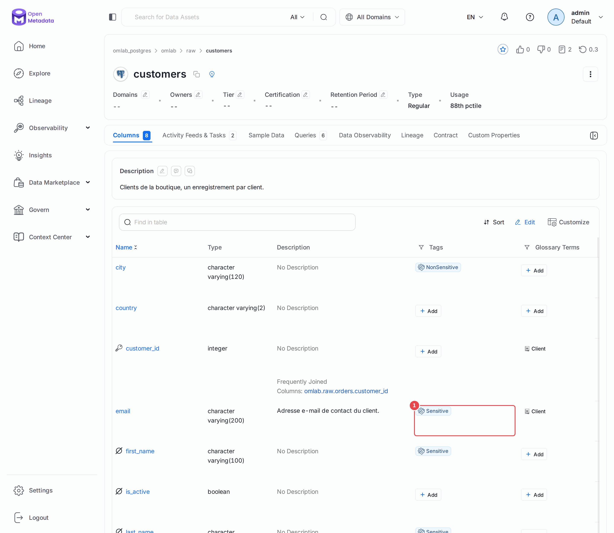
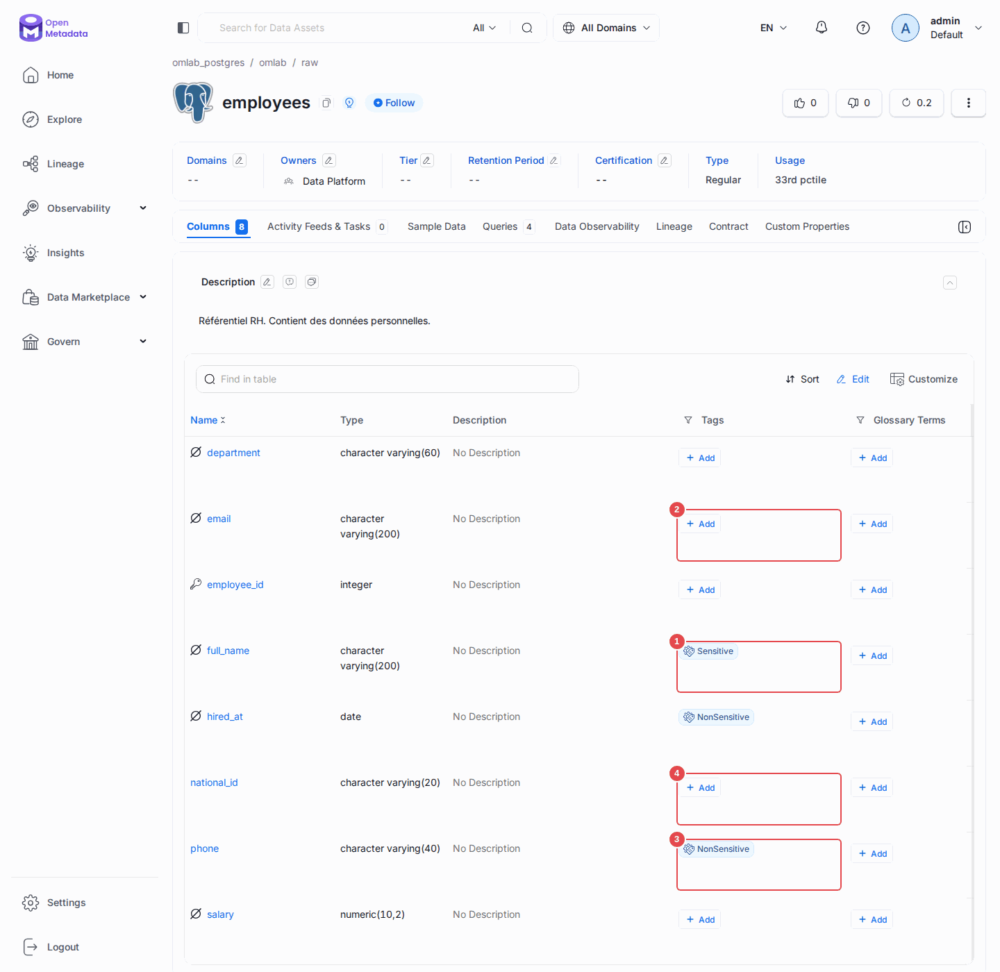
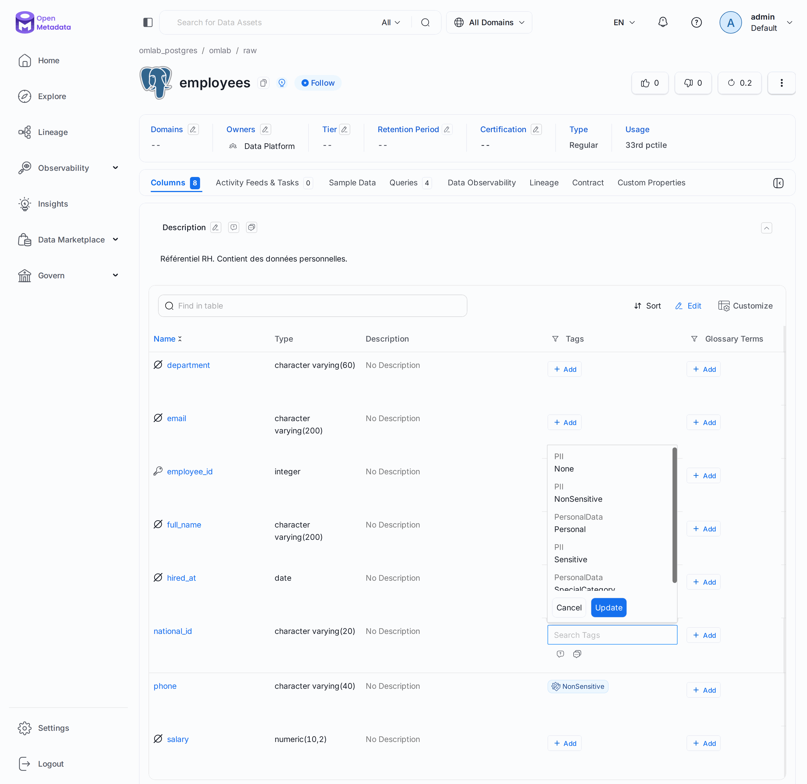
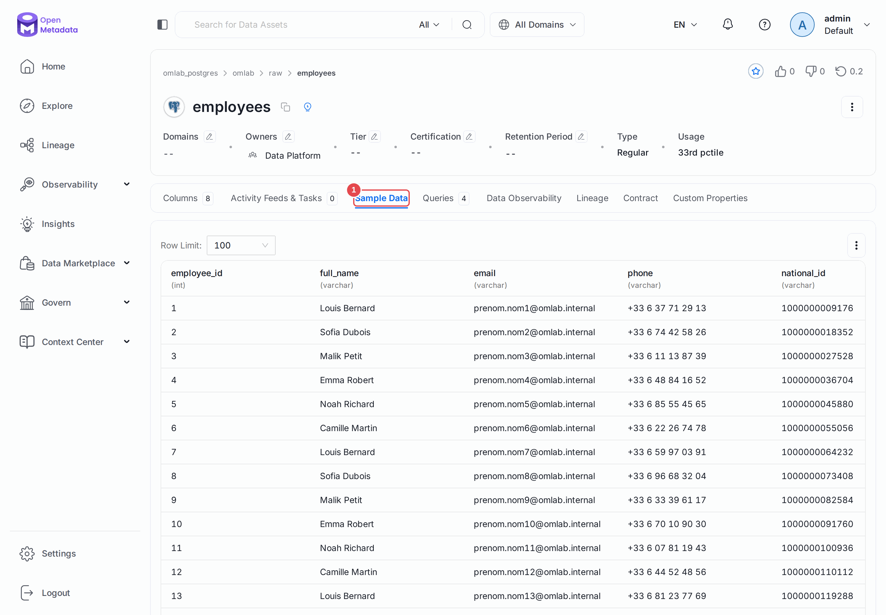

# Chapitre 08 — Classification et données personnelles

> **Objectifs** — Étiqueter les données, faire tourner la détection automatique
> de PII, et surtout : mesurer ce qu'elle rate.
> **Durée** — 40 minutes.

---

## 1. Classifications et étiquettes

Une **classification** est un ensemble fermé d'**étiquettes**. OpenMetadata en
fournit trois d'origine :

| Classification | Étiquettes | Usage |
|---|---|---|
| `PII` | `Sensitive`, `NonSensitive`, `None` | données personnelles |
| `Tier` | `Tier1` … `Tier5` | criticité métier |
| `Certification` | `Gold`, `Silver`, `Bronze` | niveau de confiance |

Une étiquette s'écrit toujours `Classification.Étiquette` : `PII.Sensitive`.
Elle se pose sur une table, une colonne, un tableau de bord — sur n'importe
quelle entité.

Rien n'empêche de créer les vôtres : `Conformite.RGPD`, `Retention.5ans`,
`Statut.Deprecie`. La règle utile est d'en créer peu : une classification que
personne ne sait quand appliquer ne sera jamais appliquée.

## 2. La détection automatique

Depuis la version 1.6, l'échantillonnage et la détection de PII forment un
workflow à part, `AutoClassification`, avec sa propre sous-commande.
C'est le changement qui casse le plus de tutoriels trouvés en ligne :

> Les configurations antérieures écrivent `generateSampleData` et
> `confidence` dans le **profiler**. En 2.0, cela donne encore :
> `Extra parameter 'generateSampleData'`.

[`tp/08-classification/auto-classification.yaml`](../tp/08-classification/auto-classification.yaml) :

```yaml
sourceConfig:
  config:
    type: AutoClassification
    storeSampleData: true
    sampleDataCount: 50
    enableAutoClassification: true
    confidence: 80
    classificationLanguage: en
```

```bash
./omlab classify tp/08-classification/auto-classification.yaml
```

### Le bloc `processor` n'est plus nécessaire

Les exemples écrits pour la 1.x contiennent ce bloc, qui ne sert à rien :

```yaml
processor:
  type: orm-profiler
  config: {}
```

En 1.13, son absence provoquait une erreur cryptique (`'NoneType' object has no
attribute 'model_dump'`). En 2.0.7, le workflow s'en passe : notre fichier ne le
contient plus, et le garder dans un ancien fichier reste sans effet.

## 3. Ce que la détection trouve — et ce qu'elle rate

Voici le résultat réel sur notre jeu de données :

```
raw.customers
    email            PII.Sensitive
    first_name       PII.Sensitive
    last_name        PII.Sensitive
    city             PII.NonSensitive
    signup_date      PII.NonSensitive
raw.employees
    full_name        PII.Sensitive
    phone            PII.NonSensitive
    hired_at         PII.NonSensitive
raw.orders
    order_date       PII.NonSensitive
raw.products
    name             PII.Sensitive
    created_at       PII.NonSensitive
```

Regardez `raw.employees` de près. Cette table contient :

| Colonne | Contenu | Détecté ? |
|---|---|---|
| `full_name` | « Camille Martin » | ✅ Sensitive |
| `email` | `prenom.nom42@omlab.internal` | ❌ **rien** |
| `phone` | `+33 6 37 71 29 13` | ❌ **`NonSensitive`**, soit pire que rien |
| `national_id` | `1000091760000` | ❌ **rien** |
| `salary` | `48231.00` | ❌ rien (et c'est discutable) |

**Le numéro de sécurité sociale n'est pas détecté.** L'e-mail non plus, alors
qu'il l'est sur `raw.customers`. Le téléphone d'un salarié est classé comme
**non sensible**. Et à l'inverse, `raw.orders.order_date` — une date de commande,
qui n'a rien de personnel — reçoit une étiquette PII, tout comme `raw.products.name`,
le nom d'un produit, classé `Sensitive`.

Le résultat change aussi d'une version à l'autre : la 1.13.6 ne touchait pas à
`raw.products`, que la 2.0.7 étiquette sur deux colonnes. Il reste stable d'une
exécution à l'autre, mais une montée de version impose de relire.

C'est le message central de ce chapitre :

> La détection automatique de PII est un **outil de débroussaillage**, pas un
> outil de conformité. Elle produit des faux négatifs sur les formats
> nationaux (le NIR français n'est pas dans les modèles anglophones) et des
> faux positifs sur toutes les dates. Un audit RGPD qui s'appuierait sur elle
> sans relecture serait faux.

### Pourquoi ces écarts

Le moteur (Presidio, avec un modèle spaCy anglais) combine deux signaux : le
**nom de la colonne** et le **contenu de l'échantillon**. Sur `customers.email`,
le nom parle de lui-même. Sur `employees.email`, le contenu
(`prenom.nom42@omlab.internal`) et le contexte ont fait passer la confiance
sous le seuil de 80. Le paramètre `classificationLanguage: en` explique le
reste : les formats français ne sont pas dans les modèles chargés.

## 4. Les échantillons : puissants et dangereux

`storeSampleData: true` stocke 50 lignes réelles dans le catalogue. C'est
excellent pour comprendre une table d'un coup d'œil, et c'est exactement là
qu'un catalogue devient une fuite de données :

```bash
curl -s -H "Authorization: Bearer $OM_TOKEN" \
  "localhost:8585/api/v1/tables/$(...)/sampleData" | jq '.sampleData.columns'
```

```json
["employee_id","full_name","email","phone","national_id","department","salary","hired_at"]
```

Cinquante salaires et cinquante numéros de sécurité sociale, visibles par
quiconque a accès à la fiche. Trois parades, cumulables :

1. **exclure** les tables sensibles du workflow (`tableFilterPattern`) ;
2. **désactiver** `storeSampleData` globalement ;
3. **interdire** la lecture par une politique — c'est ce que fait le chapitre 09,
   avec une règle `deny` sur l'opération `ViewSampleData` conditionnée à
   `matchAnyTag('PII.Sensitive')`.

La troisième est la bonne : elle laisse l'échantillon disponible pour ceux qui
en ont le droit.

## 5. Corriger à la main

L'auto-classification pose des étiquettes de type `Generated`. Une correction
humaine pose une étiquette `Manual`, qui **prime** et survit aux exécutions
suivantes. Le mode d'emploi est donc :

1. laisser la machine débroussailler ;
2. relire, corriger, compléter ;
3. considérer que seul ce qui a été relu fait foi.

## Mode d'emploi : relire et corriger

**Lire le résultat.** Sur `raw.customers`, la colonne **Tags** du tableau montre les
étiquettes posées. `email` **(1)** a bien reçu `Sensitive`.



**Repérer ce qui manque.** La même vue sur `raw.employees` est plus instructive :
`full_name` **(1)** est correct, `email` **(2)** et `national_id` **(4)** n'ont rien,
et `phone` **(3)** est classé `NonSensitive`.



**Poser une étiquette.** Sur la ligne de `national_id`, cliquez sur **+ Add** dans la
colonne **Tags**, tapez `PII`, cochez **Sensitive** puis validez par **Update**. Pour
retirer une étiquette, survolez-la et cliquez sur son crayon.



**Mesurer l'exposition.** L'onglet **Sample Data (1)** montre ce que voit quiconque
accède à la fiche. Les valeurs affichées ici sont fictives : elles viennent du
terrain de jeu.



---

## TP guidé

```bash
./omlab classify tp/08-classification/auto-classification.yaml
```

1. Dans l'UI, ouvrez `raw.customers` : les étiquettes PII sont sur les colonnes.
2. Ouvrez `raw.employees` et constatez que `national_id` n'en a aucune.
3. **Corrigez-le à la main** : posez `PII.Sensitive` sur `national_id` et
   `email`, et remplacez `NonSensitive` par `Sensitive` sur `phone`.
4. Retirez `PII.NonSensitive` de `raw.orders.order_date` — un faux positif
   qui décrédibilise l'ensemble.
5. Regardez l'échantillon de `raw.employees` (onglet **Sample Data**) et
   mesurez le problème.

**Vérifier :**

```bash
./omlab check 08
```

```
Chapitre 08 — Classification et PII
  OK   raw.customers.email est étiquetée PII
  OK   un échantillon est stocké (50 lignes)
```

## Exercices

1. Descendez `confidence` à `40`, relancez, et comparez. Le `national_id`
   est-il détecté ? Quels nouveaux faux positifs apparaissent ? Où est le bon
   compromis ?
2. Créez une classification `Conformite` avec les étiquettes `RGPD`,
   `Confidentiel`, `Public`, et appliquez-la à `raw.employees`.
3. Excluez `raw.employees` du workflow, relancez, et vérifiez que l'échantillon
   déjà stocké **reste** en place. Que faut-il faire pour l'effacer vraiment ?
4. Écrivez un script qui liste toutes les colonnes nommées `*email*`, `*phone*`
   ou `*_id` qui ne portent aucune étiquette PII : votre liste de contrôle.

## Pièges & FAQ

**« Les étiquettes se propagent-elles par le lineage ? »**
Pas automatiquement dans la version libre. Notez d'ailleurs que
`analytics.dim_customer.email` a bien été étiqueté — mais parce que le
workflow l'a analysé lui-même, pas par propagation.

**« Mes étiquettes ont disparu après une ré-ingestion ! »**
Vérifiez d'abord comment vous les lisez. Les colonnes sont renvoyées par
défaut, **mais pas leurs étiquettes** : `?fields=columns` donne une liste
`tags` vide, `?fields=columns,tags` donne la vraie. Ce faux positif de
diagnostic est très courant.

**« Puis-je détecter des formats français ? »**
Oui, en ajoutant vos propres motifs de reconnaissance, ou plus simplement en
posant une règle maison : toute colonne nommée `national_id`, `nir` ou `ssn`
reçoit `PII.Sensitive`. Une expression régulière sur les noms de colonnes est
souvent plus fiable que le modèle statistique.

## Pour aller plus loin

- [Auto-classification et PII](https://docs.open-metadata.org/v2.0.x/how-to-guides/data-governance/classification)

---

**Précédent :** [07 — Glossaire](07-glossaire.md) ·
**Suivant :** [09 — Équipes, rôles et politiques](09-teams-roles-policies.md)
