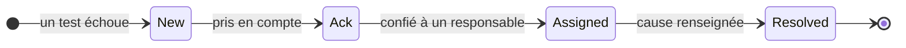
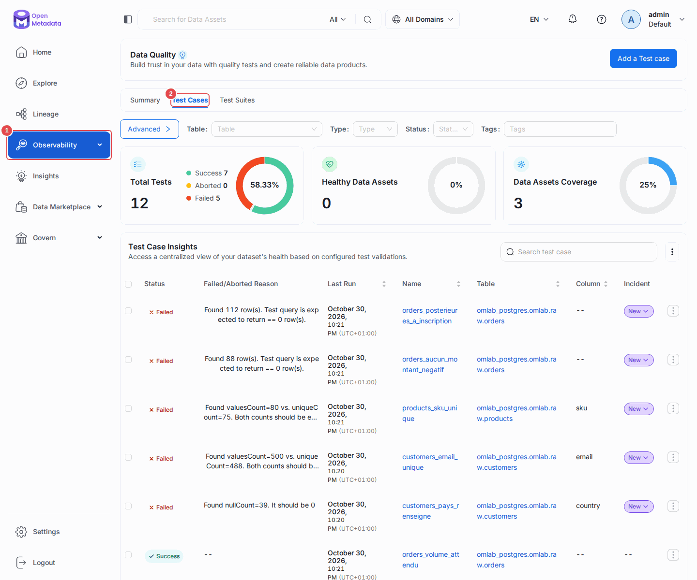
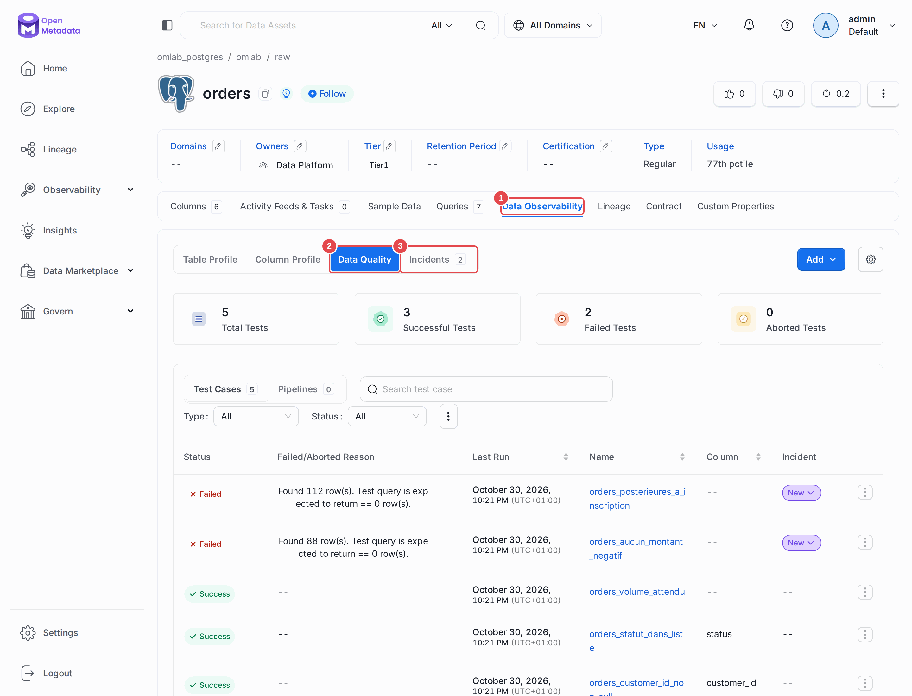
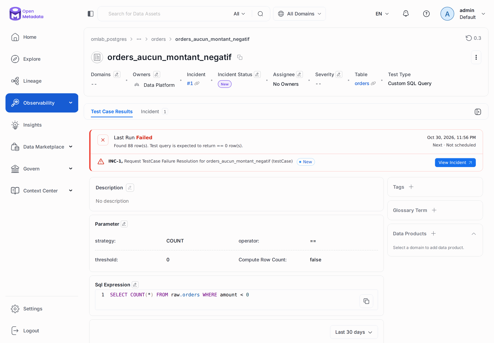
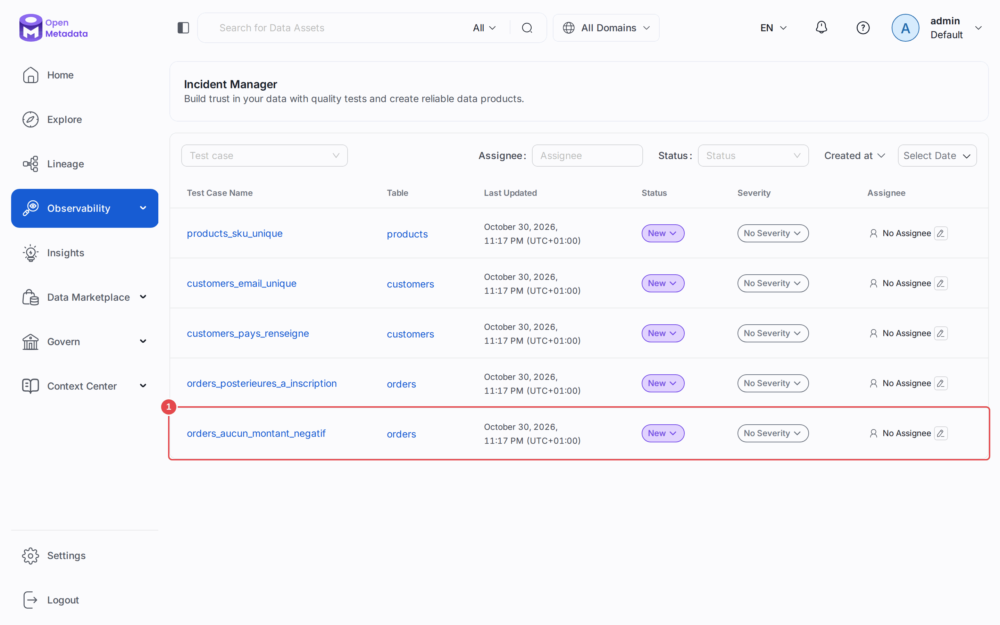
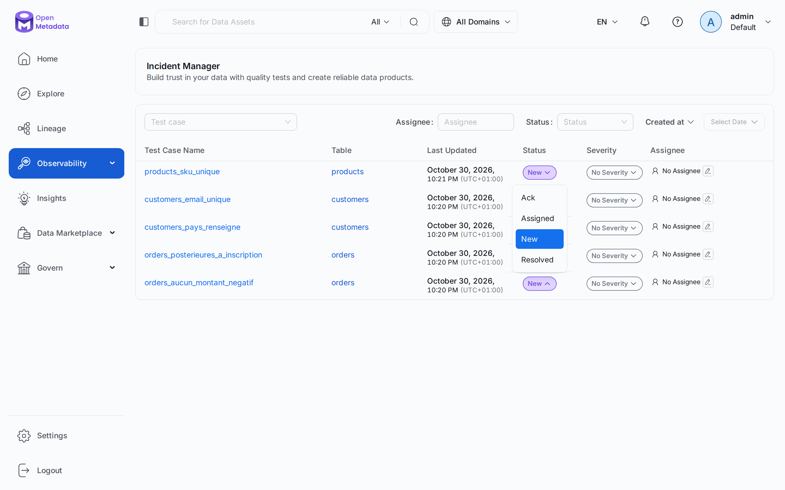

# Chapitre 10 — Qualité de données

> **Objectifs** — Écrire des tests qui échouent pour de bonnes raisons,
> connaître les trois pièges qui produisent des résultats faux et silencieux,
> et savoir traiter un incident.
> **Durée** — 60 minutes. **C'est le chapitre le plus dense du tutoriel.**

---

## 1. Le vocabulaire

| Objet | Ce que c'est |
|---|---|
| **Test definition** | le *type* de test, fourni par OpenMetadata (25 en 2.0) |
| **Test case** | une *instance* : ce type, sur cette colonne, avec ces paramètres |
| **Test suite** | l'ensemble des tests d'une table |
| **Test result** | un résultat horodaté : `Success`, `Failed`, `Aborted` |
| **Incident** | ce qu'ouvre un échec, avec un cycle de vie et un responsable |

Les 25 définitions se répartissent en deux familles : celles qui portent sur
une **colonne** (nulls, unicité, bornes, regex, appartenance à un ensemble) et
celles qui portent sur la **table** (nombre de lignes, de colonnes, présence
d'une colonne, SQL libre, comparaison entre deux tables).

## 2. Trois pièges qui donnent des résultats faux

Ce sont les trois choses qui rendent ce chapitre difficile. Elles ont toutes
été rencontrées en construisant ce tutoriel, et elles ont toutes en commun de
**ne produire aucune erreur** — juste un résultat faux.

### Piège 1 — Les types numériques

Le réflexe naturel :

```yaml
- name: orders_amount_positif
  testDefinitionName: columnValuesToBeBetween
  columnName: amount
```

Et le retour :

```
Test case orders_amount_positif of type columnValuesToBeBetween
is not compatible with column amount of type NUMERIC
```

`amount` est un `numeric(12,2)` Postgres, qu'OpenMetadata mappe sur `NUMERIC`.
Or `columnValuesToBeBetween` accepte `DECIMAL`, `DOUBLE`, `INT` et leurs cousins,
mais pas `NUMERIC`. Sur une colonne `NUMERIC`, seuls **trois** tests sont disponibles :

- `columnValuesToBeNotNull`
- `columnValuesToBeUnique`
- `columnValuesMissingCount`

Pour tout le reste — et donc pour la plupart des montants, taux et prix d'un
entrepôt réel — il faut passer par du SQL libre. Ce n'est pas une lubie du
tutoriel : c'est une contrainte du produit qu'on découvre au pire moment.

Pour connaître les tests applicables à un type donné :

```bash
curl -s -H "Authorization: Bearer $OM_TOKEN" \
  "localhost:8585/api/v1/dataQuality/testDefinitions?entityType=COLUMN&supportedDataType=NUMERIC" \
  | jq '.data[].name'
```

### Piège 2 — `strategy: ROWS` contre `strategy: COUNT`

Ces deux mots ne décrivent pas comment OpenMetadata compte, mais **ce que
votre requête doit renvoyer** :

| Stratégie | Votre requête renvoie | OpenMetadata fait |
|---|---|---|
| `ROWS` (défaut) | les lignes fautives | `len(rows)` |
| `COUNT` | **un seul nombre** | `cursor.scalar()` |

Et voici le piège, tel qu'il s'est produit ici :

```yaml
sqlExpression: "SELECT order_id FROM raw.orders WHERE amount < 0"
strategy: "COUNT"
```

```
Found 13 row(s). Test query is expected to return == 0 row(s).
```

Treize. Alors que la base en contient **88**. Que s'est-il passé ?
`cursor.scalar()` a pris la première valeur de la première ligne — c'est-à-dire
l'`order_id` de la première commande à montant négatif, qui vaut 13. Le test
a échoué, donc on aurait pu ne rien remarquer. Mais le nombre affiché était
un identifiant, pas un décompte.

Sur une table où le défaut est rare, ce même bug produit un test **au vert**
qui masque un vrai problème.

La version correcte :

```yaml
# COUNT : la requête renvoie elle-même le nombre
sqlExpression: "SELECT COUNT(*) FROM raw.orders WHERE amount < 0"
strategy: "COUNT"

# ROWS : la requête renvoie les lignes ; on peut les consulter dans l'UI
sqlExpression: "SELECT o.order_id, o.order_date FROM raw.orders o WHERE ..."
strategy: "ROWS"
```

Préférez `ROWS` quand c'est possible : l'UI peut alors montrer les lignes en
faute, ce qui change tout au moment de corriger.

### Piège 3 — L'échantillonnage

Les tests de colonnes utilisent le moteur d'échantillonnage du profiler, dont
le mode par défaut est **dynamique**. Sur une grosse table, vos tests ne
regardent donc pas toutes les lignes. Pour un contrôle de conformité, imposez-le :

```yaml
profileSampleConfig:
  sampleConfigType: STATIC
  config:
    profileSample: 100
    profileSampleType: PERCENTAGE
```

### Bonus — les test cases survivent au YAML

Un test retiré de votre fichier **n'est pas supprimé** du serveur : il continue
de s'exécuter à chaque passage de la suite. Le YAML crée et met à jour, il ne
supprime jamais. Pour faire le ménage :

```bash
curl -X DELETE -H "Authorization: Bearer $OM_TOKEN" \
  "localhost:8585/api/v1/dataQuality/testCases/<id>?hardDelete=true&recursive=true"
```

## 3. Écrire une suite

[`tp/10-qualite/tests-orders.yaml`](../tp/10-qualite/tests-orders.yaml). Le
workflow n'a **pas** de `serviceConnection` : OpenMetadata connaît déjà la
connexion depuis le chapitre 04 et la relit côté serveur. On ne redonne donc
aucun mot de passe.

```bash
./omlab test tp/10-qualite/tests-orders.yaml
./omlab test tp/10-qualite/tests-customers.yaml
./omlab test tp/10-qualite/tests-products.yaml
```

Résultat sur les douze tests des trois tables :

```
Failed   orders_aucun_montant_negatif      Found 88 row(s). Expected == 0.
Success  orders_customer_id_non_null       Found nullCount=0. It should be 0
Failed   orders_posterieures_a_inscription Found 112 row(s). Expected == 0.
Success  orders_statut_dans_liste          Found countInSet=3000.
Success  orders_volume_attendu             Found rowCount=3000 vs min=2500, max=3500.
Failed   customers_email_unique            valuesCount=500 vs uniqueCount=488
Failed   customers_pays_renseigne          Found nullCount=39. It should be 0
Success  customers_email_bien_forme        500/500 valeurs conformes à la regex
Success  customers_volume_exact            rowCount=500 vs expected 500
Failed   products_sku_unique               valuesCount=80 vs uniqueCount=75
Success  products_categorie_connue         Found countInSet=80.
Success  products_prix_strictement_positif Found 0 row(s). Expected == 0.
```

**Cinq échecs sur douze, et c'est le résultat attendu.** Chacun correspond à
un défaut semé volontairement dans le jeu de données
([`docker/seed/02_data.sql`](../docker/seed/02_data.sql)). Une suite de tests
tout au vert sur des données réelles doit inspirer de la méfiance, pas de la
satisfaction : elle teste probablement des évidences.

Vérifiez d'ailleurs vous-même, c'est l'exercice le plus formateur du chapitre :

```bash
./omlab psql "SELECT count(*) FROM raw.orders WHERE amount < 0"   # 88
./omlab psql "SELECT count(*) FROM raw.customers WHERE country IS NULL"  # 39
```

### Le cas du SKU

`products_sku_unique` mérite un mot. Le SKU n'est pas la clé primaire de
`raw.products` : **rien en base n'empêche les doublons**. Cinq produits
partagent `SKU-00001`, et aucune contrainte ne s'en plaint. C'est le cas
d'école du défaut que seul un test de catalogue peut révéler.

## 4. Incidents

Un test qui échoue ouvre un **incident**, avec un cycle de vie :



Depuis la 2.0, un incident est une **tâche** de catégorie `Incident` : on le retrouve
aussi par `GET /api/v1/tasks` (chapitre 17), et l'ancien module qualité de Data
Insights a disparu au profit de cet écran.

Un incident résolu demande une **cause** : donnée réellement erronée, test mal
calibré, faux positif. C'est ce qui distingue un outil de qualité d'un simple
tableau de bord rouge : la trace de ce qu'on a décidé.

Dans l'UI : **Observability → Incident Manager**, ou la sous-vue **Incidents** de
l'onglet **Data Observability** de la table.

Question à se poser sur `customers_pays_renseigne` : 39 pays manquants, est-ce
un *défaut* ou une *règle métier* ? Si le pays est optionnel à l'inscription,
ce test échouera pour l'éternité et apprendra à tout le monde à ignorer le
rouge. Un test qui échoue en permanence sans que personne n'agisse est pire
qu'un test absent.

## 5. Planifier

En YAML, on planifie avec son ordonnanceur habituel. Depuis l'UI, chaque suite
a son propre calendrier. Trois régimes qui fonctionnent bien :

- **à chaque chargement** — le plus juste, mais suppose une orchestration ;
- **quotidien** — le défaut raisonnable ;
- **avant publication** — sur les tables sous contrat (chapitre 16).

Le coût est celui de vos requêtes : un test de complétude sur une table de
2 milliards de lignes n'est pas gratuit.

## Mode d'emploi : suivre la qualité et traiter un incident

**La vue d'ensemble.** Dans le menu **Observability (1)**, cliquez sur **Data Quality**,
puis sur l'onglet **Test Cases (2)**. Les compteurs montrent 12 tests, dont 5 en échec,
et le tableau donne la raison de chaque échec.



**Depuis une table.** Sur `raw.orders`, l'onglet **Data Observability (1)** propose la
sous-vue **Data Quality (2)** pour ses tests et **Incidents (3)** pour ses incidents.



**Le détail d'un test.** Cliquez sur `orders_aucun_montant_negatif` : la page donne les
paramètres, le SQL exécuté et la courbe des résultats. On y lit le `COUNT` et les 88
lignes du piège n°2.



**Prendre l'incident en charge.** **Observability → Incident Manager** liste les
incidents ouverts. Repérez la ligne de votre test **(1)**.



**Changer son statut.** Cliquez sur le statut `New` de la ligne : le menu propose
`Ack`, `Assigned` et `Resolved`, les états du cycle de vie décrit plus haut. La colonne
**Assignee** désigne le responsable.



---

## TP guidé

```bash
./omlab test tp/10-qualite/tests-orders.yaml
./omlab test tp/10-qualite/tests-customers.yaml
./omlab test tp/10-qualite/tests-products.yaml
```

1. Dans l'UI : **Observability → Data Quality**, vue d'ensemble des douze tests.
2. Ouvrez `raw.orders`, onglet Data Observability, et lisez le détail de
   `orders_aucun_montant_negatif`.
3. Ouvrez l'incident correspondant, passez-le en `Ack` puis assignez-le à
   l'équipe `data_platform`.
4. **Corrigez la donnée et voyez le test passer au vert :**
   ```bash
   ./omlab psql "UPDATE raw.orders SET amount = abs(amount) WHERE amount < 0"
   ./omlab test tp/10-qualite/tests-orders.yaml
   ```
5. Remettez le défaut, sinon les chapitres suivants perdent leur intérêt :
   ```bash
   ./omlab psql "UPDATE raw.orders SET amount = -amount WHERE order_id IN (SELECT order_id FROM raw.orders ORDER BY order_id LIMIT 88)"
   ```

**Vérifier :**

```bash
./omlab check 10
```

```
Chapitre 10 — Qualité de données
  OK   au moins 12 tests sont enregistrés (12)
  OK   orders_aucun_montant_negatif échoue (c'est le comportement attendu)
  OK   customers_pays_renseigne échoue (c'est le comportement attendu)
  OK   products_sku_unique échoue (c'est le comportement attendu)
  OK   orders_volume_attendu passe
  OK   products_categorie_connue passe
```

## Exercices

1. Écrivez un test qui vérifie qu'aucune ligne de `raw.order_items` n'a une
   quantité nulle. *(Rappel : `quantity` est un `int` — vous avez le choix
   entre un test de colonne et du SQL.)*
2. Écrivez un test `tableDiff` qui compare `raw.orders` et
   `analytics.fct_orders` sur `order_id`. Il devrait passer ; cassez-le en
   supprimant une ligne de `fct_orders`.
3. Reproduisez volontairement le piège n°2 : écrivez `SELECT order_id ...`
   avec `strategy: COUNT`, et constatez le résultat faux.
4. Ajoutez un test avec `computePassedFailedRowCount: true` et une stratégie
   `ROWS`, puis consultez les lignes fautives dans l'UI.
5. Créez la même suite depuis l'UI et comparez l'ergonomie des deux approches.

## Pièges & FAQ

**« `Aborted` plutôt que `Failed` ? »**
Le test n'a pas pu s'exécuter : SQL invalide, droits manquants, délai dépassé.
Ce n'est pas un échec de qualité, c'est une panne du test — à traiter
différemment.

**« Comment tester la fraîcheur ? »**
`tableRowInsertedCountToBeBetween` avec `columnName: order_date` et un
`rangeInterval` : « au moins N lignes insérées dans les dernières 24 h ».
C'est le test le plus utile de tous, et le plus souvent oublié.

**« Peut-on tester entre deux bases ? »**
`tableDiff` sait comparer deux tables de services différents. C'est l'outil
d'une migration : on compare l'ancien et le nouveau système.

## Pour aller plus loin

- [Qualité de données](https://docs.open-metadata.org/v2.0.x/how-to-guides/data-quality-observability/quality)
- [Les 25 définitions de tests](https://docs.open-metadata.org/v2.0.x/how-to-guides/data-quality-observability/quality/tests-yaml)

---

**Précédent :** [09 — Sécurité](09-teams-roles-policies.md) ·
**Suivant :** [11 — Lineage manuel](11-lineage-manuel-colonne.md)
