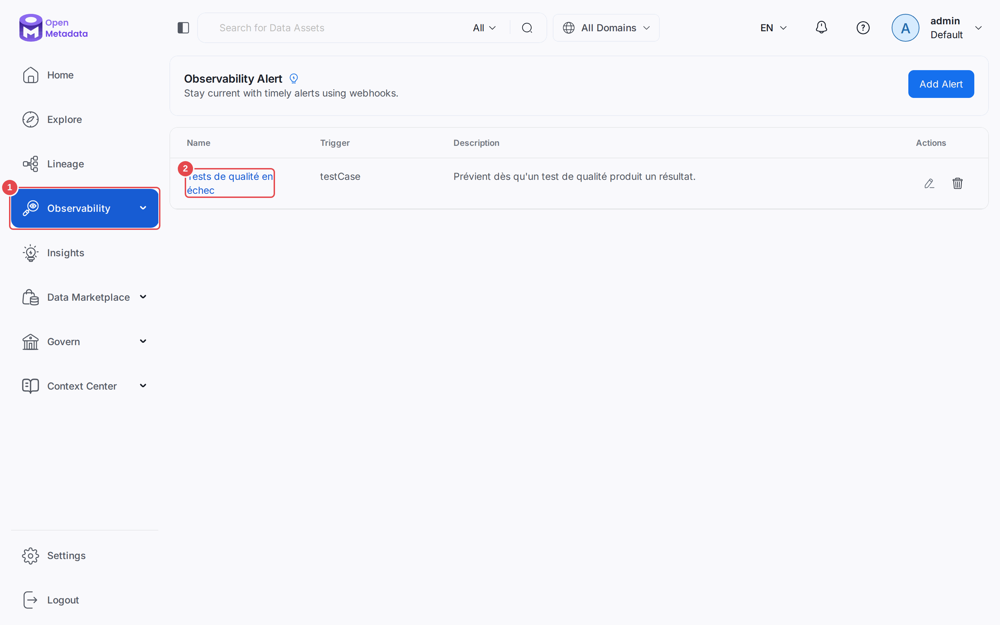
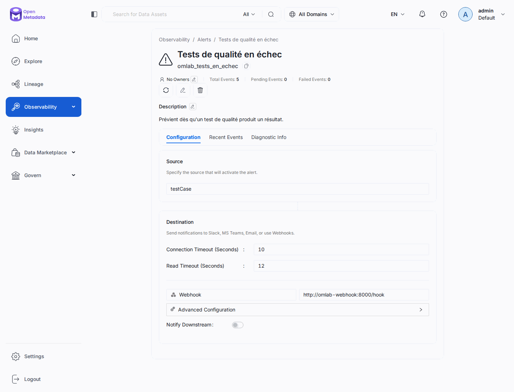
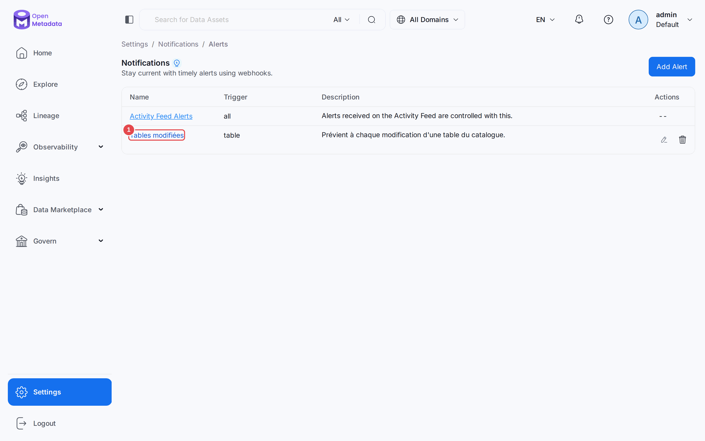
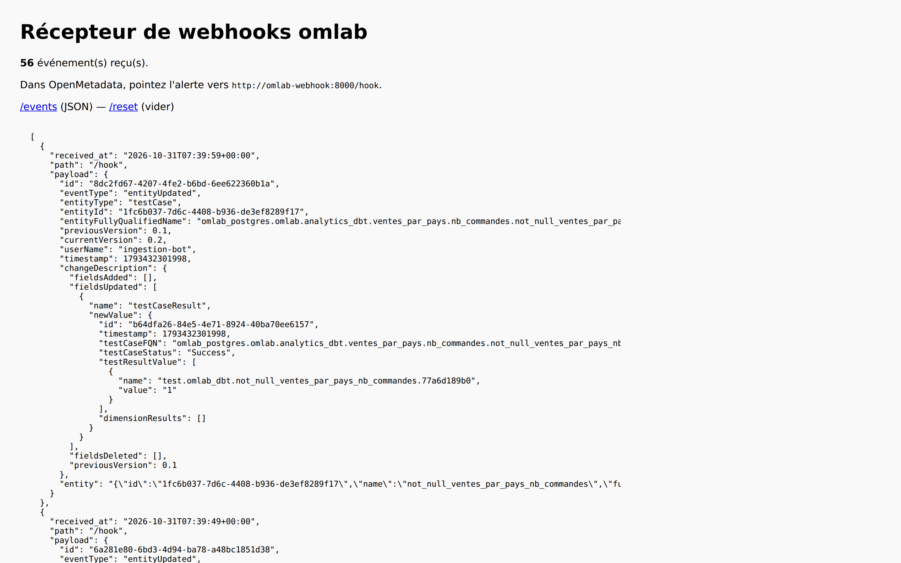

# Chapitre 12 — Alertes, notifications et webhooks

> **Objectifs** — Faire en sorte que le catalogue vienne vous chercher, plutôt
> que d'attendre qu'on le consulte. Voir passer une vraie charge utile.
> **Durée** — 35 minutes.

---

## 1. Inverser le sens

Un catalogue est passif : il attend qu'on l'ouvre. Les alertes inversent la
relation — c'est OpenMetadata qui prévient quand un test échoue, quand un
schéma change, quand une table critique perd son propriétaire.

C'est ce qui transforme un annuaire en outil d'exploitation.

## 2. Anatomie d'une alerte

Quatre éléments, dans l'ordre où le serveur les lit :

| Élément | Rôle |
|---|---|
| `alertType` | `Notification` (événements du catalogue) ou `Observability` (tests, fraîcheur) |
| `resources` | sur quel type d'entité on écoute : `table`, `testCase`, `pipeline`… |
| `input` | les filtres, sous forme de fonctions nommées avec arguments |
| `destinations` | où envoyer |

### Le champ qui piège

L'API **renvoie** un champ `filteringRules` très détaillé, avec des conditions
écrites façon SpEL. On a naturellement envie de le renvoyer tel quel en
écriture. Ça ne marche pas :

```
HTTP 400 — {"code":400,"message":"Invalid request format"}
```

`filteringRules` est **calculé** par le serveur à partir de `input`. En
écriture, on fournit `input` (une liste de filtres nommés) et `resources` au
niveau racine. Le message d'erreur ne le dit à aucun moment.

### Les destinations

| Catégorie | Types |
|---|---|
| `External` | `Webhook`, `Slack`, `MsTeams`, `GChat`, `Email` |
| Interne | `Owners`, `Teams`, `Users`, `Admins`, `Followers`, `Mentions`, `Assignees` |

Les destinations internes sont les plus intéressantes et les moins utilisées :
**« prévenir les propriétaires de l'entité concernée »**, sans avoir à savoir
qui c'est. L'alerte suit le propriétaire quand il change.

## 3. Le récepteur de test

Le projet embarque un petit serveur HTTP
([`scripts/webhook_server.py`](../scripts/webhook_server.py)) qui journalise
tout ce qu'il reçoit :

- vu depuis OpenMetadata : `http://omlab-webhook:8000/hook`
- vu depuis votre navigateur : `http://localhost:8010/`

Rien ne remplace la lecture d'une vraie charge utile. La documentation décrit
les champs ; le récepteur montre ce qui arrive réellement.

## 4. Créer les alertes

```bash
./omlab py tp/12-alertes/creer_alerte.py
```

```
  alerte omlab_tests_en_echec     -> http://omlab-webhook:8000/hook
  alerte omlab_tables_modifiees   -> http://omlab-webhook:8000/hook
```

Les deux alertes sont créées **sans filtre** : tous les événements du type
choisi passent. C'est volontaire — l'affinage se fait très bien dans l'UI, qui
propose la liste des filtres disponibles pour chaque ressource, alors que
l'API demande de connaître leurs noms exacts.

## 5. Déclencher et lire

```bash
./omlab psql "ALTER TABLE raw.products ADD COLUMN poids_kg numeric(6,3)"
./omlab ingest tp/04-ingestion/metadata.yaml
./omlab test tp/10-qualite/tests-orders.yaml
```

Une vingtaine de secondes plus tard (le serveur dépile par lots) :

```bash
./omlab py tp/12-alertes/lire_evenements.py
```

```
8 événement(s) reçu(s)

--- 2026-08-05T10:21:23+00:00 ---
  eventType  : entityUpdated
  entityType : testCase
  entityFQN  : omlab_postgres.omlab.raw.orders.orders_aucun_montant_negatif
  userName   : ingestion-bot
    champ modifié : testCaseResult
```

Les champs qui comptent dans une charge utile :

| Champ | Usage |
|---|---|
| `eventType` | `entityCreated`, `entityUpdated`, `entityDeleted`, `entitySoftDeleted` |
| `entityType`, `entityFullyQualifiedName` | quelle entité |
| `userName` | qui — utile pour ignorer les bots |
| `changeDescription` | **ce qui a changé**, champ par champ |
| `entity` | l'entité complète après modification |

`changeDescription` est le champ à exploiter : c'est lui qui permet de
distinguer « quelqu'un a corrigé une faute de frappe » de « une colonne a
disparu ».

N'oubliez pas de remettre la table en état :

```bash
./omlab psql "ALTER TABLE raw.products DROP COLUMN poids_kg"
./omlab ingest tp/04-ingestion/metadata.yaml
```

## 6. Que faut-il vraiment surveiller

La tentation est d'alerter sur tout. Le résultat garanti est que plus personne
ne lit les alertes au bout de deux semaines.

Une base de départ raisonnable :

| Événement | Destinataire | Pourquoi |
|---|---|---|
| Test en échec sur une table `Tier1` | propriétaires | ça casse la production |
| Schéma modifié sur une table `Tier1` | propriétaires + consommateurs en aval | ça casse chez les autres |
| Table supprimée | admins | irréversible |
| Propriétaire retiré | gouvernance | crée un orphelin |

Et surtout : **filtrer par criticité**. Une alerte sur les 4 000 tables du
catalogue est un bruit de fond ; une alerte sur les 30 tables Tier1 est un
signal.

## Mode d'emploi : retrouver ses alertes

Les deux alertes du TP ne sont **pas au même endroit**, parce qu'elles n'ont pas le
même `alertType`.

**Les alertes `Observability`.** Dans le menu **Observability (1)**, cliquez sur
**Alerts** : `omlab_tests_en_echec` y apparaît sous son titre **(2)**.



**Le détail d'une alerte.** Cliquez sur son titre. L'onglet **Configuration** montre la
source et la destination, **Recent Events** ce qui a été envoyé. Le crayon en haut de
page ouvre l'édition, c'est-à-dire l'ajout de filtres et de destinations.



**Les alertes `Notification`.** *Settings → Notifications* contient l'autre,
`omlab_tables_modifiees` **(1)**, à côté des *Activity Feed Alerts* fournies d'origine.



**Le récepteur.** http://localhost:8010/ affiche les charges utiles reçues, les plus
récentes d'abord.



---

## TP guidé

```bash
./omlab py tp/12-alertes/creer_alerte.py
./omlab test tp/10-qualite/tests-orders.yaml
./omlab py tp/12-alertes/lire_evenements.py
```

1. Ouvrez http://localhost:8010/ dans votre navigateur : la charge utile
   complète y est affichée en JSON.
2. Dans l'UI : **Observability → Alerts**, ouvrez `omlab_tests_en_echec`. Pour
   voir comment le serveur a traduit votre `input`, lisez `filteringRules` par
   l'API : `GET /api/v1/events/subscriptions/name/omlab_tests_en_echec`.
3. **Ajoutez un filtre depuis l'UI** (crayon de l'alerte) pour ne garder que les
   tests au statut `Failed`. Relancez la suite et comptez les événements reçus.
4. Ajoutez une seconde destination de type `Owners`.
5. Videz le récepteur : http://localhost:8010/reset

**Vérifier :**

```bash
./omlab check 12
```

```
Chapitre 12 — Alertes
  OK   les deux alertes du TP existent
```

## Exercices

1. Créez une alerte qui ne se déclenche que sur les tables `Tier.Tier1`.
2. Créez une alerte sur la suppression d'entités, destinée aux admins.
3. Modifiez `webhook_server.py` pour qu'il n'affiche que les événements dont
   `changeDescription` contient `columns` — un détecteur de rupture de schéma
   en vingt lignes.
4. Branchez une alerte sur un vrai Slack (il faut une URL de webhook entrante).

## Pièges & FAQ

**« Je ne reçois rien. »**
Dans l'ordre : l'alerte est-elle `enabled` ? L'URL est-elle celle vue **depuis
le conteneur serveur** (`omlab-webhook:8000`, pas `localhost:8010`) ? Avez-vous
attendu le `pollInterval` ? Le récepteur tourne-t-il
(`./omlab logs omlab-webhook`) ?

**« Trop d'événements. »**
C'est le mode par défaut sans filtre. Filtrez par criticité, par équipe
propriétaire, ou excluez les bots — l'ingestion en génère beaucoup.

**« Les alertes remplacent-elles un outil de supervision ? »**
Non. Elles portent sur les **métadonnées** (schéma, qualité, propriété), pas
sur l'infrastructure. Elles complètent une supervision, ne la remplacent pas.

## Pour aller plus loin

- [Alertes et notifications](https://docs.open-metadata.org/v1.13.x/how-to-guides/admin-guide/alerts)

---

**Précédent :** [11 — Lineage manuel](11-lineage-manuel-colonne.md) ·
**Suivant :** [13 — L'API REST](13-api-rest.md)
