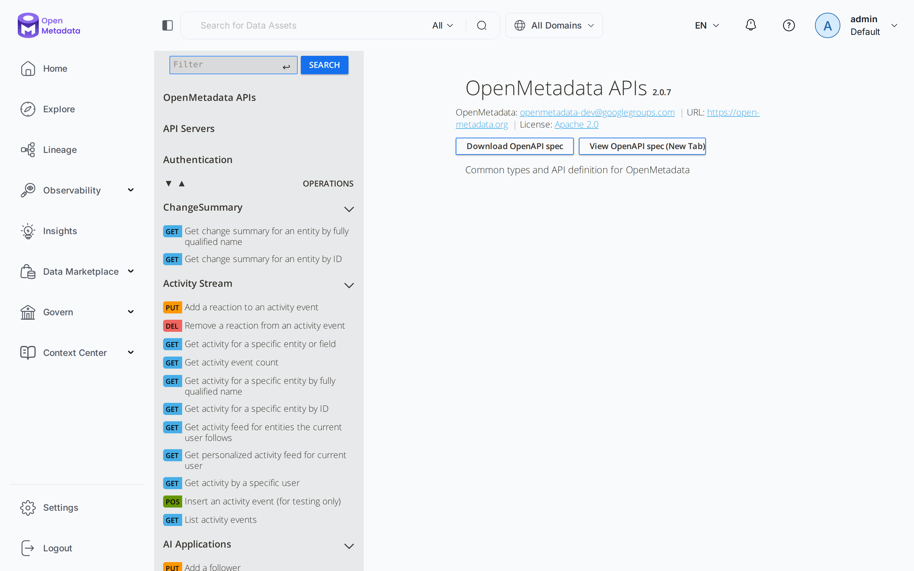

# Chapitre 13 — L'API REST

> **Objectifs** — Savoir tout faire sans SDK ni UI. C'est le chapitre qui vous
> débloque quand rien d'autre ne marche.
> **Durée** — 40 minutes.

---

## 1. Pourquoi apprendre l'API

L'UI appelle cette API. Le SDK Python aussi. Les workflows d'ingestion aussi.
Tout passe par là.

La connaître sert trois fois : quand le SDK ne couvre pas un endpoint, quand
il faut intégrer OpenMetadata depuis un langage sans SDK, et — surtout — quand
il faut comprendre pourquoi quelque chose ne marche pas.

Cinq idées suffisent à s'en servir.

## 2. S'authentifier

```bash
export OM_TOKEN=$(grep OM_TOKEN .env | cut -d= -f2)
curl -s -H "Authorization: Bearer $OM_TOKEN" \
  localhost:8585/api/v1/users/me | jq '{name, isBot}'
```

```json
{ "name": "ingestion-bot", "isBot": true }
```

Un jeton de bot pour l'automatisation, un jeton de session pour l'humain :
c'est le rappel du chapitre 02.

## 3. Lire — et le rôle de `fields`

Deux façons d'atteindre une entité :

```bash
GET /api/v1/tables/name/omlab_postgres.omlab.raw.products    # par FQN
GET /api/v1/tables/{uuid}                                    # par UUID
```

Et surtout, le paramètre qui change tout :

```
=== 1. GET, avec et sans `fields` ===
  sans fields : 21 clés
  avec fields : 25 clés
  champs gagnés : ['followers', 'owners', 'tags', 'usageSummary']
  colonnes déjà là sans les demander ? True
```

Deux enseignements dans ces quatre lignes.

**`columns` fait partie du socle** renvoyé d'office pour une table. En
revanche `tags`, `owners`, `usageSummary` et `profile` sont des jointures
coûteuses, absentes tant qu'on ne les demande pas.

**Le corollaire pique.** `?fields=columns` renvoie bien les colonnes, mais
avec une liste `tags` **vide** — pas parce qu'elles n'ont pas d'étiquettes,
mais parce que vous ne les avez pas demandées. On croit alors que les
étiquettes ont été effacées. Il faut `?fields=columns,tags`. Ce faux
diagnostic est très courant, et il a coûté un aller-retour pendant la
construction de ce tutoriel.

## 4. Écrire — PUT contre PATCH

| | PUT | PATCH |
|---|---|---|
| Corps | l'entité **entière** | la liste des modifications |
| Champ oublié | **effacé** | intact |
| Travail concurrent | écrasé | préservé |
| Format | JSON | JSON Patch, RFC 6902 |
| `Content-Type` | `application/json` | `application/json-patch+json` |

En dehors de la création, **utilisez PATCH**. Un PUT sur une entité qu'on n'a
pas relue intégralement est une perte de données en attente.

```bash
curl -X PATCH \
  -H "Authorization: Bearer $OM_TOKEN" \
  -H "Content-Type: application/json-patch+json" \
  -d '[{"op":"replace","path":"/description","value":"Nouvelle description"}]' \
  localhost:8585/api/v1/tables/{uuid}
```

Les opérations utiles : `add`, `replace`, `remove`. Le `-` dans un chemin
signifie « à la fin du tableau » :

```json
[{"op": "add", "path": "/tags/-", "value": {"tagFQN": "Tier.Tier1", "source": "Classification"}}]
[{"op": "add", "path": "/columns/3/tags/-", "value": {...}}]
[{"op": "remove", "path": "/owners/0"}]
```

### L'écriture inutile ne coûte rien

Lancez deux fois le TP de suite. Le premier passage crée une version, le second non :

```
=== 2. PATCH : ne toucher qu'un champ ===
  version     : 0.2 -> 0.3      (premier passage)
  version     : 0.3 -> 0.3      (second passage)
```

Un patch qui réécrit la valeur déjà présente **n'incrémente pas la version**
et ne pollue pas l'historique. Propriété précieuse : un script de
documentation rejoué tous les jours ne crée pas 365 versions identiques.

Les modifications rapprochées d'un même auteur sont aussi regroupées dans une seule
version. Sous `./omlab demo`, qui enchaîne les étapes, le premier passage affiche donc
`0.2 -> 0.2` : attendez une dizaine de minutes pour voir la version monter.

## 5. L'historique

```
=== 3. Historique ===
  3 version(s) enregistrée(s)
    v0.3 par ingestion-bot  champs=['description']
    v0.2 par ingestion-bot  champs=['description', 'tags']
    v0.1 par ingestion-bot  champs=[]
```

```
GET /api/v1/tables/{id}/versions            liste
GET /api/v1/tables/{id}/versions/0.2        un état précis
```

La granularité peut descendre jusqu'à l'étiquette d'une colonne, sous la forme
`columns.<colonne>.tags` : OpenMetadata trace le changement champ par champ. C'est ce qui alimente l'onglet
Versions de l'UI, et ce qui permet de répondre à « qui a retiré cette
étiquette, et quand ? ».

## 6. Chercher — un autre moteur

```bash
GET /api/v1/search/query?q=commande&index=table_search_index&size=5
```

```
=== 4. Recherche (Elasticsearch, pas la base) ===
  2 résultat(s) pour « commande » :
      0.60  omlab_postgres.omlab.analytics.fct_orders
      0.60  omlab_postgres.omlab.raw.order_items
```

`/tables` interroge Postgres : exact, lent à filtrer, immédiatement à jour.
`/search/query` interroge Elasticsearch : rapide, avec un score de pertinence,
et **asynchrone**. Une entité créée à l'instant est lisible par FQN mais peut
manquer à l'appel dans la recherche pendant quelques secondes.

Les index disponibles : `table_search_index`, `dashboard_search_index`,
`glossary_term_search_index`, `all` (tous à la fois).

Pour un filtrage précis, `query_filter` accepte du DSL Elasticsearch :

```
GET /api/v1/search/query?q=*&index=table_search_index
    &query_filter={"query":{"term":{"columns.tags.tagFQN":"Commerce.ChiffreAffaires"}}}
```

C'est ce qu'utilise le TP du chapitre 07 pour retrouver tous les assets d'un
terme.

## 7. Paginer

```
=== 5. Pagination par curseur ===
  page 1 : ['campagnes', 'customers', 'dim_customer', 'employees']
  page 2 : ['fct_orders', 'objectifs_2026', 'order_items', 'orders']
  total  : 12 tables
```

Pas d'`offset` : un **curseur opaque**.

```bash
GET /api/v1/tables?limit=100
GET /api/v1/tables?limit=100&after=<paging.after>
```

Le curseur garantit qu'une entité créée pendant le parcours ne décale pas
toute la pagination — ce qui, avec un offset, ferait sauter ou dupliquer des
lignes sur un gros catalogue.

## Mode d'emploi : le Swagger

http://localhost:8585/docs ouvre la référence de **votre** version, dans l'interface
elle-même. Le menu de gauche classe les routes par entité, et le champ **Filter** les
retrouve par nom.



---

## TP guidé

```bash
./omlab py tp/13-api/tour_api.py
```

Puis en ligne de commande :

```bash
export OM_TOKEN=$(grep OM_TOKEN .env | cut -d= -f2)
BASE=localhost:8585/api/v1

curl -s -H "Authorization: Bearer $OM_TOKEN" "$BASE/users/me" | jq '{name,isBot}'
curl -s -H "Authorization: Bearer $OM_TOKEN" \
  "$BASE/tables/name/omlab_postgres.omlab.raw.orders?fields=columns,tags,owners" \
  | jq '{name, description, owners: [.owners[]?.displayName]}'
curl -s -H "Authorization: Bearer $OM_TOKEN" \
  "$BASE/search/query?q=revenue&index=table_search_index&size=3" \
  | jq '.hits.hits[]._source.fullyQualifiedName'
```

1. Récupérez une table sans `fields`, puis avec, et comparez `jq 'keys'`.
2. Modifiez une description par PATCH, puis relisez l'historique.
3. Parcourez toutes les tables par pagination.

## Exercices

1. Écrivez un script bash qui liste toutes les tables sans propriétaire.
2. Ajoutez `Tier.Tier2` à trois tables en un seul patch chacune.
3. Retrouvez la version 0.1 d'une table et comparez-la à l'actuelle.
4. Utilisez `query_filter` pour lister les tables portant `PII.Sensitive`.
5. Créez un service de base de données **entièrement** par l'API
   (`POST /api/v1/services/databaseServices`) et retrouvez-le dans l'UI.

## Pièges & FAQ

**« Où est la documentation de l'API ? »**
Elle est servie par votre instance : http://localhost:8585/docs (Swagger).
C'est la référence exacte de **votre** version — préférez-la toujours à la
documentation en ligne, qui peut décrire une autre version.

**« 400 Invalid request format, sans détail. »**
C'est la réponse standard à une validation Pydantic ratée. Causes fréquentes :
un nom d'opération inexistant (chapitre 09), un champ calculé renvoyé en
écriture (chapitre 12), un enum mal orthographié. Comparez votre corps de
requête avec ce que renvoie un `GET` sur un objet équivalent.

**« Pourquoi une apostrophe devient-elle `&#39;` ? »**
Le serveur stocke les descriptions échappées : `GET` renvoie `Chiffre
d&#39;affaires`, même si l'UI affiche bien `Chiffre d'affaires`. Un script qui
compare du texte doit d'abord déséchapper, avec `html.unescape` en Python.

**« Peut-on tout faire par l'API ? »**
Oui. L'UI n'a aucun privilège particulier : tout ce qu'elle affiche ou modifie
passe par ces mêmes routes. Ouvrez les outils de développement du navigateur
pour voir quel appel correspond à quel écran — c'est la meilleure façon de
découvrir un endpoint.

## Pour aller plus loin

- Swagger de votre instance : http://localhost:8585/docs
- [Référence de l'API](https://docs.open-metadata.org/v2.0.x/api-reference)

---

**Précédent :** [12 — Alertes](12-alertes-webhooks.md) ·
**Suivant :** [14 — Le SDK Python](14-sdk-python.md)
