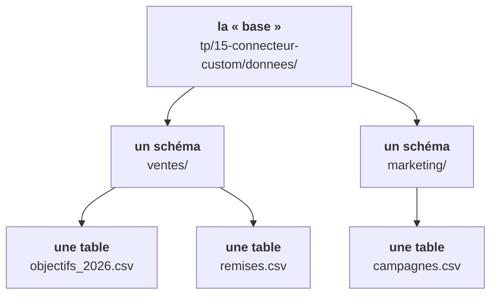
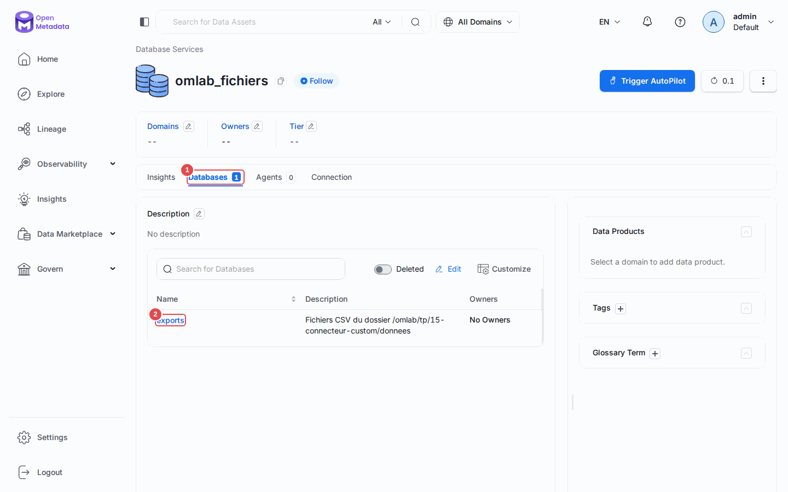
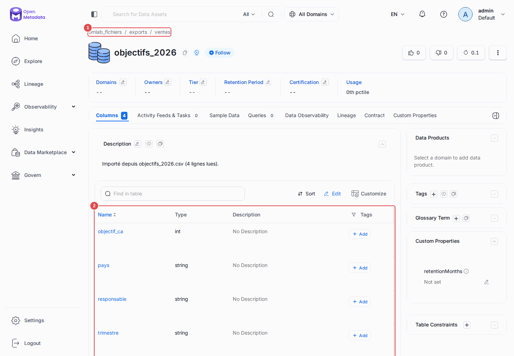

# Chapitre 15 — Écrire son propre connecteur

> **Objectifs** — Cataloguer un système qu'OpenMetadata ne connaît pas, en
> écrivant une classe Python d'une centaine de lignes.
> **Durée** — 50 minutes.

---

## 1. Quand on en arrive là

OpenMetadata parle à une centaine de systèmes. Il en restera toujours un qui
manque : un entrepôt interne, un vieux système propriétaire, un dépôt de
fichiers avec ses conventions maison, une API métier.

Le **Custom Database Connector** est la porte de sortie : vous écrivez une
classe, OpenMetadata l'exécute exactement comme un connecteur officiel — même
workflow, même sink, même gestion d'erreurs.

Il existe aussi un générateur de squelette pour contribuer un vrai connecteur
au projet (`metadata scaffold-connector --help`). Ce chapitre prend la voie
légère : celle qui reste dans votre dépôt.

## 2. Ce qu'on va cataloguer

Un dossier de CSV, présenté comme une base de données :



Les colonnes viennent de l'en-tête du fichier, les types sont devinés à la
lecture des premières lignes.

## 3. L'anatomie d'un connecteur

Le code est dans [`lib/csv_connector.py`](../lib/csv_connector.py).

> **Pourquoi dans `lib/` et pas dans `tp/15-connecteur-custom/` ?** Parce
> qu'OpenMetadata importe votre classe par son chemin de module Python, et
> qu'un tiret dans un nom de dossier casse l'import. `lib.csv_connector`
> fonctionne, `tp.15-connecteur-custom.csv_connector` non.

Un connecteur est un **générateur**. Sa seule obligation est de produire, dans
l'ordre, des requêtes de création d'entités.

```python
class CsvFolderSource(Source):

    @classmethod
    def create(cls, config_dict, metadata, pipeline_name=None):
        """Le framework passe le YAML brut ; on le revalide en objet typé."""

    def prepare(self):
        """Appelé une fois avant le parcours. On y vérifie l'accès."""

    def test_connection(self):
        """Ce que fait le bouton « Test Connection » de l'UI."""

    def _iter(self):
        """Le cœur : un générateur d'entités."""

    def close(self):
        """Fermeture des connexions, sessions, fichiers."""
```

### L'ordre compte

```python
yield Either(right=CreateDatabaseRequest(...))        # 1. la base
yield Either(right=CreateDatabaseSchemaRequest(...))  # 2. les schémas
yield Either(right=CreateTableRequest(...))           # 3. les tables
```

On ne peut pas créer un schéma avant sa base. Le framework n'ordonne rien pour
vous.

### `Either` : réussir ou signaler sans tout arrêter

```python
try:
    yield Either(right=self._table(fichier, schema_fqn))
except Exception as exc:
    yield Either(left=StackTraceError(
        name=fichier.name,
        error=f"Lecture impossible de {fichier}: {exc}",
        stackTrace=traceback.format_exc(),
    ))
```

Un `Either(left=...)` signale une erreur **sans interrompre le workflow** :
les autres fichiers seront traités, et l'erreur remonte dans le résumé final.
C'est le comportement qu'on veut sur un système réel, où un fichier corrompu
ne doit pas bloquer les 999 autres.

### Les paramètres libres

Tout ce dont votre connecteur a besoin passe par `connectionOptions`, un
dictionnaire non typé :

```yaml
connectionOptions:
  directory: /omlab/tp/15-connecteur-custom/donnees
  databaseName: exports
```

```python
options = config.serviceConnection.root.config.connectionOptions
options = options.root if options else {}
self.racine = Path(str(options.get("directory", "/omlab/donnees_csv")))
```

Non typé signifie : **c'est à vous de valider**. Un `directory` absent ou faux
doit produire un message clair, pas une trace de pile.

### Le piège qui coûte une heure

Les connecteurs officiels bénéficient d'une mécanique interne qui crée le
**service** à leur place. Un connecteur maison n'en profite **pas**. Sans ces
lignes dans `prepare()` :

```python
service = self.metadata.get_by_name(entity=DatabaseService, fqn=self.service_name)
if service is None:
    self.metadata.create_or_update(CreateDatabaseServiceRequest(
        name=self.service_name,
        serviceType=DatabaseServiceType.CustomDatabase,
        connection=self.config.serviceConnection.root,
    ))
```

…le workflow affiche fièrement :

```
Workflow Success %: 100.0
```

puis, juste après :

```
Failed to flush entities to bulk API:
  message='databaseService instance for omlab_fichiers not found' status=400
```

Six entités produites, zéro écrite, et un résumé qui annonce 100 % de succès.
Le sink échoue **après** le calcul du résumé. Retenez la leçon générale :
sur ce produit, **lisez toujours les lignes qui suivent le résumé**.

## 4. Faire tourner

[`tp/15-connecteur-custom/csv.yaml`](../tp/15-connecteur-custom/csv.yaml) :

```yaml
source:
  type: customDatabase
  serviceName: omlab_fichiers
  serviceConnection:
    config:
      type: CustomDatabase
      sourcePythonClass: lib.csv_connector.CsvFolderSource
      connectionOptions:
        directory: /omlab/tp/15-connecteur-custom/donnees
        databaseName: exports
```

```bash
./omlab ingest tp/15-connecteur-custom/csv.yaml
```

```
Processed records: 6
Errors: 0
Workflow Success %: 100.0
```

Deux conditions pour qu'OpenMetadata trouve votre classe :

1. elle doit être **importable depuis le conteneur d'ingestion** — le dépôt est
   monté sur `/omlab` et `./omlab` pose `PYTHONPATH=/omlab` ;
2. son chemin de module ne doit contenir **ni tiret ni chiffre initial**.

Le résultat :

```
omlab_fichiers.exports.ventes.objectifs_2026     (pays, trimestre, objectif_ca, responsable)
omlab_fichiers.exports.ventes.remises            (code_remise, taux, actif)
omlab_fichiers.exports.marketing.campagnes       (campagne, budget, canal, leads)
```

Les types devinés : `objectif_ca` → `INT`, `taux` → `DOUBLE`, le reste →
`STRING`. Notez que `actif` (`true`/`false`) est tombé en `STRING` : la
détection est volontairement rudimentaire, c'est un des exercices.

## 5. Ce que ce connecteur ne fait pas

Il se limite aux métadonnées. Pour aller plus loin, il faudrait implémenter :

- le **profiling** : fournir une interface de sampler ;
- le **lineage** : produire des `AddLineageRequest` ;
- les **tests de qualité** : exposer un moteur d'exécution SQL.

Chacun est un travail supplémentaire. La bonne question avant de se lancer :
*ai-je besoin du catalogue, ou de toute la chaîne ?* Dans neuf cas sur dix,
cataloguer suffit.

## Mode d'emploi : le connecteur vu de l'interface

**Le service.** *Settings → Services → Databases → omlab_fichiers*. Pour l'interface,
c'est un service comme un autre : l'onglet **Databases (1)** liste la base `exports`
**(2)**, avec la description produite par le connecteur.



**Une table issue d'un CSV.** Le fil d'Ariane **(1)** reprend la hiérarchie
base / dossier, et le tableau **(2)** les colonnes lues dans l'en-tête, avec leur type
deviné.



---

## TP guidé

```bash
./omlab ingest tp/15-connecteur-custom/csv.yaml
```

1. Dans l'UI, ouvrez le service `omlab_fichiers` et parcourez la hiérarchie.
2. Ouvrez `objectifs_2026` : les colonnes et leurs types sont là, avec la
   description générée par le connecteur.
3. **Ajoutez un fichier** et réingérez :
   ```bash
   printf 'region,vendeur,ca\nNord,Camille,42000\nSud,Louis,38500\n' \
     > tp/15-connecteur-custom/donnees/ventes/par_region.csv
   ./omlab ingest tp/15-connecteur-custom/csv.yaml
   ```
4. **Provoquez une erreur isolée** : créez un fichier vide
   (`touch tp/15-connecteur-custom/donnees/ventes/vide.csv`), réingérez, et
   vérifiez que les autres fichiers passent quand même.

**Vérifier :**

```bash
./omlab check 15
```

```
Chapitre 15 — Connecteur maison
  OK   le service omlab_fichiers existe
  OK   les 3 CSV sont catalogués
```

## Exercices

1. Améliorez `deviner_type()` : reconnaissez les booléens (`true`/`false`) et
   les dates ISO.
2. Faites du nom de fichier une description plus riche : nombre de lignes
   total, date de dernière modification.
3. Ajoutez une option `tagPrefix` qui étiquette automatiquement toutes les
   tables d'un sous-dossier.
4. Produisez du **lineage** : si un CSV s'appelle `export_<table>.csv`,
   déclarez une arête depuis la table Postgres correspondante.
5. Écrivez un connecteur pour un système que vous utilisez vraiment (une API
   REST interne, un dossier de fichiers Parquet).

## Pièges & FAQ

**« `ModuleNotFoundError: No module named 'lib'` »**
`PYTHONPATH` n'est pas posé, ou le dépôt n'est pas monté. Vérifiez avec
`docker compose exec ingestion ls /omlab`.

**« Le workflow dit 100 % mais rien n'apparaît. »**
Le service n'existe pas. Voir le piège de la section 3 — et prenez l'habitude
de lire ce qui s'affiche **après** le résumé.

**« Comment déboguer ? »**
`loggerLevel: DEBUG` dans le YAML, et des `logger.info()` dans votre code.
Vous pouvez aussi instancier votre classe directement dans un script lancé par
`./omlab py`, sans passer par le workflow — plus rapide pour itérer.

**« Faut-il contribuer mon connecteur au projet ? »**
Si le système est répandu, oui : `metadata scaffold-connector` génère la
structure attendue. Si c'est un système interne, gardez-le chez vous.

## Pour aller plus loin

- [Connecteur personnalisé](https://docs.open-metadata.org/v1.13.x/connectors/custom-connectors)

---

**Précédent :** [14 — SDK Python](14-sdk-python.md) ·
**Suivant :** [16 — Contrats, exploitation et projet final](16-contracts-ops-projet-final.md)
