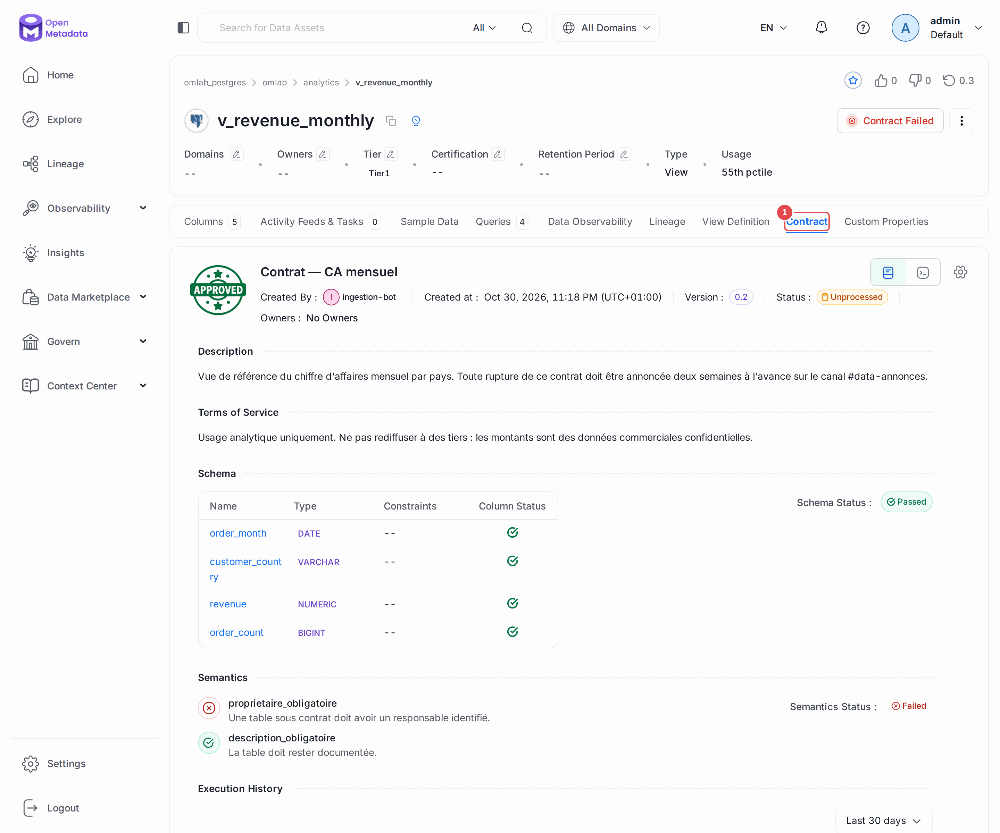
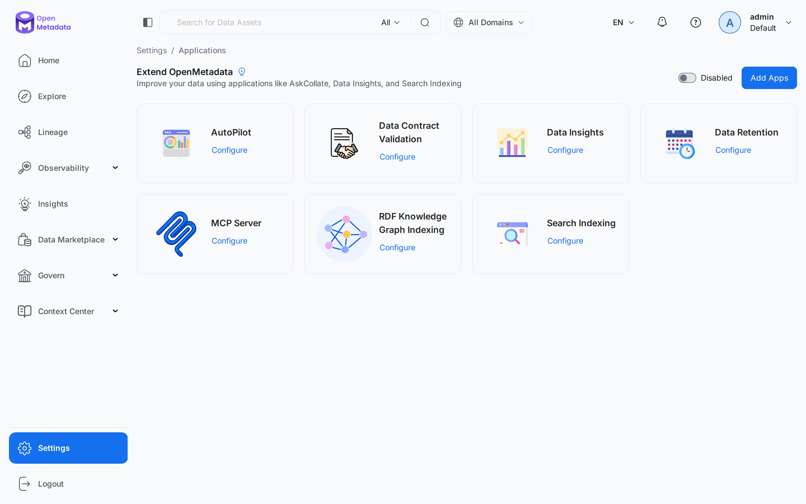

# Chapitre 16 — Contrats de données, exploitation, projet final

> **Objectifs** — Formaliser un engagement de service, savoir exploiter
> OpenMetadata en production, puis mettre en pratique les quinze chapitres sur
> un cas complet.
> **Durée** — 40 minutes de cours, 1 h 30 de projet final.

---

## Partie A — Les contrats de données

### 1. Ce qu'un contrat ajoute aux tests

Les tests du chapitre 10 disent *si les données sont conformes*. Un contrat
dit *sur quoi le producteur s'engage* — et l'engagement est publié côté
consommateur.

La différence est organisationnelle, pas technique. Quand un test échoue,
c'est un incident. Quand un contrat est rompu, c'est un manquement à un
engagement, avec un responsable identifié et des conditions d'usage écrites.

Un contrat rassemble quatre choses en un objet versionné :

| Élément | Ce qu'il engage |
|---|---|
| `schema` | les colonnes promises, avec leur type |
| `semantics` | des règles sur les **métadonnées** (a un propriétaire, est documentée) |
| `qualityExpectations` | les tests qui font foi |
| `termsOfUse`, `owners`, `effectiveFrom` | le cadre : qui, depuis quand, pour quel usage |

### 2. Le TP

```bash
./omlab py tp/16-contracts-ops/contrat_donnees.py
```

```
Contrat : contrat_revenue_monthly (v0.1)
  entité   : omlab_postgres.omlab.analytics.v_revenue_monthly
  colonnes engagées : ['order_month', 'customer_country', 'revenue', 'order_count']
  règles sémantiques : ['proprietaire_obligatoire', 'description_obligatoire']

Déclenchement de la validation...
  statut global : Failed
  schéma        : 4/4 colonnes conformes
  sémantique    : 1/2 règles respectées
      ÉCHEC proprietaire_obligatoire — Une table sous contrat doit avoir un responsable identifié.
```

**Le premier passage échoue, et c'est voulu.** La vue n'a pas de propriétaire.
Un contrat sans responsable identifié est un contrat que personne ne tiendra —
la règle sémantique le dit à votre place.

Deux détails utiles :

- le contrat **ne liste pas forcément toutes les colonnes**. Ajouter une
  colonne ne rompt rien ; retirer une colonne engagée, si.
- les règles sémantiques s'écrivent en JsonLogic :
  `{"!!": {"var": "owners"}}` signifie « le champ `owners` doit être non vide ».

Pour le voir passer au vert : attribuez la vue à l'équipe `data_platform`
(chapitre 09) et relancez le script.

### Le contrat dans l'interface

Sur `analytics.v_revenue_monthly`, l'onglet **Contract (1)** présente l'engagement : les
conditions d'usage, les colonnes promises et leur état, puis les règles sémantiques. Le
badge **Contract Failed**, en haut de la fiche, le signale à tous ceux qui l'ouvrent,
et `proprietaire_obligatoire` y apparaît en échec.



---

## Partie B — Exploiter en production

### 3. Les applications internes

OpenMetadata embarque des **applications** qui tournent côté serveur :

| Application | Rôle |
|---|---|
| `SearchIndexingApplication` | reconstruit l'index Elasticsearch |
| `DataInsightsApplication` | calcule les statistiques d'adoption |
| `DataContractValidationApplication` | valide les contrats périodiquement |
| `DataRetentionApplication` | purge les vieux résultats de tests et versions |
| `AutoPilotApplication` | découvre et configure automatiquement un nouveau service |
| `McpApplication` | expose le catalogue aux assistants IA via le protocole MCP (chapitre 17) |
| `RdfIndexApp` | alimente le graphe de connaissances, si un triplestore est branché |

Dans l'UI : **Settings → Applications**. Chacune a son calendrier, et le lien
**Configure** de sa tuile y mène.



**La réindexation est la première chose à connaître.** Symptôme typique : une
entité existe (accessible par FQN) mais n'apparaît pas dans la recherche. On
réindexe depuis *Settings → Applications → Search Indexing → Run Now*. À faire
systématiquement après une montée de version. Depuis la 2.0, l'index est toujours
recréé : il n'y a plus de mode incrémental, et les options `recreateIndex` et
`useDistributedIndexing` de l'application ont disparu.

`DataRetentionApplication` mérite un réglage explicite : sans purge, les
résultats de tests et l'historique des versions grossissent indéfiniment.

### 4. Sauvegarde et montée de version

Ce qu'il faut sauvegarder :

1. **la base de métadonnées** (`openmetadata_postgresql`) — c'est la seule
   source de vérité ;
2. **la configuration** (variables d'environnement, secrets) ;
3. **rien d'autre** : Elasticsearch se reconstruit par réindexation.

```bash
docker exec openmetadata_postgresql \
  pg_dump -U openmetadata_user openmetadata_db > sauvegarde.sql
```

La procédure de montée de version, dans l'ordre :

1. lire les notes de version (les migrations peuvent être non réversibles) ;
2. sauvegarder ;
3. changer le tag d'image dans le compose ;
4. redémarrer — `execute-migrate-all` joue les migrations ;
5. **réindexer** ;
6. vérifier qu'un workflow d'ingestion passe toujours.

Ne sautez pas de version majeure. Les migrations sont séquentielles.

### Passer de la 1.x à la 2.0

D'après les [notes de migration officielles](https://docs.open-metadata.org/v2.0.x/deployment/upgrade/breaking-changes/overview)
(ce laboratoire est réinstallé à neuf, il n'a pas rejoué cette migration) :

| Sujet | Ce qui change |
|---|---|
| Retour arrière | **aucun rétrogradage automatique** : la sauvegarde est votre seule issue |
| Base | `thread_entity` est renommée `thread_entity_legacy`, plus de quinze tables créées |
| API | `/v1/suggestions` disparaît au profit des tâches, les annonces passent à `/v1/announcements` |
| Recherche | `search_after` devient un paramètre répété, et les URL d'Explore utilisent `currentPage` et `pageSize` |
| Connexions | le pipeline Databricks passe de `token` à `authType` |
| Configuration | les réglages d'embeddings passent de `naturalLanguageSearch` à `llmConfiguration` |
| Ingestion | images en Python 3.12, Great Expectations 1.3 minimum |
| Orchestrateur | Airflow interne déconseillé au profit de l'orchestrateur Kubernetes |

### 5. Secrets

En production, on n'écrit pas de mot de passe dans un YAML. OpenMetadata sait
lire AWS Secrets Manager, AWS SSM, Azure Key Vault :

```yaml
PIPELINE_SERVICE_CLIENT_SECRETS_MANAGER_LOADER: "aws"
```

Les identifiants de connexion sont alors stockés dans le gestionnaire, et le
catalogue n'en garde qu'une référence.

### 6. Dimensionner

| Contexte | Ordres de grandeur |
|---|---|
| Découverte / laboratoire | 6 Gio RAM, 4 vCPU (ce projet) |
| Production, < 10 000 tables | 16 Gio, 8 vCPU, Postgres et ES managés |
| Production, > 100 000 tables | plusieurs répliques du serveur, ES en cluster |

Le premier poste de consommation n'est presque jamais le serveur : ce sont les
**workflows de profiling et de tests**, qui s'exécutent sur *votre* entrepôt.
C'est là qu'il faut regarder quand la facture monte.

### 7. La liste de contrôle avant mise en production

- [ ] Authentification branchée sur le SSO de l'organisation
- [ ] Un bot par usage, avec les droits minimaux
- [ ] Ingestion de métadonnées planifiée (quotidienne)
- [ ] Profiling planifié, avec échantillonnage réfléchi
- [ ] Tests sur les tables Tier1 au minimum
- [ ] Alertes filtrées par criticité, destinées aux propriétaires
- [ ] Sauvegarde quotidienne de la base de métadonnées, restauration testée
- [ ] `DataRetentionApplication` configurée
- [ ] Politique de nommage des services écrite (le FQN est difficile à changer)
- [ ] Propriétaire désigné pour le catalogue lui-même

---

## Partie C — Projet final

Vous allez cataloguer un nouveau domaine de bout en bout, sans être guidé
pas à pas. Tout ce qu'il faut a été vu dans les quinze chapitres précédents.

### Le contexte

L'équipe Support veut être cataloguée. Créez son périmètre :

```bash
./omlab psql "
CREATE SCHEMA support;

CREATE TABLE support.tickets (
    ticket_id    integer PRIMARY KEY,
    customer_id  integer NOT NULL REFERENCES raw.customers(customer_id),
    opened_at    timestamp NOT NULL,
    closed_at    timestamp,
    channel      varchar(20) NOT NULL,
    severity     varchar(10) NOT NULL,
    agent_email  varchar(200),
    satisfaction integer
);

INSERT INTO support.tickets
SELECT i,
       1 + (i * 13) % 500,
       TIMESTAMP '2025-06-01' + (i % 400) * INTERVAL '1 day',
       CASE WHEN i % 7 = 0 THEN NULL
            ELSE TIMESTAMP '2025-06-01' + (i % 400) * INTERVAL '1 day' + INTERVAL '4 hours' END,
       (ARRAY['email','chat','phone'])[1 + (i % 3)],
       (ARRAY['low','medium','high','critical'])[1 + (i % 4)],
       'agent' || (i % 12) || '@omlab.internal',
       CASE WHEN i % 11 = 0 THEN 9 ELSE 1 + (i % 5) END
FROM generate_series(1, 1200) AS i;

CREATE VIEW support.v_sla AS
SELECT severity, channel,
       count(*) AS tickets,
       avg(EXTRACT(EPOCH FROM (closed_at - opened_at)) / 3600) AS delai_moyen_h
FROM support.tickets
WHERE closed_at IS NOT NULL
GROUP BY severity, channel;
"
```

*(Notez les défauts semés : un ticket sur sept jamais fermé, et des notes de
satisfaction à 9 alors que l'échelle va de 1 à 5.)*

### Le cahier des charges

1. **Ingérer** le schéma `support` sans casser la configuration existante.
2. **Documenter** les deux entités et les colonnes non évidentes.
3. **Profiler** et repérer les anomalies dans les chiffres.
4. **Classifier** : `agent_email` est une donnée personnelle.
5. **Glossaire** : créer un terme `Ticket` et un terme `SLA`, les rattacher.
6. **Lineage** : `support.tickets` dépend de `raw.customers`. Le workflow
   automatique le trouve-t-il ? Sinon, déclarez-le.
7. **Qualité** : au moins quatre tests, dont un qui doit échouer
   *(indice : `satisfaction` doit être entre 1 et 5 — quel est son type ?)*.
8. **Propriété** : créer une équipe `support`, la désigner propriétaire.
9. **Criticité** : `support.v_sla` est Tier2.
10. **Alerte** : prévenir les propriétaires en cas d'échec de test.
11. **Contrat** : engager le schéma de `support.v_sla`.

### L'auto-évaluation

```bash
./omlab check
```

Puis répondez à ces questions ; c'est là que se mesure vraiment ce que vous
avez compris :

- Combien de tickets ne sont jamais fermés ? Votre profiler vous l'a-t-il dit
  avant que vous ne l'écriviez en SQL ?
- Le lineage `raw.customers → support.tickets` est-il apparu tout seul ?
  Pourquoi ?
- Quel type a `satisfaction` ? Quels tests étaient disponibles ? Lequel
  avez-vous dû écrire en SQL ?
- Si vous renommiez `support.tickets.severity`, que casseriez-vous ?
  Combien de temps pour le savoir ?
- Un nouvel arrivant qui ouvre `support.v_sla` comprend-il de quoi il s'agit ?

---

## Pour aller plus loin

- [Contrats de données](https://docs.open-metadata.org/v2.0.x/how-to-guides/data-contracts)
- [Sauvegarde et restauration](https://docs.open-metadata.org/v2.0.x/deployment/backup-restore-metadata)
- [Montée de version](https://docs.open-metadata.org/v2.0.x/deployment/upgrade)

## Et maintenant

Le tutoriel s'arrête ici, mais le produit continue. Trois directions
naturelles :

1. **Brancher un vrai système.** Snowflake, BigQuery, dbt, Airflow, Superset,
   Kafka — les connecteurs se configurent tous comme celui du chapitre 04.
2. **Automatiser l'enrichissement.** Les scripts du chapitre 14, branchés sur
   vos référentiels d'équipes et vos définitions dbt.
3. **Traiter le catalogue comme un produit.** Un propriétaire, des objectifs
   mesurables (taux de tables documentées, de tables avec propriétaire), des
   utilisateurs qu'on écoute.

---

**Précédent :** [15 — Connecteur maison](15-connecteur-custom.md) ·
**Chapitre suivant :** [17 — Le tour complet de la 2.x](17-tour-complet-2x.md)
