# Chapitre 17 — Le tour complet de la 2.x

> **Objectifs** — Avoir une vue d'ensemble de toutes les fonctions d'OpenMetadata 2.0,
> savoir où ce cours traite chacune, et essayer celles qu'apporte la 2.x :
> marketplace, annonces et tâches, Context Center, serveur MCP.
> **Durée** — 50 minutes.

---

## 1. La carte de toutes les fonctions

La colonne **Essai** dit ce qui a été fait pour de vrai sur le laboratoire en 2.0.7 :

- **TP** : un script ou un workflow du dépôt l'exécute ;
- **écran** : la page a été ouverte et capturée, sans scénario complet ;
- **non essayé** : la fonction existe d'après la documentation, ce laboratoire ne l'a
  pas fait tourner. Le chapitre cité l'explique.

Cette carte résume. Le détail page par page se mesure avec `./omlab couverture`.

### Découvrir

| Fonction | Essai | Chapitre |
|---|---|---|
| Recherche, facettes, syntaxe Lucene | TP | 03 |
| Fiche d'asset, versions, abonnement, votes | TP | 18 |
| Panneau **Asset Health**, certification, rétention | écran | 03 |
| Propriétés personnalisées, tier, suppression et restauration | TP | 18 |
| Conversations, demandes de description et de tag, jetons personnels | TP | 18 |
| Import et export en CSV | TP | 19 |
| Popularité et percentiles d'usage | TP | 06 |
| Lineage de service (menu **Lineage**) | écran | 17 |

### Alimenter

| Fonction | Essai | Chapitre |
|---|---|---|
| Ingestion YAML et assistant de l'interface | TP | 04 |
| Profiler, échantillonnage | TP | 05 |
| Usage et lineage déduits du SQL | TP | 06 |
| Connecteur maison | TP | 15 |
| AutoPilot : ingestion automatique d'un nouveau service | écran | 16 |
| dbt, Kafka, S3, MLflow, Metabase, Airflow, Elasticsearch, API | TP | 23 |
| OpenLineage | TP | 23 |
| Lineage entre bases | non essayé | 23 |
| Catalogues tiers, espaces de fichiers | non essayé | 23 |
| Orchestrateur Kubernetes, qui remplacera l'Airflow interne | non essayé | 22 |

### Gouverner

| Fonction | Essai | Chapitre |
|---|---|---|
| Glossaire, synonymes, rattachement | TP | 07 |
| Approbation des termes, relations entre termes | TP | 21 |
| Masquage des données sensibles | TP | 21 |
| Classifications, détection de PII | TP | 08 |
| Équipes, rôles, politiques, bots | TP | 09 |
| Domaines et produits de données, **Data Marketplace** | TP | 17 |
| Métriques | TP | 17 |
| **Ontology Explorer** | écran | 17 |
| **Workflows** de gouvernance | TP | 21 |
| **Intake Forms** : champs imposés à la création | TP | 21 |
| **Data Asset Rules** : règles d'instance | TP | 21 |
| **Column Bulk Operations** (bêta) | écran | 17 |
| Import OWL ou SKOS d'une ontologie | TP | 21 |
| Export RDF et requêtes SPARQL : `rdfEnabled` vaut `false` ici | non essayé | 22 |
| SSO, SCIM | non essayé | 22 |

### Fiabiliser

| Fonction | Essai | Chapitre |
|---|---|---|
| Tests, suites, résultats | TP | 10 |
| Incidents et leur cycle de vie | TP | 20 |
| Tests externes, tests par dimension, qualité dans le code | TP | 20 |
| Métriques maison du profiler | TP | 20 |
| **Test Library** : les définitions de tests | écran | 17 |
| Lineage manuel, impact | TP | 11 |
| Alertes et webhooks | TP | 12 |
| Slack, Teams, Google Chat : envoi vers un récepteur local | TP | 22 |
| Contrats de données | TP | 16 |
| Contrats au format ODCS | TP | 24 |
| **Data Insights** | écran | 17 |
| KPI | TP | 22 |

### Collaborer et automatiser

| Fonction | Essai | Chapitre |
|---|---|---|
| API REST | TP | 13 |
| SDK Python | TP | 14 |
| Applications internes | TP | 16 |
| Annonces et tâches, avec leurs nouvelles routes | TP | 17 |
| **Context Center** : articles | TP | 17 |
| Context Center : mémoires | TP | 24 |
| Context Center : documents, faute de stockage objet | non essayé | 24 |
| Serveur **MCP**, client du SDK officiel | TP | 24 |
| Assistants MCP (Claude, Cursor, VS Code...), OAuth | non essayé | 24 |
| Recherche sémantique : demande `LLM_ENABLED` et un fournisseur d'embeddings | non essayé | 24 |
| Personas, débogueur de permissions, journal d'audit, préférences | TP | 22 |
| Personnalisation des pages d'un persona | écran | 22 |

### Ce qui revient à Collate

Les notes de version rangent côté Collate **AI Governance Studio** et le **Policy Agent**,
et l'application **AskCollate** est citée par la page *Applications* sans y être
installée. Prudence avec ces notes : elles citent aussi le Context Center et l'**AI Mode**
parmi les fonctions Collate, alors que les articles du Context Center fonctionnent ici
dans la version libre, comme le prouve le TP. En cas de doute, essayez sur votre instance.

## 2. Domaine, produit de données, métrique

Trois objets qui répondent à trois questions :

| Objet | Question | Ici |
|---|---|---|
| **Domaine** | À qui appartient ce périmètre ? | `Ventes` |
| **Produit de données** | Que publie ce périmètre ? | `ca_mensuel` |
| **Métrique** | Comment ce chiffre se calcule-t-il ? | `ca_mensuel_net` |

```bash
./omlab py tp/17-tour-2x/01_domaine_produit.py
```

```
Domaine  : Ventes (Consumer-aligned)
Produit  : ca_mensuel
Métrique : ca_mensuel_net (SUM, MONTH)

Sur analytics.v_revenue_monthly :
  domaine : ['Ventes']
  produit : ['ca_mensuel']
```

### Le champ `assets` qui ne fait rien

`CreateDataProduct` accepte un champ `assets`, et notre première version du script s'en
servait. Le serveur répond 200, le produit existe, et il ne contient aucune table. Sans
la moindre erreur. Les assets se rattachent par deux routes dédiées, d'abord au domaine,
puis au produit :

```
PUT /api/v1/domains/Ventes/assets/add
PUT /api/v1/dataProducts/ca_mensuel/assets/add
```

## 3. Annonces et tâches

C'est le changement d'API le plus visible de la 2.0. Annonces et tâches quittent le fil
d'activité pour leurs propres routes, et `/v1/suggestions` disparaît.

| Avant la 2.0 | Depuis la 2.0 |
|---|---|
| annonces dans `/v1/feed` | `/v1/announcements` |
| suggestions dans `/v1/suggestions` | des tâches, dans `/v1/tasks` |
| incidents à part | des tâches de catégorie `Incident` |

```bash
./omlab py tp/17-tour-2x/02_annonce_tache.py
```

```
Annonce : refonte_orders (Active)
Tâche   : TASK-00006 documenter_orders_amount (Open, High)

Toutes les tâches, par catégorie :
  Incident        5
  MetadataUpdate  1
```

Les cinq incidents sont les cinq tests en échec du chapitre 10. Le numéro de la tâche
dépend de ce qui existe déjà sur votre instance.

### Une tâche ne se crée pas avec le jeton du bot

```
HTTP 403 — operations [CreateTask] not allowed
```

`ingestion-bot` lit et écrit des métadonnées, mais n'a pas le droit `CreateTask`. Plutôt
que d'élargir son rôle, le script ouvre une session administrateur pour cette seule
écriture, avec `jeton_admin()` de [`lib/om.py`](../lib/om.py).

## 4. Le Context Center

Il remplace le Knowledge Center : les pages existantes deviennent des **articles** à la
montée de version, et les anciennes URL `/knowledge-center/...` cassent. On y trouve
aussi les **documents** déposés et les **mémoires**.

```bash
./omlab py tp/17-tour-2x/03_article.py
```

```
Article : lire_les_avoirs (Article)
Lié à   : ['orders']
```

Le texte d'un article se place dans `description`. Le champ `page` n'accepte que ses
métadonnées, et y mettre un `content` donne une erreur 400.

## 5. Le serveur MCP

OpenMetadata embarque un serveur **MCP** (*Model Context Protocol*), actif d'origine : un
assistant compatible peut interroger le catalogue sans développement. Rien de magique
là-dessous, c'est du JSON-RPC sur `POST /mcp`, et le script le parle à la main :

```bash
./omlab py tp/17-tour-2x/04_client_mcp.py
```

```
Serveur : openmetadata-mcp-stateless 1.1.0

15 outils :
  company_context
  search_metadata
  semantic_search
  get_entity_details
  get_persona_context
  get_user_context
  find_context
  create_entity
  describe_entity_type
  patch_entity
  get_entity_lineage
  create_lineage
  get_test_definitions
  create_test_case
  root_cause_analysis

search_metadata(query='orders') :
{"nextCursor":"eyJ2IjozLCJ0IjoibyJ9","total":5,"query":"orders", ...
```

Regardez bien la liste : `create_entity`, `patch_entity`, `create_lineage` et
`create_test_case` **écrivent** dans le catalogue. Un assistant agit avec les droits du
jeton qu'on lui confie, d'où la règle du chapitre 09 : un bot par usage, avec les droits
minimaux.

La réponse contient un `nextCursor`, nouveauté de la 2.0 : à passer en `cursor` à l'appel
suivant pour paginer sans sauter de résultats. `from` et `size` restent acceptés.

Pour brancher un vrai client MCP, donnez-lui l'URL `http://localhost:8585/mcp` et l'en-tête
`Authorization: Bearer <jeton>`. Le [chapitre 24](24-standards-agents.md) le fait avec le SDK
officiel.

## Mode d'emploi : les écrans de la 2.x

**La marketplace.** *Data Marketplace → Overview* est la vitrine destinée aux
consommateurs. Le produit **(1)** et le domaine **(2)** du TP y apparaissent.

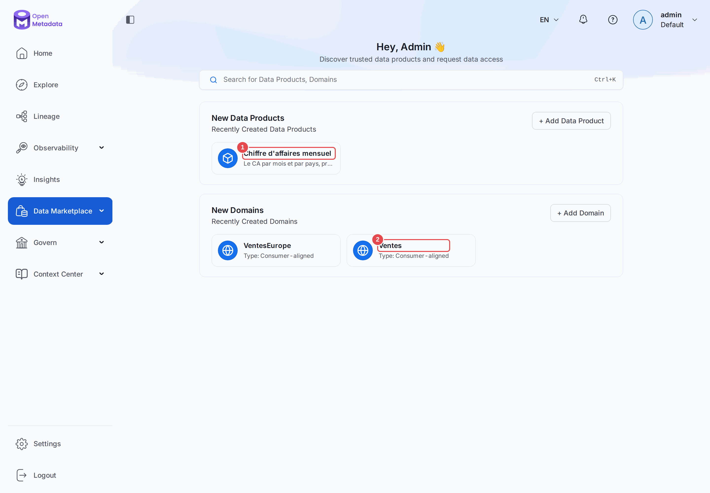

**Le domaine.** *Data Marketplace → Domains → Ventes*. Les onglets **Data Products (1)** et
**Assets (2)** montrent ce qu'il regroupe.

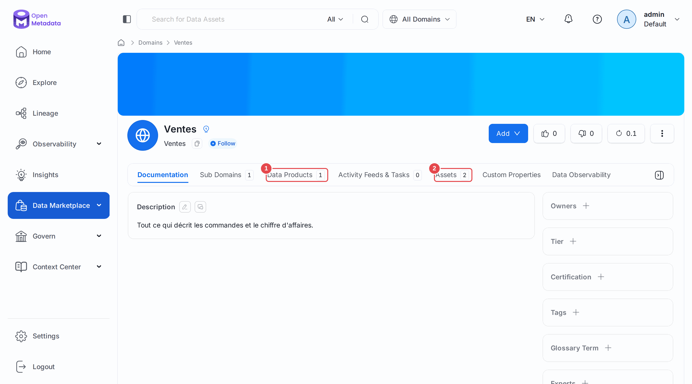

**Le produit de données.** Depuis l'onglet **Assets (1)** de `ca_mensuel`, on retrouve les
deux tables. **Input/Output Ports (2)** décrit ses entrées et ses sorties.

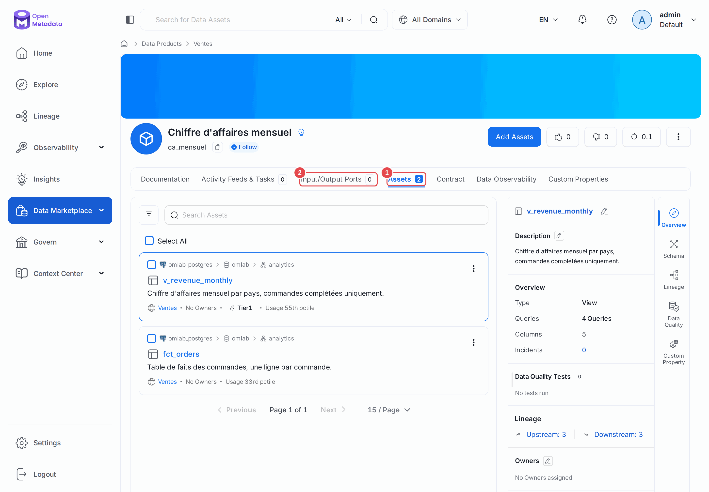

**La métrique.** *Govern → Metrics → CA mensuel net*. Le bandeau affiche le type,
l'unité et la granularité. L'onglet **Expression (1)** porte le SQL.

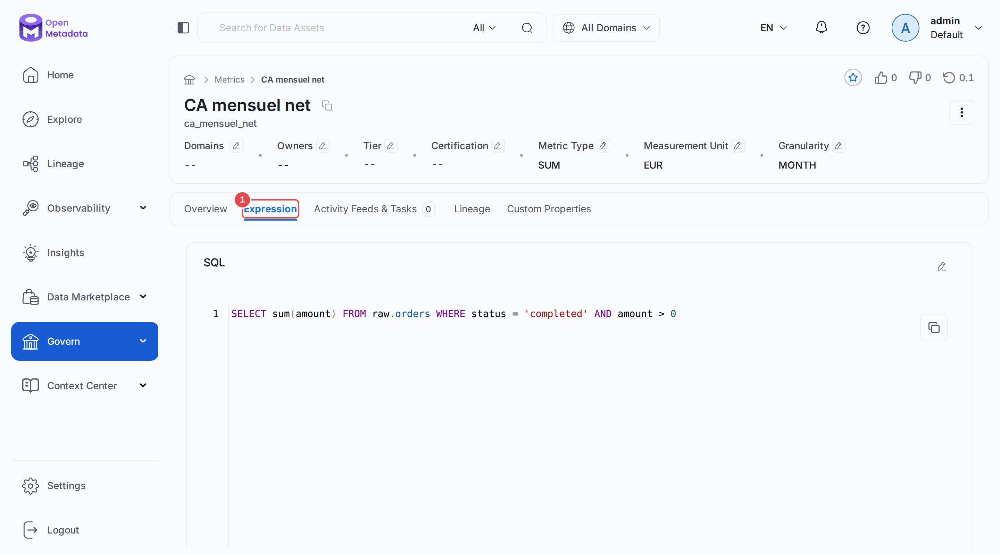

**Annonces et tâches.** Sur `raw.orders`, l'annonce s'affiche sur toute la largeur **(1)**,
pour quiconque ouvre la fiche. L'onglet **Activity Feeds & Tasks (2)** liste les tâches,
incidents compris.

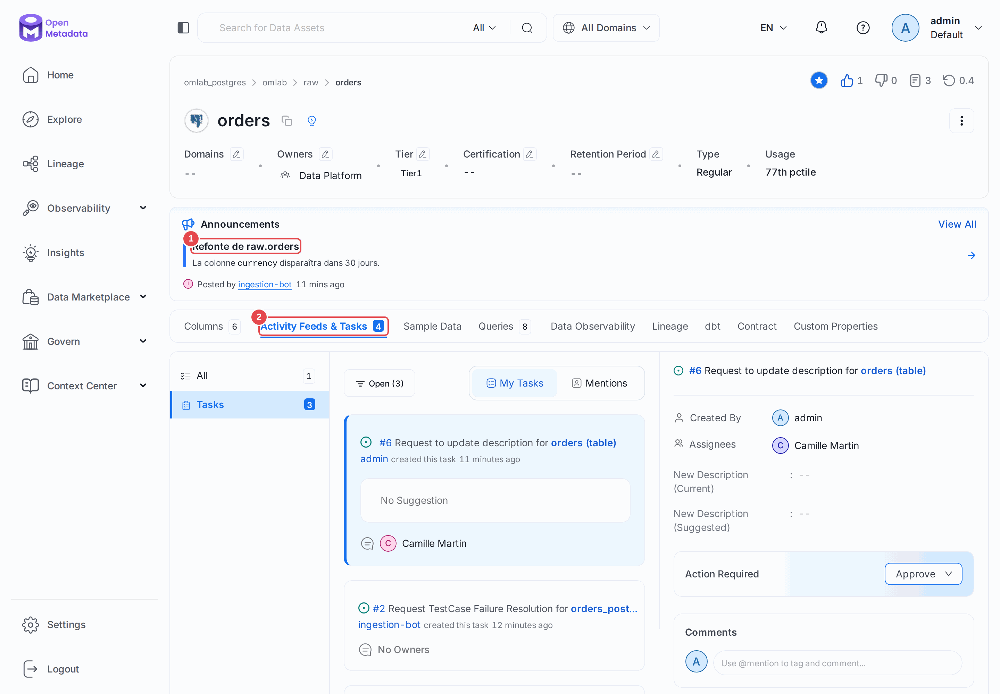

**Le Context Center.** *Context Center → Articles → Lire les avoirs dans raw.orders*. La
section **Data Assets (1)**, à droite, relie l'article à la table.

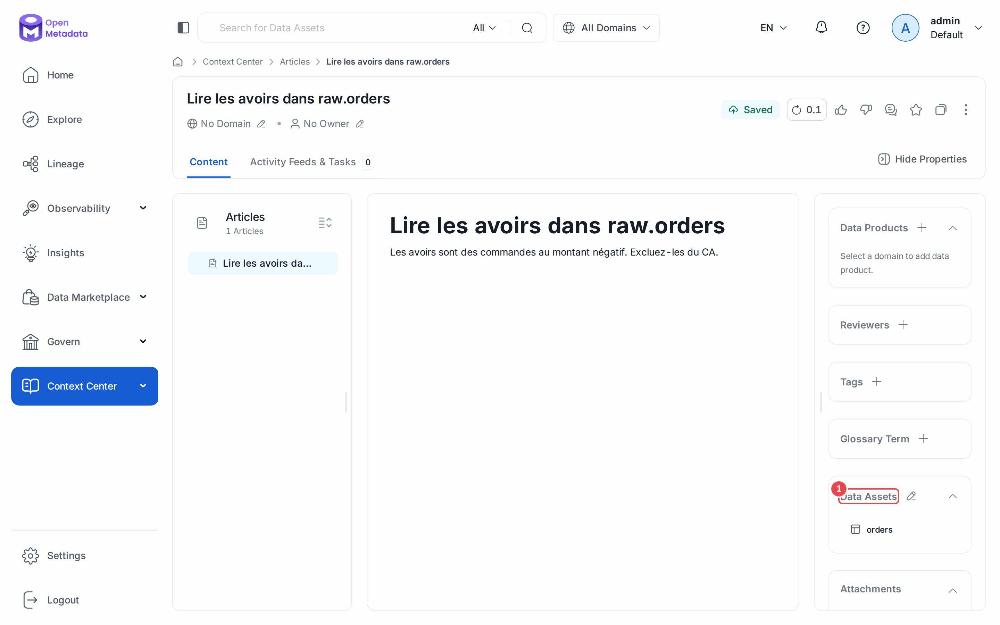

**L'ontologie.** *Govern → Ontology Explorer* dessine les termes de glossaire et leurs
relations. La capture vient du catalogue de fin de parcours : le [chapitre 21](21-gouvernance-avancee.md)
relie `Commande` à `Avoir` et importe `Transport` et `Livraison`. Les autres termes restent isolés.

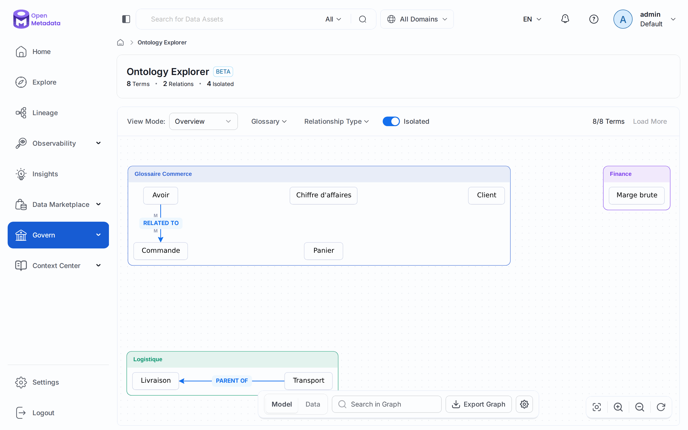

**Les workflows.** *Govern → Workflows* liste les automatismes de gouvernance fournis
d'origine, comme l'approbation des termes de glossaire.

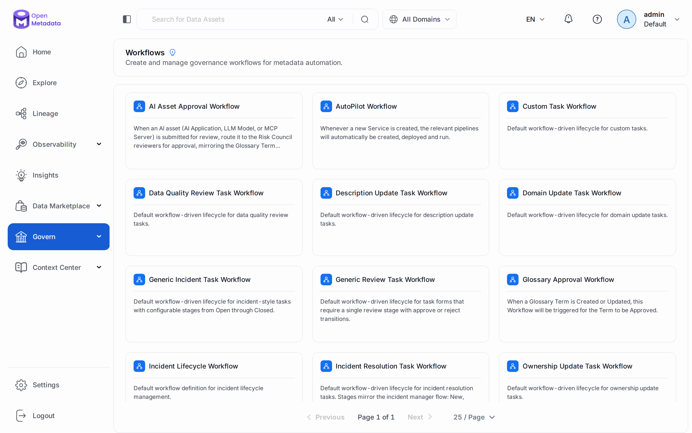

**Les formulaires d'entrée.** *Settings → Governance → Intake Forms* impose des champs à la
création des produits de données, des domaines et des termes de glossaire, côté API comme
côté interface. Aucun n'est défini ici : un formulaire pourrait bloquer le TP de la section 2 tant que
ses champs ne seraient pas fournis.

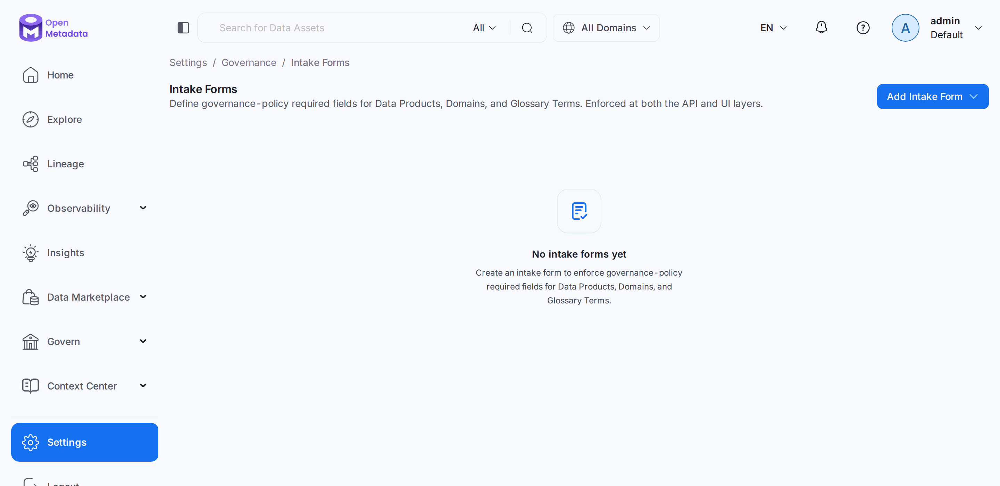

**Les colonnes en masse.** *Govern → Column Bulk Operations* regroupe les colonnes de même
nom à travers le catalogue, pour les documenter d'un coup.

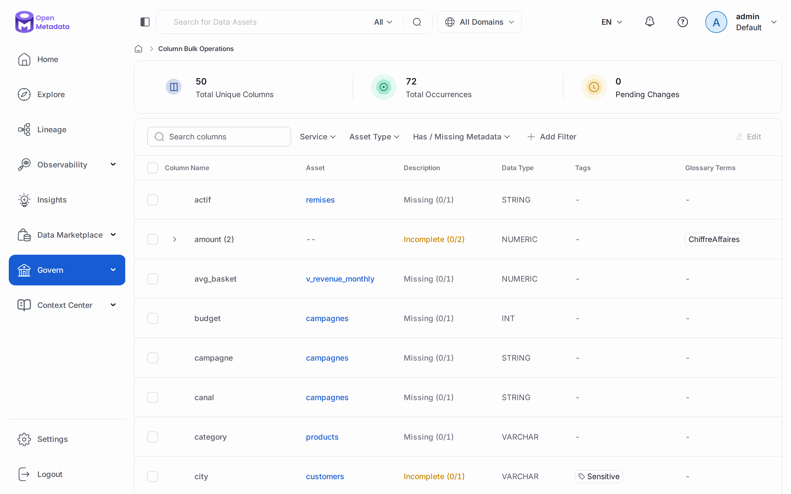

**La bibliothèque de tests.** *Observability → Test Library* liste les définitions de
tests du chapitre 10, et permet d'en ajouter.

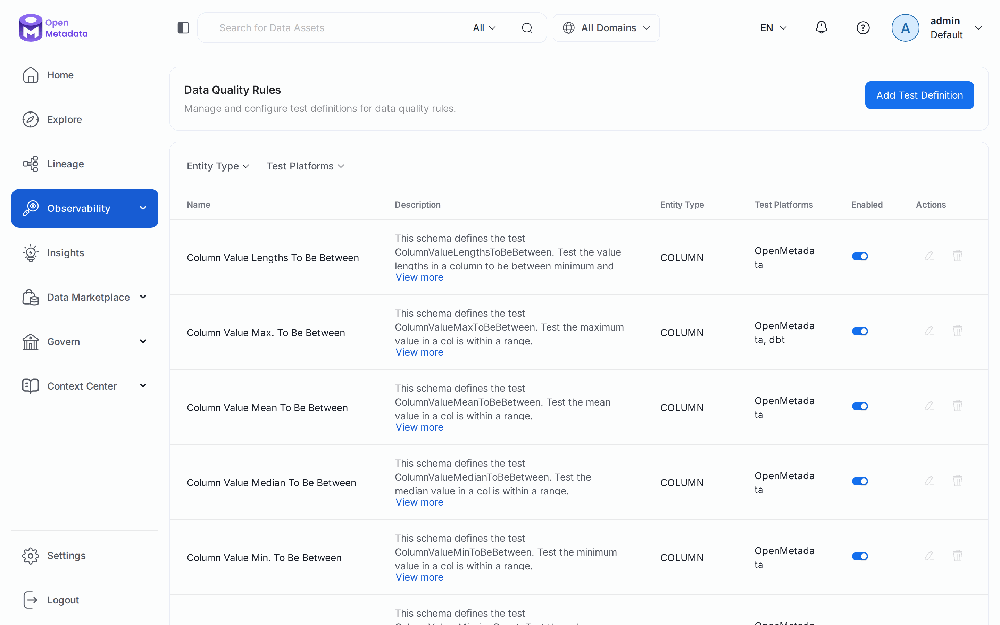

**Le lineage de service.** Le menu **Lineage** donne une vue du graphe à l'échelle de la
plateforme, service par service, avant de plonger dans une table.

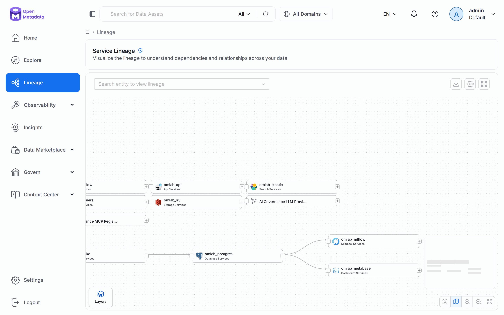

**L'adoption.** **Insights** suit la documentation, la propriété et la criticité du
catalogue dans le temps. L'application `DataInsightsApplication` l'alimente.

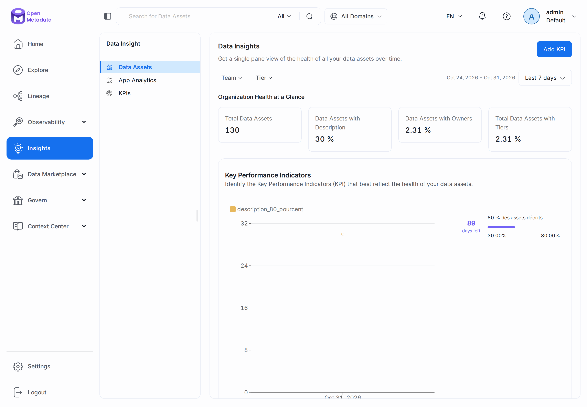

**Le serveur MCP.** *Settings → Applications → MCP Server* règle les origines autorisées.

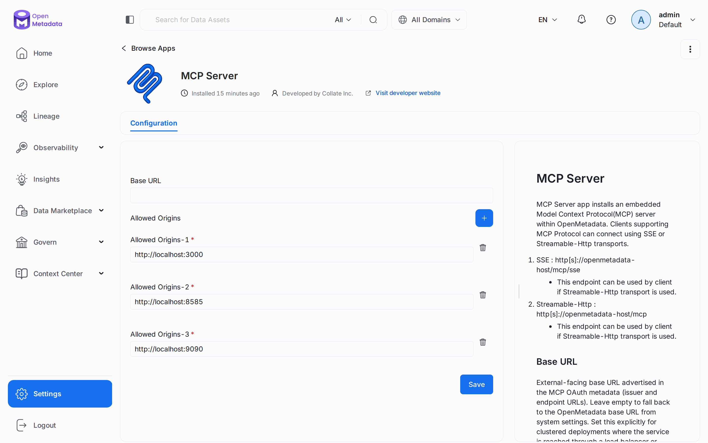

---

## TP guidé

Les chapitres 09 et 10 doivent avoir tourné : le script de tâche assigne `cmartin` et
compte les incidents.

```bash
./omlab py tp/17-tour-2x/01_domaine_produit.py
./omlab py tp/17-tour-2x/02_annonce_tache.py
./omlab py tp/17-tour-2x/03_article.py
./omlab py tp/17-tour-2x/04_client_mcp.py
```

1. Ouvrez *Data Marketplace → Overview* et retrouvez votre produit.
2. Ouvrez `analytics.v_revenue_monthly` : le domaine `Ventes` figure dans son bandeau.
3. Ouvrez `raw.orders` : l'annonce s'affiche, et la tâche attend dans **Activity Feeds & Tasks**.
4. Dans **Context Center → Articles**, lisez l'article et suivez son lien vers la table.

**Vérifier :**

```bash
./omlab check 17
```

```
Chapitre 17 — Le tour complet de la 2.x
  OK   le domaine Ventes existe
  OK   le produit ca_mensuel contient les 2 tables
  OK   la métrique ca_mensuel_net existe
  OK   l'annonce refonte_orders existe
  OK   les incidents sont des tâches (5)
  OK   la tâche documenter_orders_amount existe
  OK   l'article lire_les_avoirs existe
  OK   le serveur MCP est installé
```

## Exercices

1. Créez un second domaine `RH`, et rattachez-y `raw.employees`. Que devient l'affichage
   du sélecteur **All Domains**, en haut de page ?
2. Appelez l'outil MCP `get_entity_lineage` sur `analytics.fct_orders`, en vous inspirant
   de `04_client_mcp.py`. Comparez la réponse à celle de l'API du chapitre 13.
3. Fermez la tâche du TP avec `POST /api/v1/tasks/{id}/close`. Le jeton du bot suffit-il ?
4. Déclarez une relation entre `Commande` et `ChiffreAffaires` dans le glossaire, puis
   rouvrez l'Ontology Explorer.

## Pièges & FAQ

**« Mon produit de données est vide, sans erreur. »** Le champ `assets` de la création
est ignoré. Utilisez `PUT /dataProducts/{nom}/assets/add`, après avoir rattaché les tables
au domaine.

**« `POST /tasks` répond 403. »** `ingestion-bot` n'a pas `CreateTask`. Écrivez avec un
autre compte, ou donnez ce droit à un bot dédié.

**« Mes anciens scripts d'annonces renvoient 404. »** Les annonces sont passées à
`/v1/announcements`, et les suggestions sont devenues des tâches.

**« Le MCP répond 405 dans mon navigateur. »** Normal : un `GET /mcp` n'est pas un appel.
Il faut un `POST`, avec `Accept: application/json, text/event-stream`.

**« Insights affiche 0 partout. »** `DataInsightsApplication` doit avoir tourné, et les
courbes se remplissent au fil des jours : le lendemain d'une installation, elles restent
presque vides.

## Pour aller plus loin

- [Liste officielle des fonctions](https://docs.open-metadata.org/v2.0.x/features)
- [Notes de version 2.0](https://docs.open-metadata.org/v2.0.x/releases/2.0-release)
- [Ruptures de compatibilité](https://docs.open-metadata.org/v2.0.x/deployment/upgrade/breaking-changes/overview)

---

**Précédent :** [16 — Contrats, exploitation, projet final](16-contracts-ops-projet-final.md) ·
**Suivant :** [18 — Collaborer sur une fiche](18-collaboration.md)
