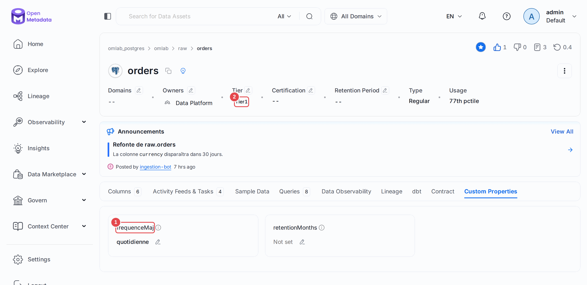
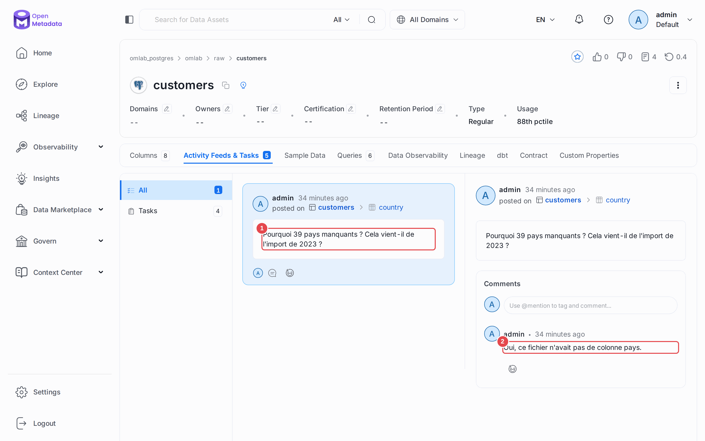
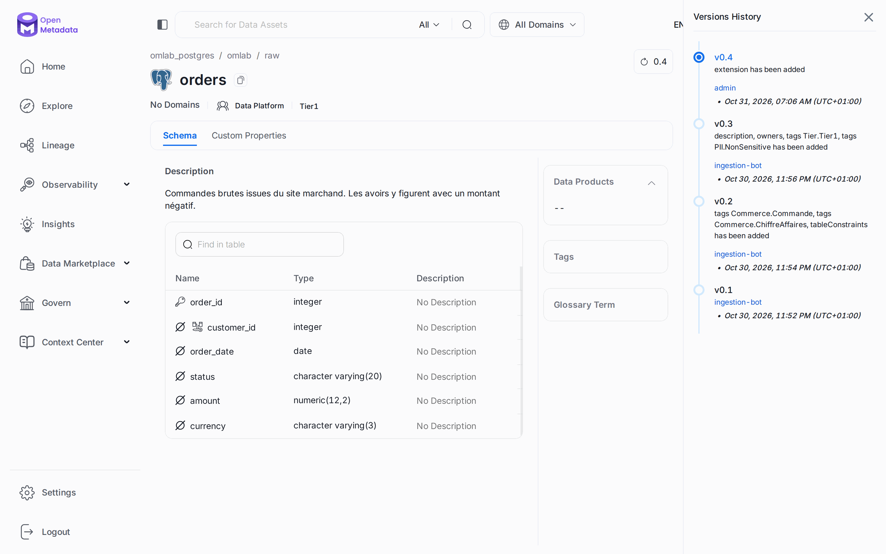
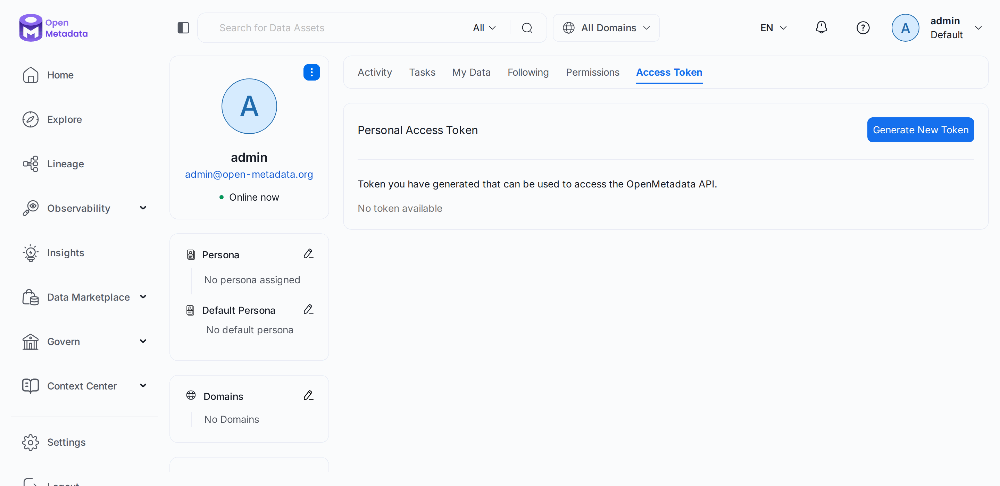

# Chapitre 18 — Collaborer sur une fiche

> **Objectifs** — Enrichir une fiche avec une propriété personnalisée et un tier, s'abonner
> et voter, lire les versions, discuter, demander une description ou un tag, supprimer sans
> perdre, créer un jeton personnel.
> **Durée** — 40 minutes.

---

## 1. Enrichir une fiche

Les champs prévus par OpenMetadata ne suffisent jamais tout à fait. Une **propriété
personnalisée** ajoute le vôtre, par exemple la fréquence de rafraîchissement. Elle se
déclare sur le **type d'entité** : toutes les tables la reçoivent d'un coup, avec une valeur
vide.

Le **tier** dit à quel point un asset compte, de `Tier1` (critique) à `Tier5`. Ce n'est pas
un champ à part mais une étiquette de la classification `Tier`. Data Insights s'en sert pour
ventiler ses indicateurs.

```bash
./omlab py tp/18-collaboration/01_fiche_enrichie.py
```

```
Propriété déclarée sur le type table : frequenceMaj
Extension : {'frequenceMaj': 'quotidienne'}
Tier      : ['Tier.Tier1']
Abonnés   : ['admin']
Votes     : +1 / -0

4 versions, dont les 3 dernières :
  0.4   admin           extension
  0.3   ingestion-bot   description, owners, tags, columns.order_date.tags
  0.2   ingestion-bot   columns.order_id.tags, columns.amount.tags, tableConstraints
```

Ces versions montrent deux choses :

- **Les modifications rapprochées d'un même auteur fusionnent.** Le script change
  l'extension puis le tier, et la version 0.4 n'en cite qu'un. Ne vous servez pas de
  l'historique comme d'un journal d'audit : le vrai journal est au [chapitre 22](22-administration.md).
- **Les contraintes de table sont cataloguées.** `tableConstraints`, en 0.2, vient de la clé
  primaire et des clés étrangères de Postgres. L'interface les affiche sous forme d'icône
  devant chaque colonne, et lit `GET /tables/...?fields=tableConstraints`. Une contrainte
  absente de la base se déclare à la main, dans la fiche ou par un `PATCH`.

## 2. Discuter et demander

Une **conversation** s'attache à un asset ou à une seule colonne, et reste sur
`/v1/feed`. Une **demande** est une tâche : elle a un destinataire et se termine par une
réponse.

```bash
./omlab py tp/18-collaboration/02_conversation_demandes.py
```

```
Conversation : Pourquoi 39 pays manquants ? Cela vient-il de l'import de 2023 ?
  réponses   : 1
Demande de description : TASK-00007 (Open)
Demande de tag         : TASK-00008 (Open)
Après réponse          : Approved / Cancelled
Description de la colonne : "Pays du client, code ISO à deux lettres. Vide pour l'import de 2023."
```

Répondre à une demande de description **écrit la description** dans la fiche : la dernière
ligne le prouve. C'est tout l'intérêt par rapport à un message dans un chat. Le numéro des
tâches dépend de ce qui existe déjà sur votre instance.

Le fil d'activité de la page d'accueil se filtre sur **tout**, **mes données** et **ce que
je suis**. S'abonner à une table, c'est donc choisir ce qui remontera dans ce fil.

## 3. Supprimer sans perdre

| Suppression | Effet | Retour en arrière |
|---|---|---|
| Logique (par défaut) | disparaît des listes, reste lisible avec `include=deleted` | `PUT /tables/restore` |
| Définitive (`hardDelete=true`) | efface la fiche, son historique et ce qui s'y rattache | aucun |

```bash
./omlab py tp/18-collaboration/03_cycle_de_vie.py
```

```
Créée      : omlab_postgres.omlab.raw.table_ephemere
Supprimée  : visible dans les listes ? False
             encore lisible avec include=deleted ? True
Restaurée  : visible dans les listes ? True
Effacée    : visible ? False
             include=all répond 404
```

## 4. Le jeton personnel

Un jeton personnel agit **en votre nom**, avec vos droits, et se révoque sans changer de mot
de passe. Il sert à un script perso ou à un assistant. Pour un traitement automatique qui
doit survivre à votre départ, préférez un bot ([chapitre 09](09-teams-roles-policies.md)).

```bash
./omlab py tp/18-collaboration/04_jeton_personnel.py
```

```
Jeton : tuto_chapitre_18 (PERSONAL_ACCESS_TOKEN)
Agit en tant que : admin
Après révocation : 0 jeton(s) restant(s)
Le jeton révoqué reçoit : HTTP 401
```

## 5. L'extension de navigateur

L'extension Chrome affiche la fiche d'un asset depuis l'outil où vous travaillez, sans
changer d'onglet. Elle s'installe depuis le Chrome Web Store et se pointe sur l'URL de votre
instance. Un laboratoire en `localhost` n'apporte rien pour la juger : **ce tutoriel ne l'a
pas essayée**.

## Mode d'emploi : les écrans

**La propriété et le tier.** Sur `raw.orders`, onglet **Custom Properties**, la propriété
`frequenceMaj` **(1)** porte sa valeur. Le tier **(2)** s'affiche dans le bandeau. L'étoile
bleue en haut à droite indique que vous suivez cette table, et le pouce compte les votes.



**La conversation.** Onglet **Activity Feeds & Tasks** de `raw.customers`. La question **(1)**
vise la colonne `country`, et la réponse **(2)** s'affiche dessous.



**Les versions.** Le numéro de version, en haut à droite d'une fiche, ouvre l'historique.
Chaque entrée dit qui a changé quoi.



**Le jeton personnel.** Votre profil, onglet **Access Token**, bouton **Generate New Token**.



---

## TP guidé

Les chapitres 09 et 10 doivent avoir tourné.

```bash
./omlab py tp/18-collaboration/01_fiche_enrichie.py
./omlab py tp/18-collaboration/02_conversation_demandes.py
./omlab py tp/18-collaboration/03_cycle_de_vie.py
./omlab py tp/18-collaboration/04_jeton_personnel.py
```

1. Ouvrez `raw.orders`, onglet **Custom Properties**, et modifiez la valeur à la main.
2. Ouvrez `raw.customers`, répondez à la conversation et ajoutez une réaction.
3. Sur une colonne sans description, cliquez sur **?** et demandez-en une.

**Vérifier :**

```bash
./omlab check 18
```

```
Chapitre 18 — Collaborer sur une fiche
  OK   la propriété frequenceMaj est déclarée sur le type table
  OK   raw.orders porte la valeur de sa propriété
  OK   raw.orders est en Tier1
  OK   la demande de description a été approuvée
  OK   la réponse a écrit la description de la colonne
  OK   la table éphémère a bien été effacée
```

## Exercices

1. Déclarez une propriété de type `enum` avec trois valeurs, et renseignez-la dans l'interface.
2. Supprimez logiquement `raw.products`, regardez ce que deviennent son lineage et ses tests,
   puis restaurez-la.
3. Fermez la demande de tag avec un jeton personnel plutôt qu'une session admin : l'auteur
   affiché change-t-il ?

## Pièges & FAQ

**« Ma propriété n'apparaît nulle part dans l'export de la table. »** Elle vit dans
`extension`, et ce champ ne revient que s'il est demandé : `?fields=extension`.

**« Une modification manque dans l'historique. »** Les modifications rapprochées d'un même
auteur fusionnent dans une seule version.

**« `PUT /users/generateToken/{id}` répond 403 sur un utilisateur. »** Cette route ne sert
qu'aux bots. Pour une personne, c'est `PUT /users/security/token`, en session avec ce compte.

**« Ma réponse à une conversation renvoie 400. »** Sur `POST /feed/{id}/posts`, le corps ne
contient que `message`. Un champ `from`, pourtant cité par la documentation, est rejeté par
la 2.0.7.

## Pour aller plus loin

- [Guide de l'utilisateur](https://docs.open-metadata.org/v2.0.x/how-to-guides/guide-for-data-users)
- [Collaboration](https://docs.open-metadata.org/v2.0.x/how-to-guides/data-collaboration)

---

**Précédent :** [17 — Le tour complet de la 2.x](17-tour-complet-2x.md) ·
**Suivant :** [19 — Import et export en masse](19-import-export.md)
