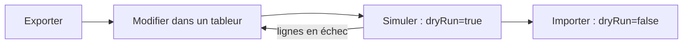
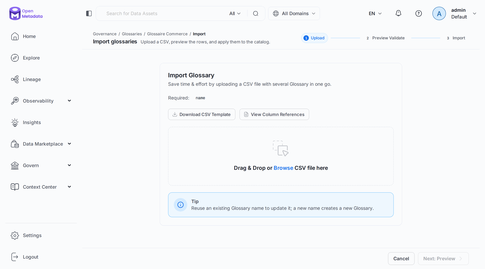
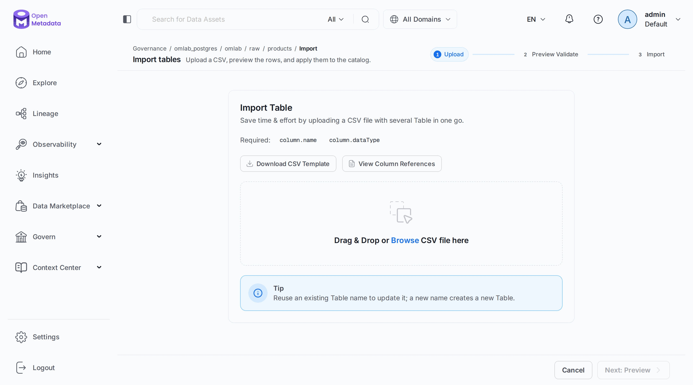
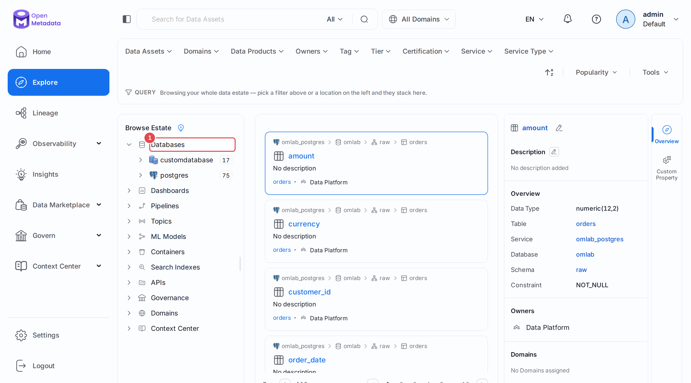

# Chapitre 19 — Import et export en masse

> **Objectifs** — Éditer le catalogue dans un tableur : exporter, modifier, simuler, importer.
> Savoir ce qui s'exporte, et lire le rapport d'une ligne en échec.
> **Durée** — 25 minutes.

---

## 1. La boucle en quatre temps

Documenter 200 colonnes à la souris décourage tout le monde. Le CSV permet de confier le
travail à quelqu'un qui connaît les données mais pas l'outil.



Le même schéma vaut pour les glossaires, les tables, les services, les équipes, les
utilisateurs, les tests et les métriques :

```
GET /api/v1/glossaries/name/Commerce/export
PUT /api/v1/glossaries/name/Commerce/import?dryRun=true
```

Ces routes échangent du texte, pas du JSON, d'où l'aide `texte()` de [`lib/om.py`](../lib/om.py).
Les variantes `exportAsync` et `importAsync` existent pour les gros volumes : la réponse
arrive alors par un job, pas dans l'appel.

## 2. Un glossaire

```bash
./omlab py tp/19-import-export/01_glossaire_csv.py
```

```
Exporté : 4 termes, colonnes : parent, name*, displayName, description, synonyms, relatedTerms...
Simulation : success, 5/5 lignes
  Panier existe après simulation ? False
Import     : success, 5/5 lignes
  Panier   : statut Approved, synonymes ['Cart', 'Caddie']

Avec une ligne fautive : partialSuccess, 1 ligne en échec
  Fautif : #INVALID_FIELD: Field 6 error - Entity CeTermeNexistePas of type glossaryTerm not found
```

Le statut `partialSuccess` mérite votre attention : **sans simulation, les lignes correctes
auraient été écrites**, et les autres ignorées. La colonne `details` donne la raison ligne
par ligne, avec le numéro du champ fautif.

## 3. Les colonnes d'une table

```bash
./omlab py tp/19-import-export/02_colonnes_csv.py
```

```
Import : success, 6/6 colonnes
  product_id   Identifiant technique du produit.
  sku          -
  name         Nom commercial affiché sur la boutique.
  category     -
  unit_price   -
  created_at   -
```

Un nom qui n'existe pas **crée** un asset. L'interface le rappelle par une astuce : *« Reuse
an existing Table name to update it; a new name creates a new Table »*. Une faute de frappe
dans le CSV d'un service produit donc une table fantôme, d'où la simulation systématique.

## 4. Ce qui s'exporte encore

```bash
./omlab py tp/19-import-export/03_autres_exports.py
```

```
Service entier              1 lignes  [name*,displayName,description,owner,tags,glossaryTerms,tie...]
Équipes                     1 lignes  [name*,displayName,description,teamType*,parents*,Owner,isJ...]
Tests d'une table           5 lignes  [name*,displayName,description,testDefinition*,entityFQN*,t...]
Métrique                    1 lignes  [name*,displayName,description,metricType,unitOfMeasurement...]
Lineage                    21 lignes  [fromId*,fromEntityType*,fromFullyQualifiedName*,toId*,toEn...]
Colonnes du catalogue      48 lignes  [column.name*,column.displayName,column.description,column....]
Résultats de recherche      5 lignes  [Entity Type,Service Name,Service Type,FQN,Name,Display Nam...]

Tests réimportés (simulation) : success, 5/5 lignes
```

Les nombres de lignes dépendent de l'avancement de votre catalogue. Le script finit par
réimporter les tests en simulation : modifier un paramètre dans le CSV, par exemple un seuil,
suffit à l'appliquer à tous les tests d'une table. Dans l'interface, l'import propose aussi
une **édition en ligne** de la grille avant validation.

## Mode d'emploi : les écrans

**L'import d'un glossaire.** Depuis le glossaire, menu **⋮ → Import**. Trois étapes en haut
de page : **Upload**, **Preview Validate**, **Import**. La seconde correspond à la simulation.
**Download CSV Template** donne un fichier vide au bon format.



**L'import d'une table.** Même écran, depuis le menu **⋮** de la table. **View Column
References** décrit chaque colonne du CSV.



**L'arborescence.** Pour repérer ce qu'on va exporter, le panneau de gauche d'**Explore**
déroule la hiérarchie **(1)** service, base, schéma, table.



---

## TP guidé

```bash
./omlab py tp/19-import-export/01_glossaire_csv.py
./omlab py tp/19-import-export/02_colonnes_csv.py
./omlab py tp/19-import-export/03_autres_exports.py
```

1. Exportez `raw.customers` depuis l'interface, et ouvrez le fichier dans un tableur.
2. Remplissez trois descriptions, puis réimportez-le en lisant bien l'étape de prévisualisation.
3. Glissez une faute dans un nom de colonne : que montre la grille ?

**Vérifier :**

```bash
./omlab check 19
```

```
Chapitre 19 — Import et export en masse
  OK   le terme Panier vient de l'import CSV
  OK   ses synonymes ont été importés
  OK   la description de raw.products.name vient de l'import CSV
```

## Exercices

1. Exportez les équipes, ajoutez-en une dans le fichier, et importez-la.
2. Importez un terme avec une valeur dans la colonne `parent` : où se range-t-il ?
3. Changez un seuil dans l'export des tests de `raw.orders`, importez, et relancez le workflow.

## Pièges & FAQ

**« L'export répond 415. »** La route refuse un `GET` déclaré en `text/plain`. L'import, lui,
exige ce type. L'aide `texte()` gère les deux cas.

**« Mon import a réussi, mais des lignes manquent. »** Lisez `status` : `partialSuccess`
n'est pas `success`, et `importResultsCsv` donne le détail.

**« Exporter une classification système répond 400. »** `PII` et `Tier` sont des entités
système : *« can not be modified »*. Seules vos propres classifications s'exportent.

**« L'export des utilisateurs répond 500. »** Constaté sur le laboratoire en 2.0.7 :
*« Cannot invoke Object.toString() because identity is null »*. Passez par l'export des équipes.

## Pour aller plus loin

- [Import et export d'assets](https://docs.open-metadata.org/v2.0.x/how-to-guides/data-discovery/bulk-upload)
- [Import et export de tests](https://docs.open-metadata.org/v2.0.x/how-to-guides/data-quality-observability/quality/import-export-test-cases)
- [Dépannage de la découverte](https://docs.open-metadata.org/v2.0.x/how-to-guides/data-discovery/troubleshooting)

---

**Précédent :** [18 — Collaborer sur une fiche](18-collaboration.md) ·
**Suivant :** [20 — La qualité avancée](20-qualite-avancee.md)
