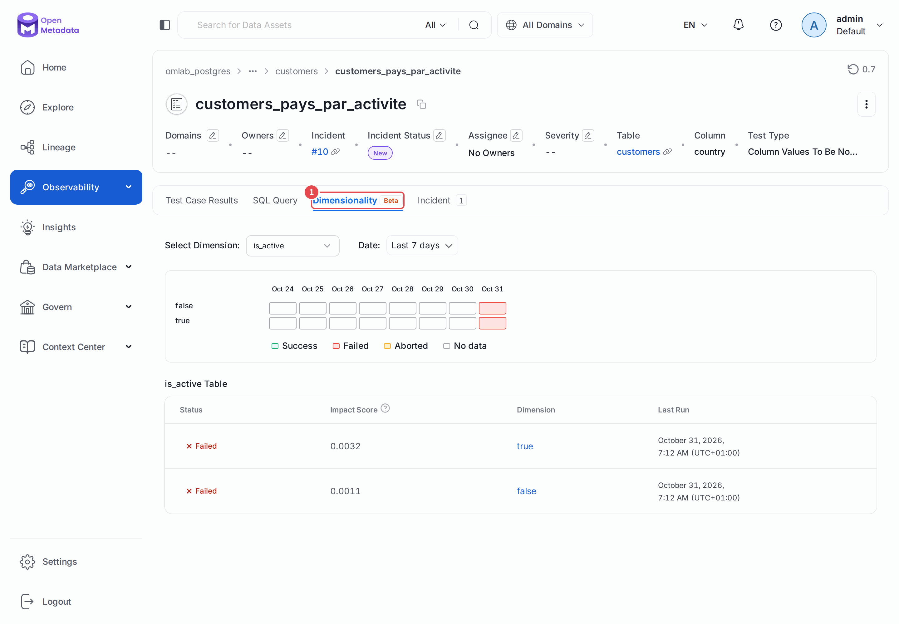
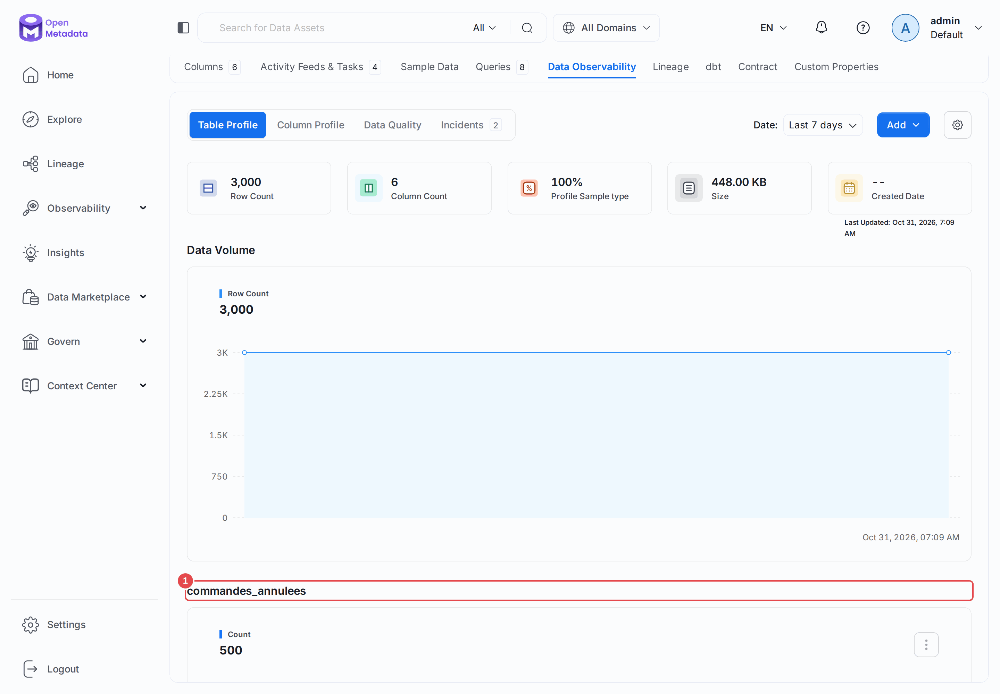
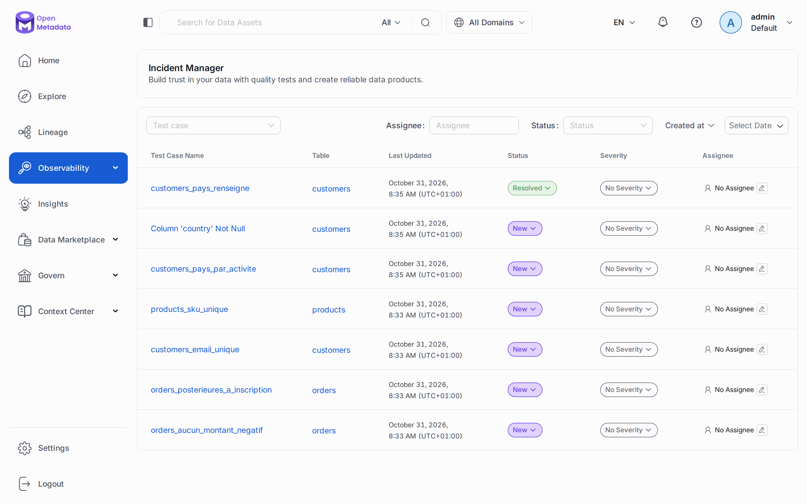
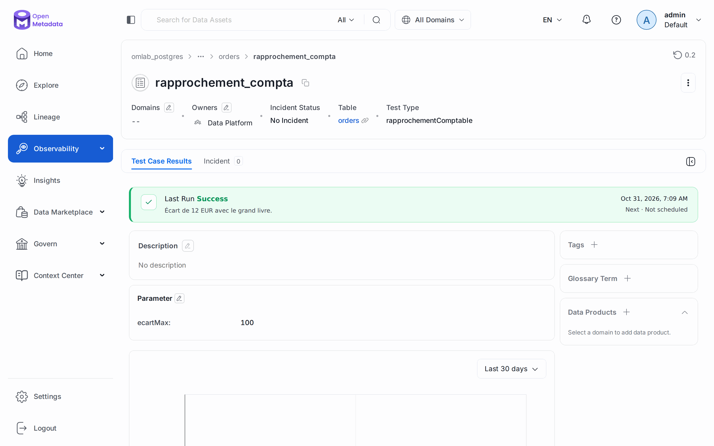

# Chapitre 20 — La qualité avancée

> **Objectifs** — Publier le verdict d'un outil externe, ajouter des métriques au profiler,
> découper un test par segment, écrire la qualité dans le code, faire vivre un incident.
> **Durée** — 50 minutes.

---

## 1. Un test maison, exécuté ailleurs

Votre équipe a peut-être déjà des contrôles, dans un autre outil. Plutôt que de les réécrire,
publiez leur verdict. `testPlatforms: ["Other"]` indique qu'OpenMetadata n'exécute rien et
centralise seulement le résultat.

```bash
./omlab py tp/20-qualite-avancee/01_test_externe.py
```

```
Test maison : rapprochement_compta
  statut    : Success
  message   : Écart de 12 EUR avec le grand livre.
```

Pour qu'OpenMetadata exécute lui-même un test maison, il faut en plus écrire un **validateur** :
une classe Python héritant de `BaseTestValidator`, installée dans le paquet `metadata` de
l'environnement d'ingestion, et une définition déclarant `OpenMetadata` dans `testPlatforms`.
Ce tutoriel ne l'a pas fait tourner, et c'est rarement nécessaire : le test
`tableCustomSQLQuery` du [chapitre 10](10-data-quality.md) couvre la plupart des besoins.

## 2. Des métriques maison dans le profil

Le profiler compte les nulls et les doublons, mais il ne connaît pas votre métier. Une
**métrique personnalisée** est une requête SQL, évaluée à chaque profil, dont le résultat
rejoint les graphiques de la table ou de la colonne.

```bash
./omlab py tp/20-qualite-avancee/02_metrique_profil.py
./omlab profile tp/20-qualite-avancee/profiler-orders.yaml
```

```
Réglage de la table : {'sampleDataCount': 50, 'randomizedSample': False, 'excludeColumns': ['currency'], 'computeTableMetrics': True, 'computeColumnMetrics': True, 'profileSample': 100, 'profileSampleType': 'PERCENTAGE'}
Métriques de table  : ['commandes_annulees']
Métriques d'amount  : ['montant_des_avoirs']
```

Après le workflow, l'API donne `commandes_annulees = 500` et `montant_des_avoirs = -9357.3`.

Le même script règle le profiler **pour cette seule table** : `excludeColumns` retire
`currency`, et ce réglage prime sur celui du workflow. À l'échelle de l'instance,
*Settings → Preferences → Profiler Configuration* choisit les métriques calculées par type
de données, et autorise ou non le stockage des échantillons.

## 3. Un test par segment

Un test global dit « 39 clients sans pays ». Un test **par dimension** dit où ils se trouvent,
ce qui oriente la correction.

```bash
./omlab py tp/20-qualite-avancee/03_test_dimension.py
./omlab test tp/20-qualite-avancee/tests-dimension.yaml
./omlab py tp/20-qualite-avancee/03_test_dimension.py
```

```
Test : customers_pays_par_activite, découpé par ['is_active']
Global : Failed, 39 lignes en échec sur 500
Par valeur de is_active :
  false        Failed      5 en échec sur    77
  true         Failed     34 en échec sur   423
```

Choisissez une colonne de faible cardinalité : la documentation conseille de 5 à 25 valeurs.
Au-delà de 10 valeurs, les moins problématiques sont regroupées dans un groupe **Others**.
Les tests de niveau table ne se découpent pas.

### Le piège du YAML

Notre première version déclarait `dimensionColumns` dans le YAML :

```
testCases.0.dimensionColumns
  Extra inputs are not permitted
```

Le bloc `testCases` ne connaît pas ce champ. Un test par segment se déclare **par l'API ou
dans l'interface**, puis le workflow l'exécute : sans `testCases`, le runner lance tout ce
que le catalogue connaît sur la table.

## 4. La qualité dans le code

Le SDK permet de contrôler la qualité depuis un pipeline, sans YAML ni planification.

```bash
./omlab py tp/20-qualite-avancee/04_qualite_en_code.py
```

```
--- TestRunner sur raw.customers ---
  customers_email_bien_forme                     Success
  customers_email_unique                         Failed
  customers_pays_par_activite                    Failed
  customers_pays_renseigne                       Failed
  customers_volume_exact                         Success
  table_row_count_between                        Success
  country_not_null                               Failed

--- DataFrameValidator sur un lot à charger ---
  Chargement autorisé ? False
  columnValuesToBeUnique     Failed   Found valuesCount=4 vs. uniqueCount=2. Both counts should be equal for column values to be unique.
```

Deux comportements à connaître, tous deux constatés ici :

- **`TestRunner` n'est pas un simple contrôle en lecture seule.** Il enregistre ses deux tests
  (`country_not_null`, `table_row_count_between`) dans le catalogue, et exécute aussi ceux
  déjà déclarés. D'où ses sept lignes pour deux tests écrits.
- **`DataFrameValidator` s'arrête au premier échec.** Trois tests déclarés, un seul verdict :
  un lot refusé peut cacher d'autres défauts. C'est le seul mode de `FailureMode` en 2.0.7.2.

Ce que nous n'avons pas fait tourner, d'après la documentation : `validator.run()` avec un
**découpage par blocs** (*chunks*) pour un fichier trop gros pour la mémoire,
`result.publish(fqn)` pour publier le verdict dans le catalogue, et `TestRunner.from_yaml()`
pour réutiliser un fichier de workflow. Les classes de tests disponibles sont listées dans
`metadata.sdk.data_quality` : `ColumnValuesToBeBetween`, `TableCustomSQLQuery`, `TableDiff`...

## 5. Faire vivre un incident

Un test en échec ouvre un incident, et le [chapitre 10](10-data-quality.md) s'arrêtait là. Il
a ensuite un cycle de vie : `New`, `Ack`, `Assigned`, `Resolved`.

```bash
./omlab py tp/20-qualite-avancee/05_incident.py
```

```
Avant : ['New']
Après : ['New', 'Ack', 'Assigned', 'Resolved']
Cause : MissingData
```

Si le test échoue encore au passage suivant, un nouvel incident s'ouvre à `New`. Résoudre un
incident ne corrige pas la donnée. Pour être prévenu de l'activité sur les incidents, créez
une alerte de source **Task** : elle couvre aussi les demandes de description et de tag, sans
filtre pour les distinguer.

## 6. Ce que la version libre ne fait pas

Les notes de version de la 2.0 réservent à Collate les **assertions dynamiques**
(`useDynamicAssertion`), qui calculent un seuil d'après l'historique : l'interface libre
masque ce réglage. Le champ existe pourtant dans l'API et dans les CSV. Une carte *Anomaly
Detection* figure dans la documentation, sans page correspondante dans le plan du site de la
2.0. Ce tutoriel n'a essayé ni l'une ni l'autre.

## Mode d'emploi : les écrans

**Les résultats par segment.** Ouvrez le test, onglet **Dimensionality (1)**, encore en bêta.
La grille donne un carré par jour et par valeur. Le **score d'impact** classe les segments.



**La métrique maison.** Sur la table, *Data Observability → Table Profile*, sous les
graphiques habituels : `commandes_annulees` **(1)**. Le bouton **Add** ouvre le formulaire.



**Le gestionnaire d'incidents.** *Observability → Incident Manager* filtre par personne
assignée, statut, test et date. La colonne **Status** fait avancer l'incident à la main.



**Un résultat venu d'ailleurs.** Le message et le paramètre sont ceux que le script a publiés.



---

## TP guidé

Le chapitre 10 doit avoir tourné.

```bash
./omlab py tp/20-qualite-avancee/01_test_externe.py
./omlab py tp/20-qualite-avancee/02_metrique_profil.py
./omlab profile tp/20-qualite-avancee/profiler-orders.yaml
./omlab py tp/20-qualite-avancee/03_test_dimension.py
./omlab test tp/20-qualite-avancee/tests-dimension.yaml
./omlab py tp/20-qualite-avancee/03_test_dimension.py
./omlab py tp/20-qualite-avancee/04_qualite_en_code.py
./omlab py tp/20-qualite-avancee/05_incident.py
```

**Vérifier :**

```bash
./omlab check 20
```

```
Chapitre 20 — La qualité avancée
  OK   le test externe a son verdict
  OK   la métrique de table a une valeur (500)
  OK   la métrique de colonne a une valeur (-9357.3)
  OK   le test par segment connaît 2 valeurs de is_active
  OK   TestRunner a enregistré ses tests dans le catalogue
  OK   un incident est allé jusqu'à Resolved
```

## Exercices

1. Découpez `customers_email_unique` par `country` : un pays concentre-t-il les doublons ?
2. Ajoutez une métrique `panier_moyen` sur `raw.orders`, et relancez le profil.
3. Faites échouer le `DataFrameValidator` sur son dernier test seulement, en corrigeant le lot.

## Pièges & FAQ

**« Le workflow signale une erreur sur mon test par segment. »** `columnValuesToBeBetween`
n'accepte pas une colonne `NUMERIC`, comme au [chapitre 10](10-data-quality.md). Nous avons
retenu `columnValuesToBeNotNull`, valable pour tous les types.

**« Mon test externe échoue dans le workflow. »** Il ne devrait pas y figurer : un test
`Other` n'a pas de validateur. Publiez son résultat, ne le lancez pas.

**« Mon test en code apparaît dans l'interface sans que je l'aie demandé. »** C'est le
comportement de `TestRunner`. Donnez un nom explicite à vos tests pour les reconnaître.

## Pour aller plus loin

- [La qualité dans le code](https://docs.open-metadata.org/v2.0.x/how-to-guides/data-quality-observability/quality/data-quality-as-code)
- [Validation par dimension](https://docs.open-metadata.org/v2.0.x/how-to-guides/data-quality-observability/quality/dimensional-validation)
- [Tests personnalisés](https://docs.open-metadata.org/v2.0.x/how-to-guides/data-quality-observability/quality/custom-tests)

---

**Précédent :** [19 — Import et export en masse](19-import-export.md) ·
**Suivant :** [21 — La gouvernance avancée](21-gouvernance-avancee.md)
