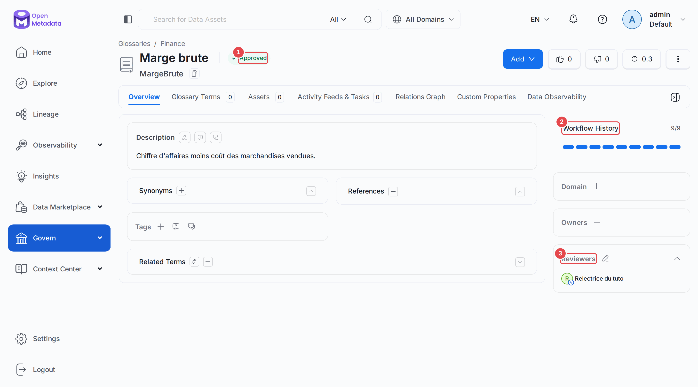
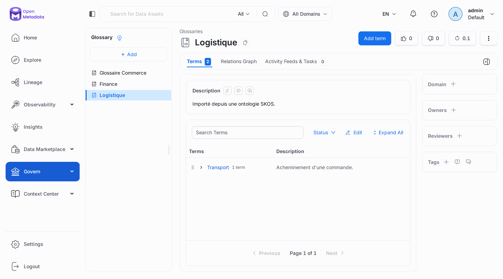
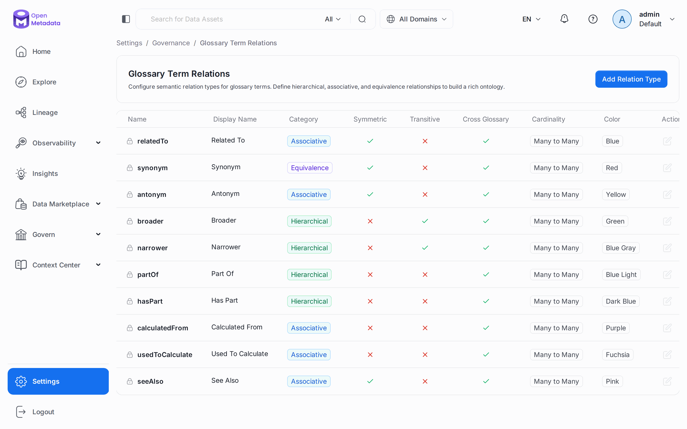
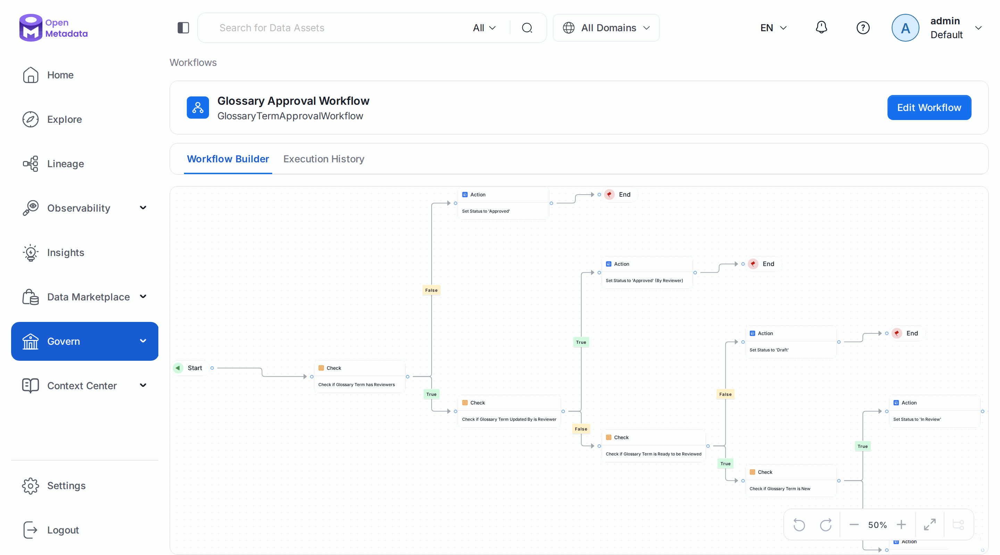
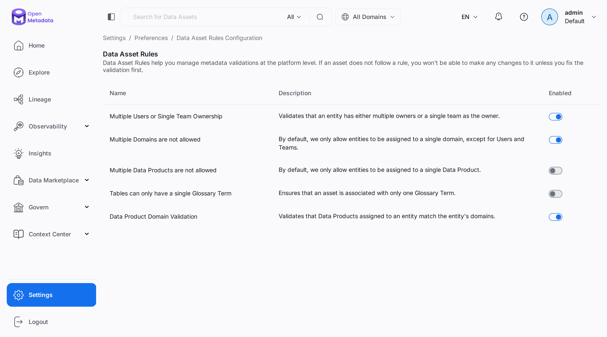

# Chapitre 21 — La gouvernance avancée

> **Objectifs** — Faire relire un terme avant publication, relier les termes, importer une
> ontologie, imposer des champs et des règles, masquer les données sensibles, comprendre un
> workflow de gouvernance.
> **Durée** — 45 minutes.

---

## 1. Faire approuver un terme

Dès qu'un glossaire a des **relecteurs**, un terme ne devient plus `Approved` tout seul.

```bash
./omlab py tp/21-gouvernance-avancee/01_approbation.py
```

```
Terme créé : Finance.MargeBrute, statut Draft
Tâche      : TASK-00014 (RequestApproval), assignée à ['relectrice']
Statut     : In Review
Après relecture : Approved

Étapes du workflow :
  GlossaryTermCreated
  CheckGlossaryTermHasReviewers
  CheckIfGlossaryTermUpdatedByIsReviewer
  CheckGlossaryTermIsReadyToBeReviewed
  CheckIfGlossaryTermIsNew
  SetGlossaryTermStatusToInReview
  ApproveGlossaryTerm
  SetGlossaryTermStatusToApprovedAfterApproval
  ApprovedEndAfterApproval
```

Cette liste suit le chemin réel du terme. On y lit la règle la plus surprenante :
`CheckIfGlossaryTermUpdatedByIsReviewer`. **Si l'auteur est lui-même relecteur, le terme est
approuvé d'office, sans tâche.** Notre première version du TP désignait admin comme relecteur
et attendait une tâche qui ne venait jamais.

Ce qui a demandé le plus d'essais sur ce TP :

- **Le type de la tâche est `RequestApproval`.** L'énumération propose aussi
  `GlossaryApproval`, mais le workflow ne s'en sert pas.
- **Tout `PUT` sur le terme relance le workflow**, et la nouvelle instance annule la tâche de
  la précédente (statut `Cancelled`). Le script repart donc d'un terme neuf.
- **Il faut une vraie personne pour relire.** Le script crée un compte avec un mot de passe et
  ouvre sa session. `cmartin`, du chapitre 09, n'a pas de mot de passe.

## 2. Relier les termes, importer une ontologie

Un glossaire devient une **ontologie** quand ses termes ont des relations typées :
`synonym`, `broader`, `partOf`, `calculatedFrom`... La liste se complète dans *Settings →
Governance → Glossary Term Relations*.

Une ontologie existante s'importe, en OWL ou en SKOS. Par défaut, `importRdf` simule : il faut
demander `dryRun=false`.

```bash
./omlab py tp/21-gouvernance-avancee/02_ontologie.py
```

```
Commande --relatedTo--> Avoir

Simulation SKOS : {"dryRun": true, "glossariesCreated": 0, "termsCreated": 2, "termsUpdated": 0, "relationsAdded": 0, "conceptMappingsAdded": 0, "relationTypesRegistered": 0, "customPropertiesCreated": 0, "messages": []}
Import          : {"dryRun": false, "glossariesCreated": 0, "termsCreated": 2, "termsUpdated": 0, "relationsAdded": 0, "conceptMappingsAdded": 0, "relationTypesRegistered": 0, "customPropertiesCreated": 0, "messages": []}
  Logistique.Transport.Livraison  parent=Transport
  Logistique.Transport  parent=None
```

`skos:broader` est devenu la hiérarchie du glossaire. Et cet import fonctionne alors que
`rdfEnabled` vaut `false` sur le laboratoire : le stockage RDF n'est utile qu'à l'export et
aux requêtes SPARQL.

Côté présentation, un terme peut aussi recevoir une couleur et une icône, depuis son menu
**⋮ → Style**, ou par les colonnes `color` et `iconURL` du CSV du [chapitre 19](19-import-export.md).

## 3. Imposer des règles

```bash
./omlab py tp/21-gouvernance-avancee/03_regles.py
```

```
Sous-domaine : Ventes.VentesEurope
Produit sans propriétaire, formulaire actif : {"code":400,"message":"Missing required field(s) per intake form 'produit_avec_proprietaire': Un produit de données doit avoir un propriétaire."}
Formulaire retiré                           : accepté

Règles d'instance :
  actif   Multiple Users or Single Team Ownership
  actif   Multiple Domains are not allowed
  inactif Multiple Data Products are not allowed
  inactif Tables can only have a single Glossary Term
  actif   Data Product Domain Validation
```

Deux mécanismes, deux portées :

| | **Intake Form** | **Data Asset Rule** |
|---|---|---|
| S'applique à | produits de données, domaines, termes | tous les assets |
| Quand | création et mise à jour | création et mise à jour, import CSV compris |
| Contourné par l'API ? | non, le TP le prouve | non |
| Assets déjà en défaut | — | restent modifiables, si l'édition n'ajoute pas de défaut |

Le script retire son formulaire à la fin : laissé actif, il ferait échouer le TP du
[chapitre 17](17-tour-complet-2x.md) à son prochain passage.

## 4. Masquer les données sensibles

L'étiquette `PII.Sensitive` ne fait pas que décorer. Le même script lit l'échantillon de
`raw.customers` avec deux comptes :

```
Colonnes PII.Sensitive de raw.customers : ['email', 'first_name', 'last_name', 'city']
Vu par admin      : {'customer_id': 1, 'email': 'user1@example.com', 'first_name': 'Louis', 'last_name': 'Bernard', 'country': 'BE', 'city': 'Lyon', 'signup_date': '2023-01-02', 'is_active': True}
Vu par la relectrice : {'customer_id': 1, 'email [MASKED]': '********', 'first_name [MASKED]': '********', 'last_name [MASKED]': '********', 'country': 'BE', 'city [MASKED]': '********', 'signup_date': '2023-01-02', 'is_active': True}
```

Le masquage dépend donc **de qui lit**, et l'API l'applique aussi : ce n'est pas un effet
d'affichage. Conséquence directe de ce mécanisme : un faux positif de la détection de PII du
[chapitre 08](08-classification-pii.md), comme `city`, cache la donnée à tous les utilisateurs.
Une étiquette posée sur la table entière masque toutes ses colonnes.

## 5. Observer un workflow

Le mécanisme d'approbation n'a rien de magique : c'est l'un des workflows fournis d'origine,
lisible et modifiable.

```bash
./omlab py tp/21-gouvernance-avancee/04_workflows.py
```

```
19 workflows fournis d'origine, dont AIAssetApprovalWorkflow

GlossaryTermApprovalWorkflow : déclenché par eventBasedEntity
  sur ['glossaryTerm'], événements ['Created', 'Updated']
  23 étapes, 22 transitions

Étapes qui attendent un humain :
  ApproveGlossaryTerm
  ApprovalForUpdates

Suspendu ? True
Après reprise ? False
```

## 6. Bonnes pratiques

Elles viennent de la documentation et de ce que les TP ont montré :

- **Un terme, une définition, un responsable.** Un glossaire sans relecteur vieillit mal.
- **Commencez par peu de classifications.** Une étiquette que personne ne filtre ne sert à rien.
- **Relisez la détection automatique** avant de la confirmer, puisqu'elle masque des données.
- **Activez une règle sur un périmètre propre**, sinon vos équipes découvrent le blocage en
  modifiant un asset.

En cas de blocage sur un glossaire, regardez d'abord l'onglet **Workflow History** du terme,
puis la tâche associée, puis `GET /governance/workflowInstances`.

## Mode d'emploi : les écrans

**Le terme approuvé.** Le statut **(1)** figure à côté du nom. **Workflow History (2)** résume
les étapes franchies, et **Reviewers (3)** montre le relecteur hérité du glossaire.



**L'ontologie importée.** Le glossaire `Logistique` contient `Transport`, qui contient
`Livraison`. L'import se lance depuis le menu **⋮** du glossaire, entrée **Import Ontology**.



**Les types de relations.** *Settings → Governance → Glossary Term Relations*. Le cadenas
marque les types système, et **Add Relation Type** en ajoute.



**Le workflow en image.** *Govern → Workflows → Glossary Approval Workflow*. **Execution
History** donne les exécutions, et **Edit Workflow** le modifie.



**Les règles d'instance.** *Settings → Preferences → Data Asset Rules*, avec un interrupteur
par règle.



---

## TP guidé

Les chapitres 07, 08, 09 et 17 doivent avoir tourné.

```bash
./omlab py tp/21-gouvernance-avancee/01_approbation.py
./omlab py tp/21-gouvernance-avancee/02_ontologie.py
./omlab py tp/21-gouvernance-avancee/03_regles.py
./omlab py tp/21-gouvernance-avancee/04_workflows.py
```

1. Ouvrez *Govern → Ontology Explorer* : `Commande` et `Avoir` sont maintenant reliés.
2. Connectez-vous avec `relectrice@omlab.example` / `Relecture-2026!tuto`, ouvrez
   `raw.customers`, onglet **Sample Data** : les colonnes sensibles sont masquées.
3. Créez un terme dans `Finance` depuis ce compte : approuvé d'office ?

**Vérifier :**

```bash
./omlab check 21
```

```
Chapitre 21 — La gouvernance avancée
  OK   le terme MargeBrute a été approuvé par la relectrice
  OK   Commande est reliée à Avoir
  OK   l'import SKOS a créé la hiérarchie Transport > Livraison
  OK   le sous-domaine VentesEurope existe
  OK   aucun formulaire de démonstration ne reste actif
  OK   les données sensibles sont masquées pour la relectrice
```

## Exercices

1. Ajoutez un type de relation `mesure`, de catégorie `Associative`, et utilisez-le entre deux termes.
2. Activez la règle *Tables can only have a single Glossary Term*, et rattachez un second terme.
3. Retirez `PII.Sensitive` de `city` : la relectrice voit-elle la ville ?

## Pièges & FAQ

**« Mon terme est approuvé sans tâche. »** L'auteur est relecteur, ou le glossaire n'en a pas.

**« Ma tâche est passée à `Cancelled` toute seule. »** Une modification du terme a relancé le
workflow. Répondez à la nouvelle tâche.

**« Le terme reste en `Draft`. »** Le workflow attend une description. Il tourne aussi en
tâche de fond : laissez-lui quelques secondes.

**« Je ne peux plus créer de produit de données. »** Un formulaire impose un champ, côté API
comme côté interface. Voyez *Settings → Governance → Intake Forms*.

**« Un utilisateur ne voit que des étoiles. »** Une étiquette `PII.Sensitive` s'applique, sur la
colonne ou sur la table.

## Pour aller plus loin

- [Approbation des termes](https://docs.open-metadata.org/v2.0.x/how-to-guides/data-governance/glossary/approval)
- [Import OWL et SKOS](https://docs.open-metadata.org/v2.0.x/how-to-guides/data-governance/ontology/import)
- [Dépannage du glossaire](https://docs.open-metadata.org/v2.0.x/how-to-guides/data-governance/glossary/troubleshooting)
- [Formulaires d'entrée](https://docs.open-metadata.org/v2.0.x/how-to-guides/data-governance/intake-forms)

---

**Précédent :** [20 — La qualité avancée](20-qualite-avancee.md) ·
**Suivant :** [22 — L'administration](22-administration.md)
