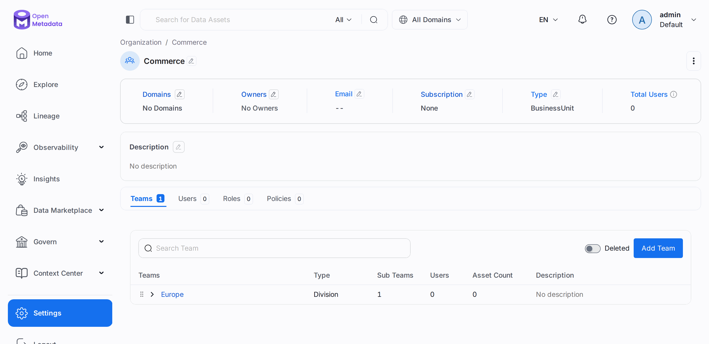
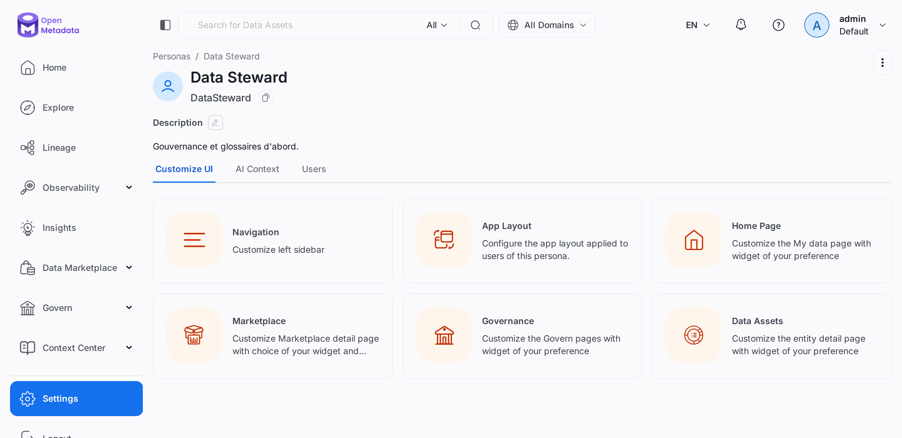
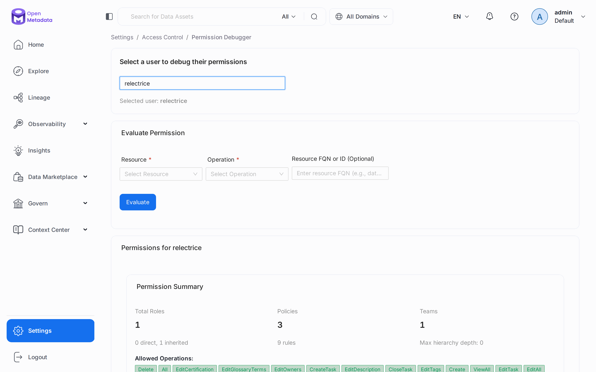
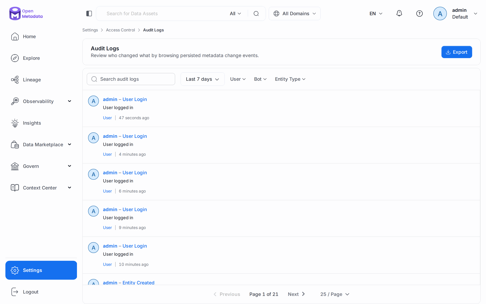
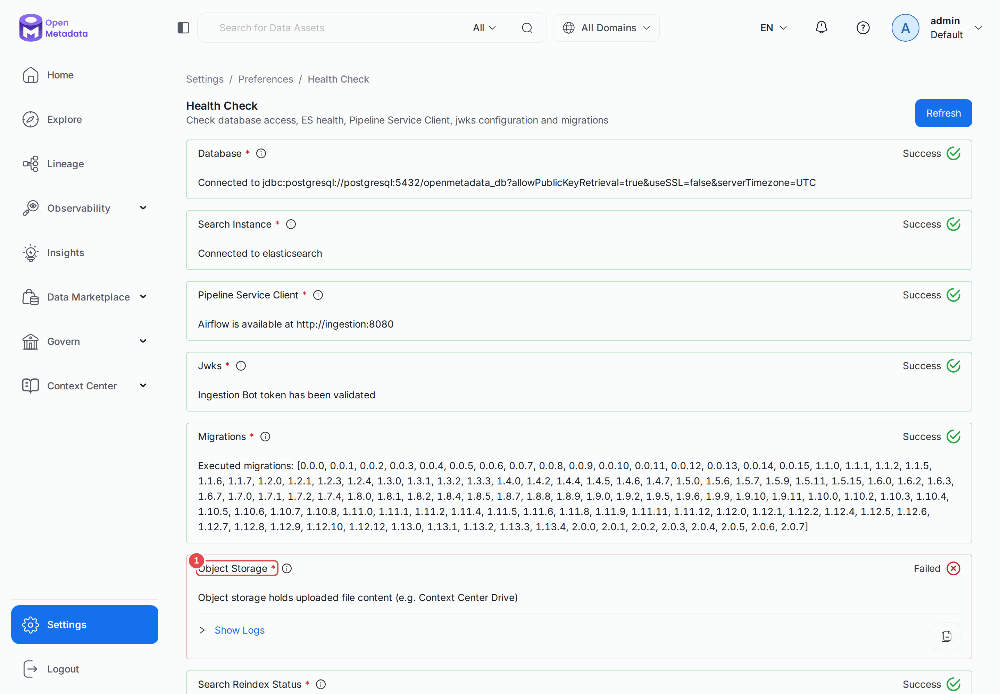
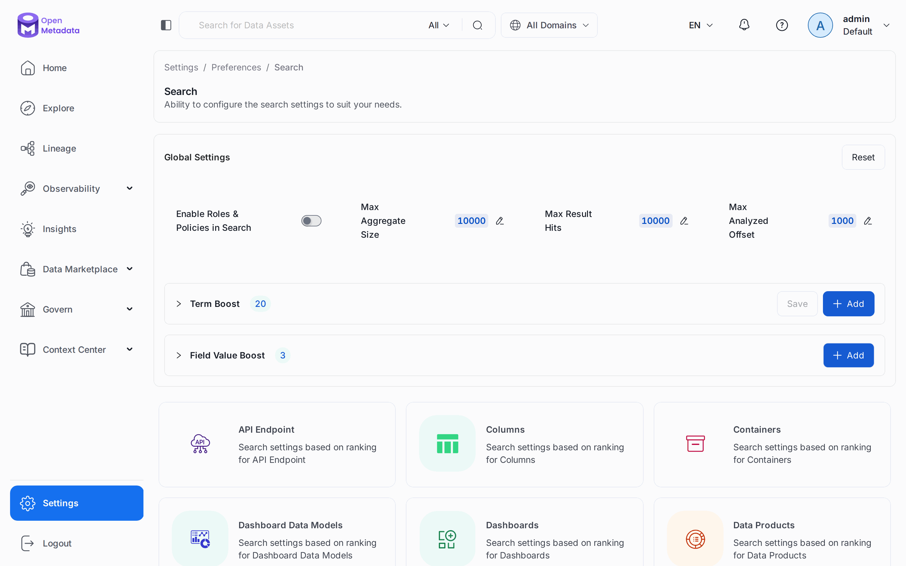
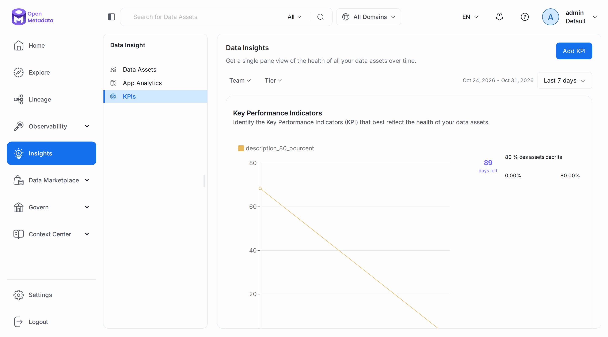

# Chapitre 22 — L'administration

> **Objectifs** — Structurer l'organisation, définir des personas, comprendre un refus d'accès,
> régler l'instance, consulter le journal d'audit, fixer un objectif, choisir une destination
> d'alerte. Situer aussi ce qui relève du déploiement.
> **Durée** — 45 minutes.

---

## 1. Équipes, personas, permissions

```bash
./omlab py tp/22-administration/01_organisation.py
```

```
Équipe Crm : type Group, parent ['Marketing']
Group vers Division : {"code":400,"message":"Team Marketing of type Department can't be of parent of team Crm of type Division"}
Persona    : DataSteward, utilisateurs ['relectrice']

Débogueur de permissions pour la relectrice, sur raw.customers :
  ViewBasic        autorisé
  ViewSampleData   autorisé
  EditDescription  autorisé
  Delete           refusé
```

**Les équipes** s'emboîtent dans un ordre imposé : `BusinessUnit`, `Division`, `Department`,
`Group`. Seul un `Group` peut posséder des assets. Le serveur refuse tout changement de type
qui casserait la hiérarchie, comme ci-dessus.

**Un persona** n'est pas un droit : c'est une **présentation**. Le rôle dit ce qu'on peut
faire, le persona dit ce qu'on voit en arrivant. Sur la page du persona, **Customize UI** règle
la navigation, la page d'accueil et ses widgets, et les pages des assets.

**Le débogueur de permissions** répond à la question « pourquoi cette personne ne peut-elle
pas ? » sans lui demander d'essayer. Il simule le contrôle et liste les politiques évaluées.

**Inviter quelqu'un** : *Settings → Team & User Management → Users → Add Users*, ou
`POST /users`. Le chapitre précédent crée ainsi sa relectrice.

## 2. Préférences, santé, journal d'audit

```bash
./omlab py tp/22-administration/02_preferences.py
```

```
Santé de l'instance :
  OK  database
  OK  searchInstance
  OK  pipelineServiceClient
  OK  jwks
  OK  migrations
  KO  Object Storage
  OK  Search Reindex Status

Préférences :
  lineage    : profondeur 2/2
  connexion  : 3 essais, blocage 30 s, session 3600 s
  e-mail     : serveur SMTP actif ? False
  recherche  : 27 types d'assets paramétrés
               champ le plus fort sur une table : displayName.keyword (boost 20.0)

Profondeur montante : 2 -> 3
Remise à            : 2

Journal d'audit, 5 dernières entrées :
  userLogin          admin           user           admin
  userLogin          admin           user           admin
  entityCreated      admin           kpi            description_80_pourcent
  userLogin          admin           user           admin
  userLogin          admin           user           admin

Ressources pédagogiques intégrées : 26
```

**`Object Storage` en KO est normal ici.** Le compose officiel n'active pas le stockage objet,
et les documents du Context Center en ont besoin : leur contenu serait sinon perdu.

Toutes ces préférences passent par une seule route, `/system/settings`, et un `config_type`.

| Préférence (*Settings → Preferences*) | `config_type` | Essai |
|---|---|---|
| Lineage : profondeur, couche par défaut | `lineageSettings` | modifié et remis |
| Connexion : essais, blocage, durée de session | `loginConfiguration` | lu |
| Recherche : poids des champs, termes favorisés | `searchSettings` | lu |
| Santé | `/system/status` | lu |
| E-mail : serveur SMTP | `emailConfiguration` | lu, non configuré |
| Thème : logo, favicon, palette de couleurs | `customUiThemePreference` | lu |
| Profiler : métriques par type de données | `profilerConfiguration` | vide par défaut |

L'**e-mail** conditionne plusieurs fonctions : invitations, réinitialisation de mot de passe,
alertes par e-mail et **rapport Data Insights**. Sans SMTP, elles restent
inopérantes. Ce laboratoire n'en a pas : ces envois n'ont pas été testés.

**Le journal d'audit** remplace les hypothèses par des faits : qui a créé ce KPI, et quand. Le
filtre par bot montre aussi ce que font vos automatismes, et **Export** l'archive.

## 3. Fixer un objectif

```bash
./omlab py tp/22-administration/03_kpi.py
```

```
KPI : description_80_pourcent, cible 80.0 % (PERCENTAGE)
Graphique suivi : percentage_of_data_asset_with_description_kpi

14 graphiques Data Insights, dont :
  AggregatedUnusedAssetsCount
  AggregatedUnusedAssetsSize
  AggregatedUsedvsUnusedAssetsCount
  AggregatedUsedvsUnusedAssetsSize
  dailyActiveUsers
  mostActiveUsers
```

Un KPI porte sur **la description ou la propriété**. Il ne se relie pas à une métrique du
[chapitre 17](17-tour-complet-2x.md) : l'une suit l'adoption du catalogue, l'autre documente un
calcul métier. C'est aussi le levier de la **culture de la donnée** selon la documentation :
afficher un objectif, nommer des responsables par tier, célébrer les progrès.

Pour envoyer ces indicateurs par e-mail, installez l'application **Data Insights Report**
depuis *Settings → Applications*.

## 4. Choisir une destination d'alerte

Le [chapitre 12](12-alertes-webhooks.md) visait un webhook générique. Slack, Teams et Google
Chat utilisent la même mécanique, avec leur propre format. Faute de vrais espaces de
discussion, le script les fait viser notre récepteur, pour voir ce qui partirait.

```bash
./omlab py tp/22-administration/04_destinations.py
```

```
Alertes créées : Slack, MsTeams, GChat
Vers l'aval : profondeur 2, activé True

4 messages reçus. Clés de premier niveau :
  ['blocks']
  ['cardsV2']
  ['attachments', 'type']
  ['changeDescription', 'currentVersion', 'entity', 'entityFullyQualifiedName', 'entityId', 'entityType']

Alertes de démonstration retirées.
```

`blocks` est le format Slack, `cardsV2` celui de Google Chat, `attachments` celui de Teams. La
quatrième charge est celle de l'alerte du chapitre 12. **Nous n'avons donc pas vérifié l'affichage
dans ces outils**, seulement l'envoi. L'ordre d'arrivée varie.

`notifyDownstream` prévient en plus les propriétaires des assets **en aval**, en suivant le
lineage jusqu'à `downstreamDepth`. Le script déclare cette alerte et relit son réglage, sans
vérifier la réception : le laboratoire n'a pas de boîte à lire.

Une alerte s'évalue dans un ordre fixe : **source, filtres, déclencheurs, destination**. Une
alerte d'observabilité sans déclencheur part à chaque événement de sa source, création et
suppression comprises. Choisissez donc toujours un déclencheur.

## 5. Ce qui relève du déploiement

Ces sujets demandent une infrastructure que ce laboratoire n'a pas. Nous ne les avons **pas
essayés** : voici à quoi ils servent, et où lire la suite.

| Sujet | À quoi ça sert | Documentation |
|---|---|---|
| **SSO** | Connexion par Okta, Azure, Google, Keycloak, LDAP... à la place du mot de passe | [Sécurité](https://docs.open-metadata.org/v2.0.x/deployment/security) |
| **SCIM** | Créer et retirer les comptes depuis l'annuaire | [Sécurité](https://docs.open-metadata.org/v2.0.x/deployment/security) |
| **Sauvegarde** | Sauvegarder base et index avant une montée de version | [Sauvegarde](https://docs.open-metadata.org/v2.0.x/deployment/backup-restore-metadata) |
| **Kubernetes** | Déployer par Helm, avec l'orchestrateur qui remplacera l'Airflow interne | [Déploiement](https://docs.open-metadata.org/v2.0.x/deployment) |
| **RDF** | Export du graphe et requêtes SPARQL, avec un stockage dédié | [RDF](https://docs.open-metadata.org/v2.0.x/deployment/rdf-knowledge-graph) |
| **Ingestion externe** | Lancer les workflows depuis votre propre Airflow ou GitHub Actions | [Ingestion externe](https://docs.open-metadata.org/v2.0.x/deployment/ingestion/external) |

Le dernier est moins loin qu'il n'y paraît : `./omlab ingest` est déjà une ingestion en ligne de
commande. En authentification simple, un fichier de workflow porte le JWT du bot dans
`securityConfig`, comme tous les YAML de ce dépôt.

**Retirer une source :** page du service, menu **⋮ → Delete**, puis saisir `DELETE` pour une
suppression définitive. Ses bases, schémas et tables disparaissent avec lui, tests et lineage
compris. Une suppression logique, elle, se restaure ([chapitre 18](18-collaboration.md)).

## Mode d'emploi : les écrans

**Les équipes.** *Settings → Team & User Management → Teams*, puis `Commerce`. Le bandeau montre
le type, et l'onglet **Teams** les sous-équipes.



**Le persona.** *Settings → Personas → Data Steward*. Chaque carte de **Customize UI**
personnalise une partie de l'interface.



**Le débogueur de permissions.** *Settings → Access Control → Permission Debugger*. Choisissez
la personne, puis une ressource et une opération. La synthèse liste rôles, politiques et règles.



**Le journal d'audit.** *Settings → Access Control → Audit Logs*.



**La santé.** *Settings → Preferences → Health Check*. La ligne **Object Storage (1)** explique
sa panne.



**La recherche.** *Settings → Preferences → Search* : les réglages globaux, puis une carte par
type d'asset pour régler le poids des champs.



**Le KPI.** *Insights → KPIs*. La courbe se remplit jour après jour, une fois que
`DataInsightsApplication` a tourné.



---

## TP guidé

Les chapitres 12 et 21 doivent avoir tourné.

```bash
./omlab py tp/22-administration/01_organisation.py
./omlab py tp/22-administration/02_preferences.py
./omlab py tp/22-administration/03_kpi.py
./omlab py tp/22-administration/04_destinations.py
```

1. Dans le débogueur, testez `cmartin` puis `relectrice` sur la même opération.
2. Dans *Settings → Preferences → Theme*, changez la couleur principale, puis cliquez sur **Reset**.
3. Dans **Audit Logs**, retrouvez le KPI créé par le script.

**Vérifier :**

```bash
./omlab check 22
```

```
Chapitre 22 — L'administration
  OK   la hiérarchie va jusqu'à l'équipe Crm
  OK   le persona DataSteward a un utilisateur
  OK   le journal d'audit contient des entrées
  OK   le KPI description_80_pourcent existe
  OK   les alertes de démonstration ont été retirées
```

## Exercices

1. Donnez à `relectrice` le persona par défaut, reconnectez-vous, et comparez la page d'accueil.
2. Doublez le poids de la description dans la recherche de tables, et cherchez `avoirs`.
3. Lancez `mailpit` sur le réseau `app_net` et configurez le SMTP : une invitation arrive-t-elle ?

## Pièges & FAQ

**« `Object Storage` est en échec. »** Normal sans stockage configuré. Le reste fonctionne, sauf
le dépôt de documents.

**« `POST /personas` répond 400. »** Le champ `users` attend une liste d'identifiants, pas des
références : `"users": ["<uuid>"]`.

**« Mon KPI reste à 0 %. »** `DataInsightsApplication` calcule les valeurs une fois par jour :
déclenchez-la, après une réindexation.

**« Je n'arrive plus à me connecter. »** `maxLoginFailAttempts` vaut 3, et le blocage dure
30 secondes.

## Pour aller plus loin

- [Guide de l'administrateur](https://docs.open-metadata.org/v2.0.x/how-to-guides/admin-guide)
- [Thème et image de marque](https://docs.open-metadata.org/v2.0.x/how-to-guides/admin-guide/preferences/theme-and-branding)
- [Comportement des alertes](https://docs.open-metadata.org/v2.0.x/how-to-guides/data-quality-observability/alerts-notifications/alert-behavior-reference)

---

**Précédent :** [21 — La gouvernance avancée](21-gouvernance-avancee.md) ·
**Suivant :** [23 — Au-delà de Postgres](23-sources.md)
