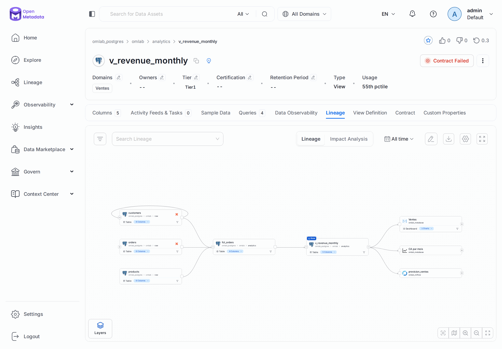
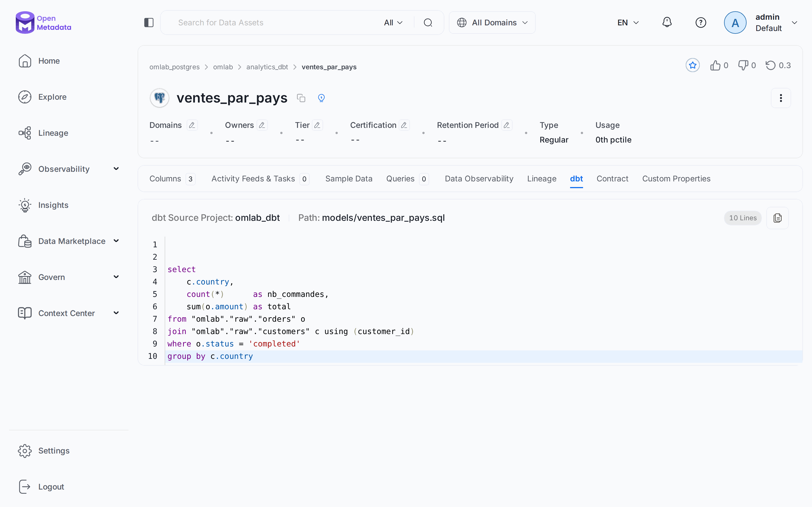
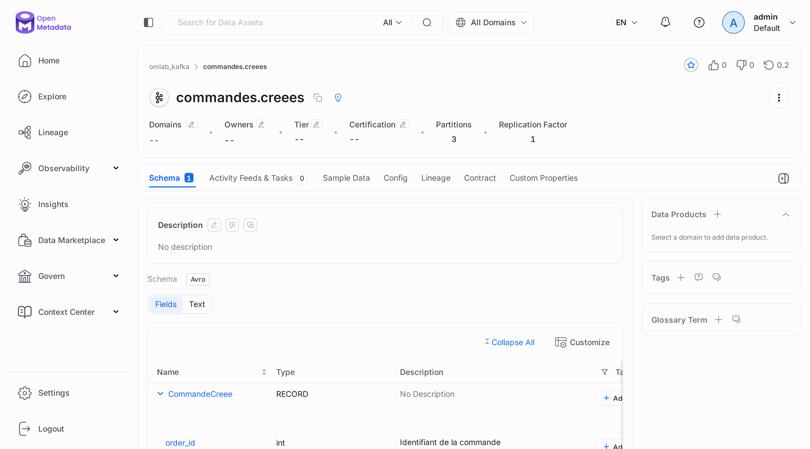
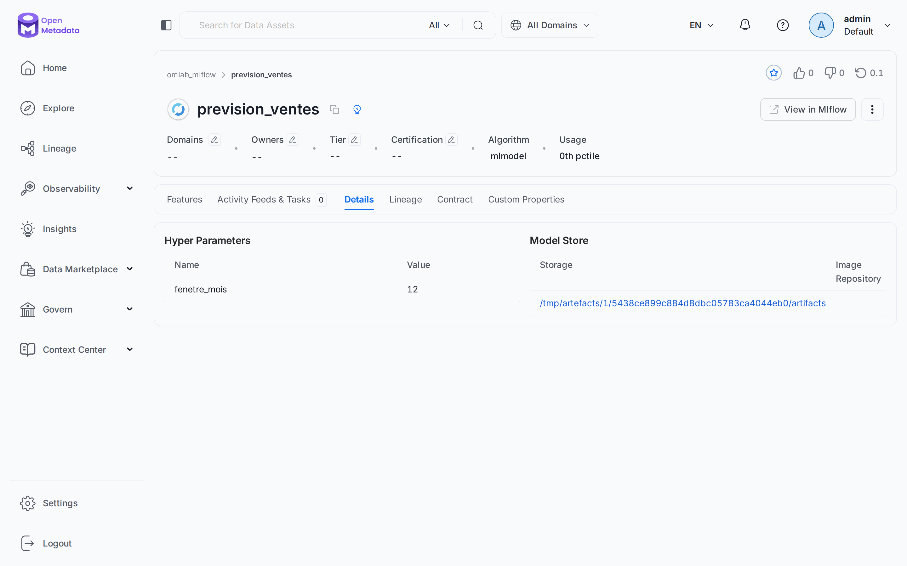
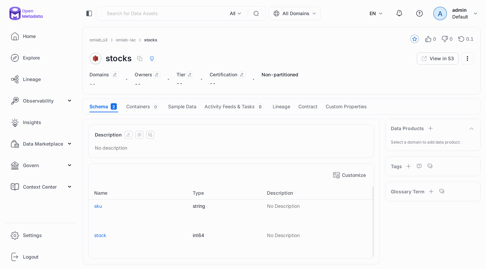
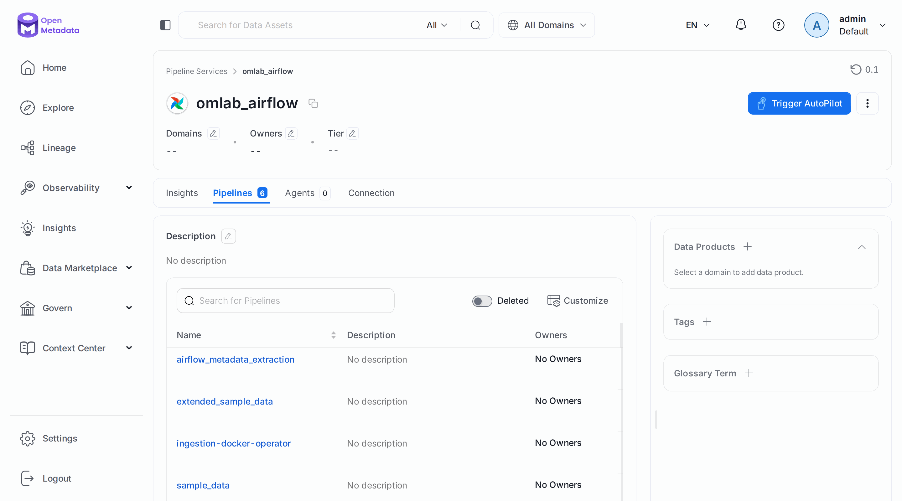
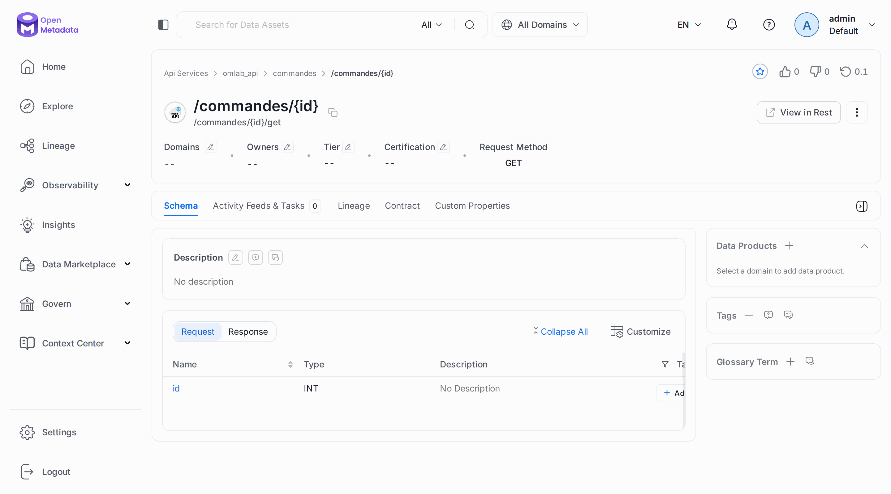

# Chapitre 23 — Au-delà de Postgres

> **Objectifs** — Cataloguer les autres familles de sources : messages, stockage, modèles,
> tableaux de bord, orchestrateur, recherche, API. Brancher dbt, recevoir de l'OpenLineage,
> et suivre un chemin d'un topic jusqu'à un tableau de bord.
> **Durée** — 1 heure. Demande environ 2 Go de RAM en plus.

---

## 1. Un connecteur, huit familles

Le catalogue ne décrit pas que des tables. Tout ce que vous avez appris sur les étiquettes,
les propriétaires et le lineage s'applique à chacune de ces familles :

| Famille | Source du TP | Conteneur | Type du workflow | Ce qui arrive |
|---|---|---|---|---|
| Base de données | Postgres | `omlab-postgres` | `DatabaseMetadata` | tables, vues |
| Messages | Redpanda, compatible Kafka | `omlab-redpanda` | `MessagingMetadata` | topics, schémas |
| Stockage | S3 simulé | `omlab-s3` | `StorageMetadata` | conteneurs, colonnes |
| Modèles | MLflow | `omlab-mlflow` | `MlModelMetadata` | modèles, hyperparamètres |
| Tableaux de bord | Metabase | `omlab-metabase` | `DashboardMetadata` | tableaux, graphiques |
| Orchestration | Airflow interne | déjà là | `PipelineMetadata` | DAG, tâches |
| Recherche | Elasticsearch interne | déjà là | `SearchMetadata` | index |
| API | Contrat OpenAPI | `omlab-fichiers` | `ApiMetadata` | collections, routes |

Deux familles restent à lire dans la documentation, sans essai ici : les **catalogues tiers**
(Alation, Atlas, Amundsen) et les **espaces de fichiers** (Google Drive, SFTP).

Sur les 368 pages de connecteurs de la documentation, les bases de données pèsent 173 pages.
Le principe reste le même : un bloc `serviceConnection`, et un `sourceConfig` de bon type.

## 2. Démarrer et cataloguer

Ces sources sont à part dans `docker/docker-compose.sources.yml`, pour ne pas alourdir le
laboratoire de base. Aucune ne publie de port sur votre machine : seul le réseau Docker les voit.

```bash
./omlab sources up
./omlab py tp/23-sources/01_alimenter_sources.py
```

```
Kafka    : 2 topics, 1 schéma Avro
S3       : 1 fichier Parquet, 1 manifeste openmetadata.json
MLflow   : 1 modèle enregistré
Metabase : 1 base, 1 question SQL, 1 tableau de bord
```

Puis chaque source passe par la commande habituelle :

```bash
./omlab ingest tp/23-sources/kafka.yaml
./omlab ingest tp/23-sources/s3.yaml
./omlab ingest tp/23-sources/mlflow.yaml
./omlab ingest tp/23-sources/metabase.yaml
./omlab ingest tp/23-sources/airflow.yaml
./omlab ingest tp/23-sources/elasticsearch.yaml
./omlab ingest tp/23-sources/api.yaml
```

Ouvrez un de ces fichiers : seuls `type`, `serviceConnection` et `sourceConfig` changent par
rapport au [chapitre 04](04-ingestion-metadonnees.md).

### Trois comportements à connaître

**S3 ne lit que ce qu'on lui désigne.** Le connecteur cherche un manifeste `openmetadata.json`
à la racine du seau, qui liste les dossiers et leur format. Sans lui, vous obtenez le seau et
rien dedans.

**MLflow : deux pièges, deux silences.** Notre premier serveur était en 2.17, et le connecteur
embarque le client 3.14 : la liste revenait **vide, sans erreur**, avec le message *« The MLflow
registry returned no registered models »*. Passer le serveur en 3.x l'a réglé. Ensuite, une
version de modèle sans exécution d'origine est ignorée (*« Run ID not found »*), d'où le
`runs/create` du script.

**Airflow se lit directement dans sa base.** `connection: {type: Backend}` ne marche que depuis
le conteneur qui héberge Airflow. Sur une vraie installation, utilisez l'API REST. Vous verrez
aussi les DAG techniques d'OpenMetadata, comme `airflow_metadata_extraction`.

## 3. dbt

dbt connaît ce que le catalogue ignore : le sens des modèles et leurs dépendances. Le workflow
ne parle ni à dbt ni à la base : il lit les fichiers que dbt a produits dans `target/`.

```bash
./omlab sources dbt
./omlab ingest tp/04-ingestion/metadata.yaml
./omlab ingest tp/23-sources/dbt.yaml
```

La table doit d'abord exister dans le catalogue, d'où la seconde commande. Vérifiez ensuite
la fiche de `analytics_dbt.ventes_par_pays` :

| Ce que dbt a apporté | Valeur |
|---|---|
| Description de la table et des colonnes | celle du `schema.yml` |
| Requête compilée | onglet **dbt** |
| Étiquette | `dbtTags.ventes` |
| Lineage | depuis `customers` et `orders`, source `DbtLineage` |
| Test | `not_null_ventes_par_pays_nb_commandes`, à `Success` |

**L'ordre des commandes dbt compte.** `run`, `docs generate` et `test` réécrivent chacune
`run_results.json`. Notre première version finissait par `docs generate`, et le test arrivait
dans le catalogue **sans résultat**. `test` doit passer en dernier, ce que fait `./omlab sources dbt`.

## 4. OpenLineage, et le chemin complet

Un job qui publie déjà de l'OpenLineage, Spark par exemple, peut envoyer ses événements
directement au serveur, sans workflow.

```bash
./omlab py tp/23-sources/02_lineage_ouvert.py
```

```
Événement reçu : {'status': 'success', 'message': 'Created 1 lineage edge(s)', 'failedEvents': [], 'lineageEdgesCreated': 1}
En amont de fct_orders : ['customers', 'orders', 'products']

Autour de v_revenue_monthly :
  chart       CA par mois
  dashboard   Ventes
  mlmodel     prevision_ventes
  table       fct_orders
  table       customers
  table       orders
  table       products
  topic       commandes.creees
```

Sans correspondance entre l'espace de noms et un service, le serveur ne relie rien. Le script
la déclare dans `openLineageSettings`, et coupe `autoCreateEntities`, qui vaut `true` par
défaut et créerait sinon des tables fantômes à la moindre faute de frappe.

La fin de la sortie est le vrai résultat de ce chapitre : **un topic Kafka, une table, un
modèle et un tableau de bord dans le même graphe**. Les liens du topic, du modèle et du tableau
de bord sont posés à la main par le script. Metabase et les autres connecteurs savent en déduire
certains eux-mêmes, si leur SQL désigne des tables d'un service connu.

### Le lineage entre bases

Chaque base a souvent son propre service, avec ses identifiants. Le workflow de lineage accepte
`processCrossDatabaseLineage` et `crossDatabaseServiceNames`, qui lui disent où chercher une
table citée dans une requête. La recherche se fait dans les métadonnées déjà ingérées : le compte
n'a besoin d'aucun droit sur l'autre base. Notre laboratoire n'ayant qu'une base, **nous ne
l'avons pas essayé**. L'[export du lineage](19-import-export.md) en CSV s'applique à tous ces liens.

## Mode d'emploi : les écrans

**Le graphe complet.** Onglet **Lineage** de `analytics.v_revenue_monthly`. Le topic n'y figure
pas à cette profondeur : augmentez-la avec le réglage en haut à droite du graphe.



**dbt.** L'onglet **dbt** affiche le projet, le chemin du modèle et la requête compilée.



**Un topic.** Le schéma Avro est lu dans le registre, avec les descriptions de ses champs.



**Un modèle.** Onglet **Details** : les hyperparamètres et l'emplacement des artefacts.



**Un conteneur S3.** Le schéma a été déduit du fichier Parquet.



**Les DAG.** *Settings → Services → Pipelines → omlab_airflow*. L'onglet **Insights** de chaque
service résume sa documentation et ses propriétaires.



**Une route d'API.** Avec ses paramètres en entrée et, dans l'onglet voisin, sa réponse.



---

## TP guidé

```bash
./omlab sources up
./omlab py tp/23-sources/01_alimenter_sources.py
./omlab ingest tp/23-sources/kafka.yaml
./omlab ingest tp/23-sources/s3.yaml
./omlab ingest tp/23-sources/mlflow.yaml
./omlab ingest tp/23-sources/metabase.yaml
./omlab ingest tp/23-sources/airflow.yaml
./omlab ingest tp/23-sources/elasticsearch.yaml
./omlab ingest tp/23-sources/api.yaml
./omlab sources dbt
./omlab ingest tp/04-ingestion/metadata.yaml
./omlab ingest tp/23-sources/dbt.yaml
./omlab py tp/23-sources/02_lineage_ouvert.py
```

Si le script d'alimentation échoue sur Metabase, c'est qu'il démarre encore : relancez-le dans une minute.

1. Dans **Explore**, parcourez les onglets du panneau de gauche : chaque famille a le sien.
2. Rattachez le terme `Commande` au topic `commandes.creees`.
3. Ajoutez le domaine `Ventes` au tableau de bord : le produit de données peut-il le contenir ?

Pour libérer la mémoire ensuite :

```bash
./omlab sources down
```

**Vérifier :**

```bash
./omlab check 23
```

```
Chapitre 23 — Au-delà de Postgres
  OK   le topic commandes.creees a son schéma Avro
  OK   le conteneur stocks a 2 colonnes
  OK   le modèle prevision_ventes a son hyperparamètre
  OK   le tableau de bord Ventes est catalogué
  OK   les DAG d'Airflow sont catalogués
  OK   Elasticsearch a des index catalogués
  OK   la route de l'API est cataloguée
  OK   le modèle dbt a son lineage et sa description
  OK   le test dbt a un résultat
  OK   OpenLineage a ajouté products en amont de fct_orders
```

## Exercices

1. Ajoutez un topic, relancez l'ingestion, puis supprimez-le : que devient sa fiche ?
2. Écrivez un second modèle dbt qui dépend du premier, et suivez le lineage.
3. Modifiez `boutique.json` pour ajouter une route, et relancez l'ingestion de l'API.

## Pièges & FAQ

**« MLflow : 0 modèle, aucune erreur. »** Comparez les versions : le connecteur embarque un
client 3.x. Un serveur 2.x répond par une liste vide.

**« Mon test dbt n'a pas de résultat. »** Vérifiez que `dbt test` est la dernière commande avant
l'ingestion : `run_results.json` ne garde que la dernière.

**« Le FQN de mon topic donne 404. »** Un point dans un nom impose des guillemets :
`omlab_kafka."commandes.creees"`, encodés dans l'URL.

**« Elasticsearch me renvoie des index internes. »** Normal, c'est l'index du catalogue. Un filtre
`searchIndexFilterPattern` les écarte. Quelques messages `Could not find search index entity` sur
les index temporaires de réindexation restent sans conséquence : le workflow finit à 100 %.

**« L'image MinIO ne se télécharge pas. »** Les registres `minio/minio` et `quay.io/minio/minio`
ont refusé l'accès depuis ce laboratoire, d'où `adobe/s3mock`, qui accepte tous les identifiants.

## Pour aller plus loin

- [Liste des connecteurs](https://docs.open-metadata.org/v2.0.x/connectors)
- [OpenLineage](https://docs.open-metadata.org/v2.0.x/how-to-guides/data-lineage/openlineage)
- [Lineage entre bases](https://docs.open-metadata.org/v2.0.x/how-to-guides/data-lineage/cross-database-lineage)

---

**Précédent :** [22 — L'administration](22-administration.md) ·
**Suivant :** [24 — Standards ouverts et agents](24-standards-agents.md)
