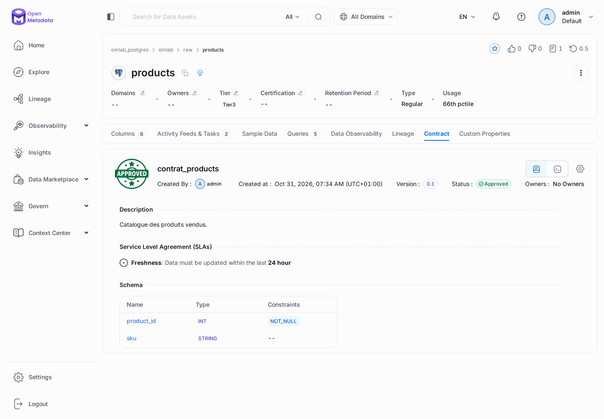
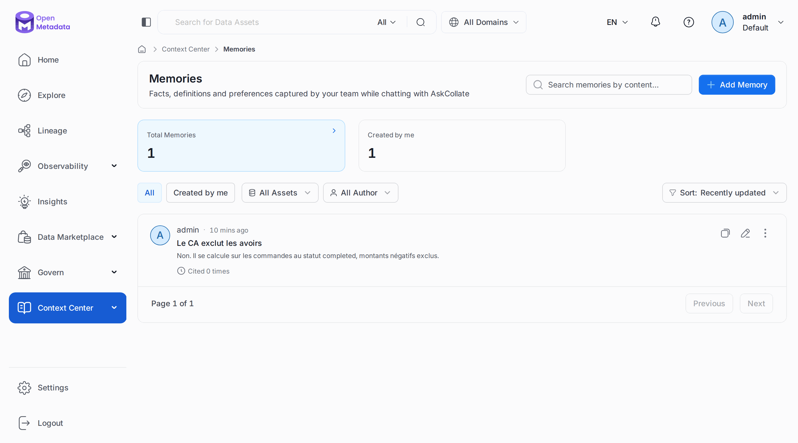

# Chapitre 24 — Standards ouverts et agents

> **Objectifs** — Échanger un contrat au format ODCS, brancher un vrai client MCP, écrire une
> mémoire pour les agents, et savoir ce qu'il reste à configurer pour un assistant.
> **Durée** — 30 minutes.

---

## 1. Le contrat en fichier : ODCS

Le [chapitre 16](16-contracts-ops-projet-final.md) créait un contrat par l'API. **ODCS** (*Open
Data Contract Standard*) permet de l'écrire dans un fichier YAML, relu en revue de code, puis
importé.

```bash
./omlab py tp/24-standards-agents/01_odcs.py
```

```
Contrat du chapitre 16, exporté en ODCS :
  ---
  apiVersion: "v3.1.0"
  kind: "DataContract"
  id: "afcf1552-7131-4dc2-a931-d9e707b13e94"
  name: "contrat_revenue_monthly"
  version: "0.2"
  status: "draft"

Avec une colonne qui n'existe pas : valide ? False
  Schema validation failed. The following fields specified in the data contract do not exist in the table: colonne_fantome
Document corrigé : valide ? True

Importé : contrat_products, statut Approved
  colonnes promises : ['product_id', 'sku']
  SLA               : {'refreshFrequency': {'interval': 24, 'unit': 'hour'}}
```

La validation compare le document à **la vraie table** du catalogue. Elle détecte donc une
promesse intenable avant la publication. Branchez-la sur votre intégration continue :

```
POST /api/v1/dataContracts/odcs/validate/yaml?entityId=...&entityType=table
PUT  /api/v1/dataContracts/odcs/yaml?entityId=...&entityType=table&mode=merge
```

`mode=merge` complète le contrat existant, et `mode=replace` l'écrase. ODCS couvre plus large
qu'OpenMetadata : les serveurs, les tarifs ou les canaux de support n'ont pas d'équivalent et
sont signalés comme non importés. La page du contrat montre donc le résultat de l'import, pas
votre fichier d'origine : **gardez le fichier dans Git**.

## 2. Un vrai client MCP

Le [chapitre 17](17-tour-complet-2x.md) parlait le protocole à la main. Voici le SDK officiel,
exécuté sur la machine hôte, là où tournerait un assistant :

```bash
set -a; . ./.env; set +a
uv run --script tp/24-standards-agents/02_client_mcp_officiel.py
```

```
Connecté à openmetadata-mcp-stateless 1.1.0
15 outils disponibles

search_metadata(query='ventes') : 14 résultat(s)
  dashboard    omlab_metabase.2
  databaseSchema omlab_fichiers.exports.ventes
  tag          dbtTags.ventes

get_entity_lineage : 4 arête(s), racine omlab_postgres.omlab.analytics.v_revenue_monthly
```

### Brancher un assistant

Chaque assistant a son fichier de configuration, mais ils demandent tous les mêmes
informations : l'URL `http://localhost:8585/mcp`, et une authentification.

| Client | Ce que dit la documentation | Essai ici |
|---|---|---|
| SDK MCP Python | le script ci-dessus | **TP** |
| Claude Desktop, Claude Code | configuration OAuth ou jeton | non |
| Cursor, VS Code, Goose | configuration OAuth ou jeton | non |
| Databricks | intégration dédiée | non |
| CrewAI, LangChain, OpenAI Agents | jeton de bot, pour un traitement sans personne devant l'écran | non |

**OAuth ou jeton ?** OAuth 2.0 est conseillé pour une personne : pas de secret dans un fichier,
un renouvellement automatique et votre connexion habituelle. Un agent qui tourne seul n'a personne
pour répondre au navigateur : il lui faut un jeton de bot, aux droits limités.

### La recherche sémantique

L'outil `semantic_search` cherche par le sens plutôt que par mots-clés : *« tables sur le
comportement d'achat »* peut trouver `order_transactions`. Il demande un index de vecteurs et un
fournisseur d'embeddings, que ce laboratoire n'a pas : **non essayé**.

## 3. Les mémoires et les documents

Le Context Center range aussi le savoir informel. Une **mémoire** est un fait court, qu'un
assistant retrouve par l'outil `find_context`.

```bash
./omlab py tp/24-standards-agents/03_memoire.py
```

```
Mémoire : ca_hors_avoirs (Faq, EntityScoped)
  Q : Le chiffre d'affaires inclut-il les avoirs ?
  R : Non. Il se calcule sur les commandes au statut completed, montants négatifs exclus.
Total : 1

Documents : stockage objet actif ? False
```

Les **documents** déposés (rapports, audits) demandent un stockage objet, absent du compose
officiel : sans lui, le serveur jette leur contenu, comme l'annonce la page de santé du
[chapitre 22](22-administration.md). **Nous n'avons donc pas testé le dépôt.** Une fois
configuré, l'extraction de questions et réponses alimente les mêmes outils que les mémoires.

## Mode d'emploi : les écrans

**Le contrat importé.** Onglet **Contract** de `raw.products` : le SLA de fraîcheur et le schéma
promis viennent du fichier ODCS. Le bouton en haut à droite exporte ou importe.



**Les mémoires.** *Context Center → Memories*. La colonne « Cited 0 times » compte les citations par
un assistant.



---

## TP guidé

Les chapitres 16 et 17 doivent avoir tourné, et le 23 pour la sortie exacte du client MCP.

```bash
./omlab py tp/24-standards-agents/01_odcs.py
./omlab py tp/24-standards-agents/03_memoire.py
set -a; . ./.env; set +a
uv run --script tp/24-standards-agents/02_client_mcp_officiel.py
```

**Vérifier :**

```bash
./omlab check 24
```

```
Chapitre 24 — Standards ouverts et agents
  OK   le contrat ODCS est rattaché à raw.products
  OK   il promet 2 colonnes
  OK   la mémoire ca_hors_avoirs existe
```

## Exercices

1. Ajoutez un `quality` à votre fichier ODCS, et lisez le rapport de validation.
2. Branchez votre assistant MCP sur le laboratoire avec un jeton personnel en lecture.
3. Demandez-lui si le CA inclut les avoirs : cite-t-il la mémoire ?

## Pièges & FAQ

**« `ImportError: eval_type_backport` au démarrage du client MCP. »** Notre première version du
SDK, 1.12, ne suit plus pydantic. La version figée dans le script fonctionne.

**« Mon import ODCS répond 400. »** Une colonne du fichier n'existe pas dans la table. Lancez
d'abord la validation.

**« `search_metadata` renvoie autre chose que des tables. »** Il cherche dans tout le catalogue.
Passez `entityType: "table"`.

## Pour aller plus loin

- [Import et export ODCS](https://docs.open-metadata.org/v2.0.x/how-to-guides/data-contracts/odcs)
- [Serveur MCP](https://docs.open-metadata.org/v2.0.x/how-to-guides/mcp)
- [Référence des outils MCP](https://docs.open-metadata.org/v2.0.x/how-to-guides/mcp/reference)
- [OAuth pour le MCP](https://docs.open-metadata.org/v2.0.x/how-to-guides/mcp/oauth)

---

**Précédent :** [23 — Au-delà de Postgres](23-sources.md) ·
**Retour au [sommaire](../README.md)**
